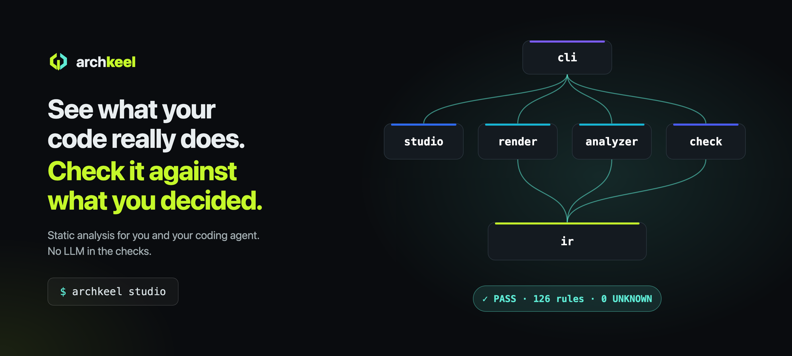
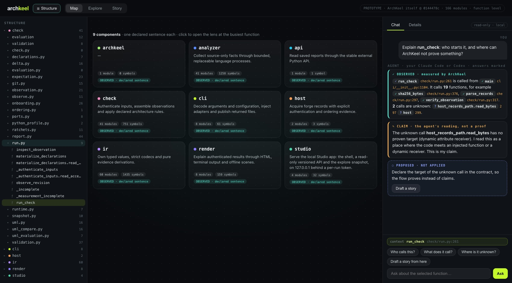
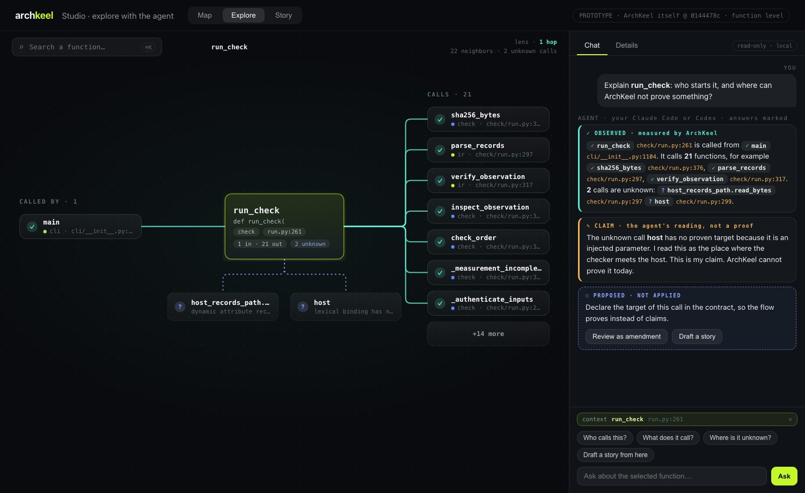
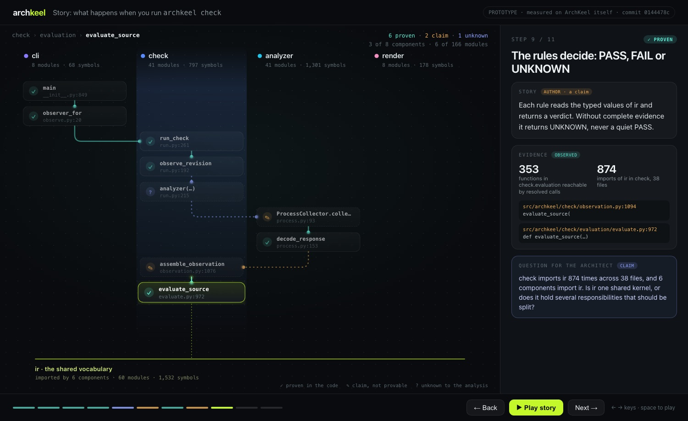
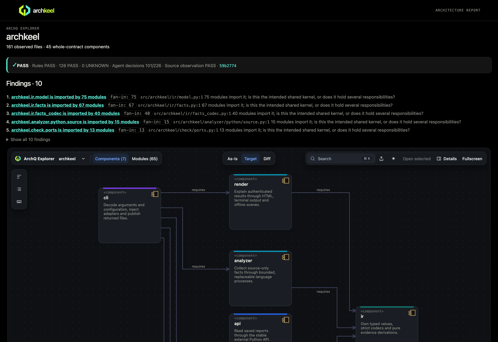
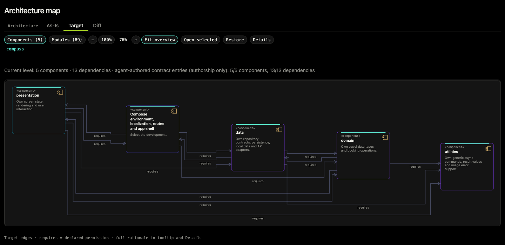
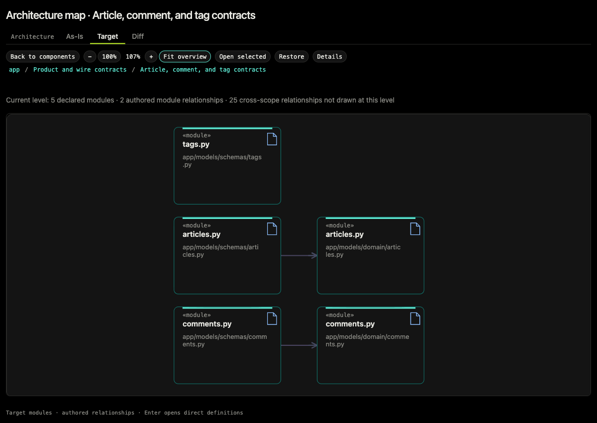

# ArchKeel

**See what your code really does. Check it against what you decided.**


[](https://github.com/rapiddweller/archkeel/actions/workflows/ci.yml)
[](https://pypi.org/project/archkeel/)
[](#claude-code)
[](#codex)
[](https://github.com/rapiddweller/archkeel/blob/main/LICENSE)

[Install](#install) · [Quick start](#quick-start) · [Why](#why-archkeel) · [Compared](#archkeel-floorplan-or-understand-anything) · [Features](#features) · [Live demo](https://rapiddweller.github.io/archkeel/demos/) · [FAQ](#faq)

<p>
  
</p>

ArchKeel reads your code and shows how it is built: the parts, the imports between them and the
evidence for each. You or your coding agent then declare the boundaries you want. ArchKeel checks
the code against them and reports forbidden imports, misplaced types and gaps in the analysis, with
source evidence for review.

The checks run on your machine and use no LLM. The agent explains and proposes; ArchKeel measures and enforces.

## Why ArchKeel?

You, or your coding agent, built a lot of code. Do you know the architecture it really has?
Tests tell you the behavior still works. They do not tell you that `render` now imports `store`,
or that a call became harder to resolve. Asking the agent "is the architecture still fine?" gets
you an opinion.

ArchKeel was built to understand the architecture that was really implemented, and to turn it
into one you choose:

```text
 Understand   Show     Measure    Challenge       Define          Enforce
 what was     it as a  it with    weak spots and  the target      every change
 built        map      evidence   violations      architecture    in CI
```

1. **Understand and show.** Static analysis resolves imports and calls. Studio and the Explorer
   draw the as-built architecture: components, hubs, cycles, with a guided tour.
2. **Measure.** Each fact keeps its evidence: the record and the source line. What the analysis
   cannot resolve is counted, not hidden.
3. **Challenge.** You and your agent discuss the weak spots: violations, cycles, components that
   hold too much. The agent proposes. Its text stays a claim until the code proves it.
4. **Define and enforce.** You decide the target architecture. Existing imports are evidence, not
   permission. The contract becomes rules. A rule passes only with complete evidence; missing
   evidence is `UNKNOWN`, never a quiet `PASS`. CI rejects the change that crosses a boundary.

## ArchKeel, Floorplan or Understand Anything?

All three turn code into something you can see. They answer different questions, and they get
their facts in different ways.

| | **ArchKeel** | **[Floorplan](https://github.com/haydenschmitty/floorplan)** | **[Understand Anything](https://github.com/Egonex-AI/Understand-Anything)** |
|---|---|---|---|
| **Question** | How does our code work, which architecture do we want, and does the code keep to it? | How does the app I built work, and what should I worry about? | How does this large codebase work, down to the functions? |
| **Where the facts come from** | Static analysis of Python, TypeScript and Dart: resolved imports and calls, each with an evidence record and a source line | Scripts scan files, imports and web requests by pattern matching ("not a compiler", in its docs); the AI names and describes the parts | Deterministic scripts plus a multi-agent LLM pipeline that builds the knowledge graph |
| **What is unknown** | Counted and shown as `UNKNOWN` | Missed links can be added by asking the AI | Relationships can come from LLM judgment |
| **Role of the LLM** | Explains and proposes. No part of a check or verdict uses it | Writes the architecture description and the names | Summarizes, finds relationships, writes tours |
| **What you end with** | A declared contract with rules, verdicts, Target and Diff views, a baseline, a CI gate | A map, a health check, recent work | A knowledge graph, layers, guided tours |
| **Runs in** | Claude Code, Codex, any shell, CI | Claude Code, Codex | Claude Code, Codex and more |

Understand Anything teaches the story behind a codebase. ArchKeel measures the architecture you actually have and holds it to the one you choose.

Pick **ArchKeel** to turn what the code does into an architecture you can enforce. Pick **Floorplan**
or **Understand Anything** to learn a codebase quickly and in plain words. They combine well: learn
first, then declare what you want to keep.

## Features

<table>
<tr>
<td width="50%" valign="top">

**🗺️ Studio, a local web app**<br>
`archkeel studio` serves the map on `127.0.0.1` with a token for each run. It writes nothing
into your repository and works offline.

</td>
<td width="50%" valign="top">

**🔎 Evidence on every edge**<br>
Every import count comes from the code. Each import keeps its evidence record and source line.
No model estimates a number.

</td>
</tr>
<tr>
<td valign="top">

**🧭 A tour from measured facts**<br>
A tour walks the code in order ("start here, then here"). The author writes the title and note of a stop. The
numbers beside it are measured and shown apart.

</td>
<td valign="top">

**🎯 As-Is, Target and Diff**<br>
Compare the observed code with the declared architecture. Cycles, violations and hubs stay visible.

</td>
</tr>
<tr>
<td valign="top">

**🚦 PASS, FAIL, UNKNOWN**<br>
A rule passes only with complete evidence. A gap in the analysis shows as `UNKNOWN`.

</td>
<td valign="top">

**🤖 Made for coding agents**<br>
A skill for Claude Code and Codex, focused JSON reports, and a check that compares a submitted
change with its published expectation.

</td>
</tr>
</table>

## Install

ArchKeel needs Python 3.11+ and a Git repository with at least one commit.

```bash
uv tool install git+https://github.com/rapiddweller/archkeel
archkeel --version
```

This installs the current `main`, which includes Studio. The release on PyPI (`uv tool install archkeel`)
does not have `archkeel studio` yet. Run it once without installing: `uvx --from git+https://github.com/rapiddweller/archkeel archkeel studio`.

TypeScript collection requires the native collector and its verified digest. There is no Python fallback.
The next owner-started release publishes the six native platform wheels below.
A pure wheel, an sdist install and an editable install do not contain the binary.
On these installs, a TypeScript scan stops with `typescript_collector_missing_binary` and exit code 2.
Install a platform wheel with `python -m pip install --only-binary=:all: --upgrade archkeel`.

| Platform | Wheel target |
|---|---|
| Linux glibc 2.17+, x86_64 | `manylinux_2_17_x86_64` |
| Linux glibc 2.17+, aarch64 | `manylinux_2_17_aarch64` |
| Linux musl 1.2+, x86_64 | `musllinux_1_2_x86_64` |
| macOS 10.12+, x86_64 | `macosx_10_12_x86_64` |
| macOS 11+, arm64 | `macosx_11_0_arm64` |
| Windows, x86_64 | `win_amd64` |

Full verification builds and tests each target with its native binaries and SHA-256 files.
The sdist omits the Rust workspace. Build native tools from a Git checkout, not from the sdist.
For TypeScript in a source checkout, install Rust and run:

```bash
uv sync --locked
make typescript-collector
uv run archkeel --version
```

To install outside the checkout, run `make native-tools native-wheel`, then install the wheel from `dist/native/`.
The wheel build supports Linux glibc x86_64/aarch64, Linux musl x86_64, macOS x86_64/arm64 and Windows x86_64.
An install without a verified collector stops with `missing_tool`, exit code 2, and no report.
An explicit `[scan].collector_argv` remains supported.

### Claude Code

```bash
claude plugin marketplace add rapiddweller/archkeel
claude plugin install archkeel@archkeel
```

### Codex

```bash
codex plugin marketplace add rapiddweller/archkeel
codex plugin add archkeel@archkeel
```

No plugin? `archkeel skill install claude` (or `codex`) writes the same instructions into your repository.
The plugin needs the CLI above; it adds the agent skill.

## Quick start

1. See the code as it is. No contract needed:

   ```bash
   archkeel studio          # opens the map in your browser
   archkeel explore         # the same observation as files, no browser
   ```

2. Ask your coding agent to draft the boundaries:

   ```text
   Set up ArchKeel for this repository. Read the architecture documents,
   propose the boundaries, and let me decide which dependencies are allowed.
   ```

   `init` drafts components and interfaces; you decide the target architecture. Existing imports
   are evidence, not permission. You can delegate decisions to the agent; its authorship is recorded separately.

3. Keep it green:

   ```bash
   archkeel validate        # check the contract
   archkeel report          # write architecture.json and the offline HTML report
   ```

Start with the [first-hour guide](docs/getting-started.md) or the [onboarding guide](docs/onboarding.md).
Read the verdicts: a report can exit `0` with failed or undecided rules. `validate` checks the
contract; `check` also compares a submitted change with its published expectation. Use
`archkeel <command> --help` for command options. Validation diagnoses absent or placeholder-only
responsibilities on components marked `decided_by: "architect"`; substantive prose is not proof that
the stated responsibility is correct. See the [exact marker syntax and exit behavior](docs/reference.md#exit-codes).

## Where Studio is going

> **Target picture.** These images are design targets for ArchKeel Studio, not shipped features.
> Studio today serves the map and the Explorer ([AD-290](docs/architecture/decisions/ad-290-archkeel-studio-is-a-local-web-application.md)).
> The work is tracked in [#822](https://github.com/rapiddweller/archkeel/issues/822).

The goal: an architect opens Studio and understands what the agent built. Every fact is measured.
The agent writes only the words, and ArchKeel checks each claim.

<p>
  
</p>

**Map.** Components as a graph. A line is the number of calls between two components; dotted means mostly partial (a claim).

<p>
  
</p>

**Explore with the agent.** A lens around one function, a structure tree and a location bar so you always know where you are, and a chat that separates what ArchKeel observed, what the agent claims and what is only proposed.

<p>
  
</p>

**Stories.** A flow plays through the real architecture. Each step is proven, a claim or unknown. The same grammar scales to a large system: [a story of 27 steps over a 1,185-module codebase](docs/assets/studio-target/ee-story-process-boundary.jpg), with the process boundary and the external systems it touches.

## See it in action

<p>
  
</p>

ArchKeel checks itself: 126 rules `PASS`, 0 `UNKNOWN`, every finding with its source line, and the
declared Target with the responsibility of each component.
[Open the live report](https://rapiddweller.github.io/archkeel/architecture.report.html?content=components&view=target&theme=dark).

<p>
  
</p>

The static report is still the artifact for CI and Pages: one offline file, the same Explorer.
[Explore Compass Flutter's declared architecture](https://rapiddweller.github.io/archkeel/demos/uml-compass-project/architecture.report.html?content=components&view=target&theme=dark),
see [ArchKeel's current Main report](https://rapiddweller.github.io/archkeel/), or browse the
[Python, Dart and TypeScript demo reports](https://rapiddweller.github.io/archkeel/demos/) with UML PASS, FAIL and UNKNOWN examples.

The gallery leads with three complete source projects: [Compass booking](https://github.com/flutter/samples/tree/5541c59ab8e9d7e74c1a35ef22bd43a487fc596c) (111 Dart files), [Python RealWorld](https://github.com/nsidnev/fastapi-realworld-example-app/tree/029eb7781c60d5f563ee8990a0cbfb79b244538c) (72 Python modules), and [Nest RealWorld](https://github.com/mikro-orm/nestjs-realworld-example-app/tree/a6818d84b6a019cf2df4ef391dc87cea7d02c6a9) (41 prepared TypeScript inputs). Each links its authored Target, baseline and three source-only variants. Coverage, rule findings and UML results remain separate.

## Review the evidence

<p>
  
</p>

Fullscreen Explorer: drill down to Python RealWorld's article, comment and tag modules.
[Explore this Target](https://rapiddweller.github.io/archkeel/demos/uml-python-realworld-project/architecture.report.html?scope=Product%20and%20wire%20contracts%3Acontracts-publishing&content=modules&view=target&theme=dark).
Target shows declared intent; cross-scope relationships remain counted separately.

Use the report to inspect findings and source locations, then explore the components.
Filters narrow the view without changing the verdicts.

```bash
archkeel report --only violations --component store
archkeel report --only calls --component store
```

Agents start with a focused architecture summary, then query the recorded snapshot:

```bash
archkeel report --only architecture --json
archkeel report --input test-artifacts/architecture/architecture.json --only architecture --json
```

Use `--component` with an id or scope from the summary, and `--only violations` for findings.
Saved queries do not rescan or change the repository. See [focused agent reports](docs/reference.md#focused-agent-reports).

ArchQ Explorer shows **As-Is** (observed code), **Target** (declared architecture),
and **Diff** (their differences). These are views of one snapshot, not two revisions.
It opens inside the report. **Fullscreen** expands the same Explorer;
**Restore** keeps your selection and zoom. Search (`Ctrl/⌘+K`), Health check,
Objects and perspectives help navigate the recorded evidence.
Folders help navigation; they do not establish ownership or runtime behavior.

The fact sheet summarizes boundary permissions until you select a scope. Its complete
audit remains available on demand. Health check builds the import matrix when opened;
Structure overview shows neutral component measurements without size-based recommendations.

`PASS` means the required rules have complete evidence and no decided violation.
`UNKNOWN` means evidence is missing. A rule can fail and still have undecided positions.
A clean graph does not prove a good design.

Dart and TypeScript rules use complete evidence for their own scopes. An unrelated
resolution gap can coexist with a proven rule PASS; a confirmed violation remains FAIL
alongside incomplete observation. Strict JSON consumers should use command-result
schema 9. Current Python observations require an explicit call-binding proof or null
for every call. See the [compatibility policy](docs/reference.md#compatibility)
before upgrading collectors or saved-report consumers.

## Start with a forbidden import

The runnable [Shop forbidden-pair fixture](fixtures/demo_catalog_dependencies.py) adds
`shop.render.text -> shop.store` at `shop/render/text.py:9`. It reports
`DEP-RENDER-NO-STORE`, `rule.violated` and `closed_world.observed_forbidden`:

```bash
make demo-architecture VARIANT=class-a-forbidden-dependency-pair OUTPUT=build/forbidden.json
```

The replay writes its report, then exits 2 because validation cannot accept the observed
whole-pair ban. Remove the crossing or revisit the declared boundary with its owner; do not
allow the forbidden pair just to make validation pass.

## Catch changes that finding diffs miss

The runnable [call coverage regression fixture](fixtures/reproduce_milestone1.py) shows a
change that adds no forbidden import or cycle but makes a call harder to resolve:

```diff
 def run(key: str) -> int:
-    return first() + second()
+    handlers = {"first": first, "second": second}
+    return handlers[key]()
```

`make demo` runs this fixture. Resolved calls drop from 2 of 2 to 0 of 1 while new finding
fingerprints stay at zero; ArchKeel rejects the candidate because unresolved calls increase
from 0 to 1.

`check` compares the accepted and candidate commits, checks the contract, and verifies the
candidate against an expectation published before submission. Publication order needs trusted
host records. A local replay checks supplied records without authenticating them.
The [reference](docs/reference.md) explains the commit protocol and its limits.

## Keep a target the code has not reached

Record existing violations, review the file, then reject new ones in CI:

```bash
archkeel validate --baseline known-violations.json --write-baseline
archkeel validate --baseline known-violations.json
```

Known violations remain `FAIL`. After fixing them, rewrite the baseline in the same change.
New or increased violations require explicit `--accept-new`; do not use it to hide a regression.
See the [target-first guide](docs/target-first.md) for the full workflow.

## Try a reproducible example

```bash
git clone https://github.com/rapiddweller/archkeel.git
cd archkeel
make demo
make demo-onboarding
```

`make demo` rejects a coverage regression and a late expectation, then shows a passing candidate.
`make demo-onboarding` replays setup on a two-level shop using committed decision fixtures;
it performs no live approvals. More cases are in the [demo catalog](docs/architecture-demo.md).

## FAQ

**Does ArchKeel use an LLM to check my code?** No. Checks are deterministic static analysis and run
locally. The agent in your harness explains and proposes; its text is a claim, never a proof.

**Does Studio change my repository?** No. It runs `explore` into a private cache folder and deletes
the folder when it stops. Only `init` writes a contract, and only when you ask for it.

**Does a clean graph mean a good design?** No. `PASS` means the required rules have complete evidence
and no decided violation. It does not prove runtime behavior or the quality of a design decision.

**Which languages?** Python, TypeScript and Dart. Ambiguous bindings and unsupported constructs stay `UNKNOWN`.


## Scope and limits

ArchKeel observes static source in configured roots. Python support covers imports, calls, and declared boundaries.
Dart records declarations, members, signatures and bounded source relationships through a
Python-hosted Tree-sitter parser. Dart analysis needs no Dart SDK or setup command.
TypeScript also records lexical UML declarations and statically bound relationships;
ambiguous bindings and unsupported constructs remain UNKNOWN. TypeScript roots may name files or directories.
ArchKeel does not prove runtime behavior, performance, or the quality of every design decision.
Separate test trees need their own scan and contract.

Exit meanings are defined [per command](docs/reference.md#exit-codes).

Read the [docs](docs/README.md).

## Development

The Python and Dart collectors use Python. The TypeScript collector uses the bundled Rust binary.
Run `make typescript-collector` after `uv sync --locked` in a source checkout.
Building or running the Flutter demo still requires Flutter; report generation does not.

```bash
make check              # lint, types, logic tests
make gate               # also build, isolated installs and self-validation
make report-browser-tests # Chromium tests of the rendered report
```

PR CI checks report data and JavaScript logic without Chromium. Full verification also runs
the Chromium tests: findings, keyboard navigation, unsafe-content escaping, the first screen and
reaching a component.
Use the Nightly gallery for manual visual review.

ArchKeel checks its own [architecture contract](https://github.com/rapiddweller/archkeel/blob/main/architecture-contract.json) using fresh
observations on every test run. See [CONTRIBUTING.md](https://github.com/rapiddweller/archkeel/blob/main/CONTRIBUTING.md).

MIT © 2026 Rapiddweller Asia Co., Ltd. Maintained by [Alexander Kell](https://github.com/ake2l).
