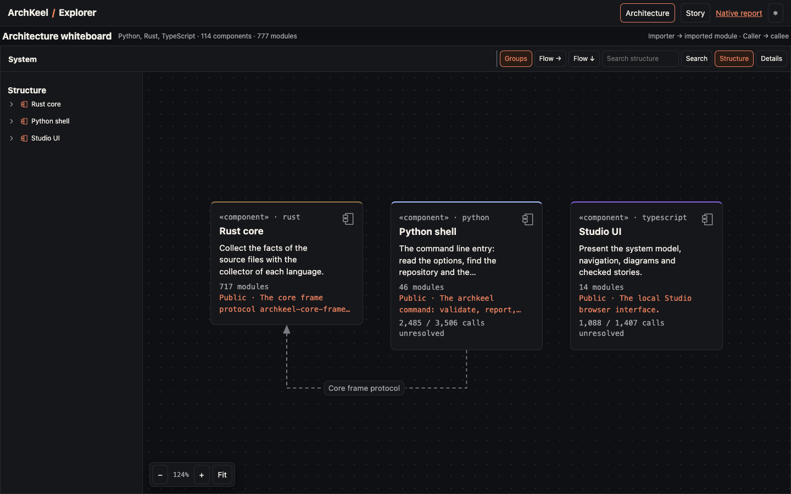
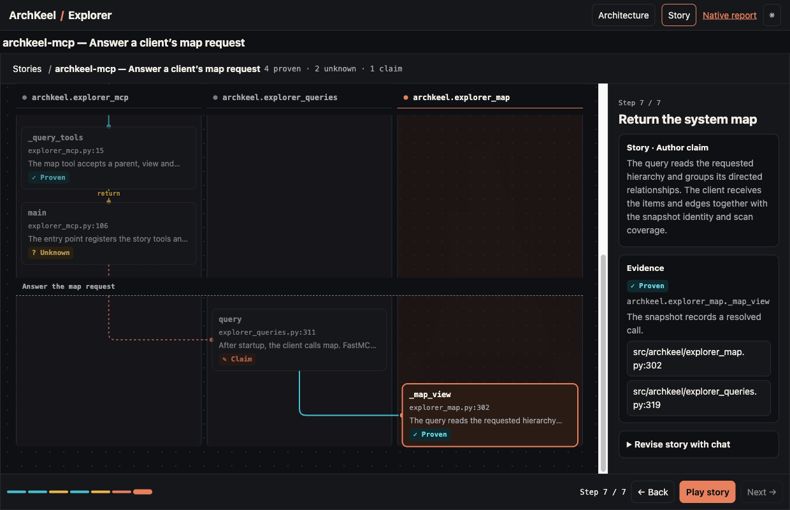
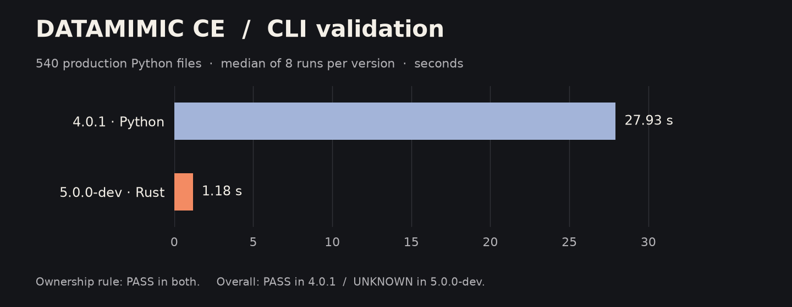

# ArchKeel

<p align="center">
  
</p>

**See what your code really does. Check it against what you decided.**

Explore a repository in Studio. Follow an import or a call to its source line. Select **Inspect unlinked calls** to see where an invocation was found and why its target is open.
Add an architecture contract to check which components may depend on each other.
Developers can inspect the evidence in the browser, CI reads the exit code, and agents can query the same snapshot.

[](https://github.com/rapiddweller/archkeel/actions/workflows/ci.yml)
[](https://rapiddweller.github.io/archkeel/self/index.html)


[](#claude-code)
[](#codex)
[](https://github.com/rapiddweller/archkeel/blob/main/LICENSE)

**See it live.** Open the [system report](https://rapiddweller.github.io/archkeel/self/index.html)
including the [Rust core](https://rapiddweller.github.io/archkeel/self/core.html) and
[Python shell](https://rapiddweller.github.io/archkeel/self/shell.html),
or [browse the examples](https://rapiddweller.github.io/archkeel/showcase/index.html).
These published reports follow `main`. The Studio pictures below come from this checkout.



[Try Studio](#quick-start) · [Check a contract](#check-a-contract) · [Compare CLI performance](#performance) · [Connect an agent](docs/explorer.md#connect-an-agent)

## Why ArchKeel?

| If you are… | Start with a question | Follow the evidence |
| --- | --- | --- |
| A developer | What depends on the module I am changing? | Select the module and follow an incoming import to its file and line. [Studio walkthrough](docs/explorer.md#follow-a-dependency-to-source) |
| An architect | Does this dependency cross an agreed boundary? | Inspect the import and check the declared rule with `archkeel validate`. [Contract guide](docs/onboarding.md) |
| A coding agent | Which source line supports this conclusion? | Query the snapshot over MCP. Follow the relation to its evidence and read the source. [Snapshot queries](docs/explorer.md#query-a-snapshot) |

Read an import or call arrow from source to target. **A imports B** identifies a static
dependency. **A calls B** identifies a call whose target the collector can prove.
**A may call B** links a Python call site to a candidate declaration you can inspect.

## Quick start

From a checkout of this Studio development line, use Python 3.11+, uv and the Rust toolchain:

```sh
make core
uv run archkeel studio .
```

Keep the terminal open. Select **Python shell**, **Rust core** or **Studio UI** in the browser.
Open a group, select an arrow, then open a source reference in the inspector. To explore your
own Git repository, replace `.` with its path. Studio can build a map without a contract.

For a guided example, choose **Story** and play the MCP map request. Its module lanes follow
the agent’s request from the MCP server into the snapshot query. Pause on a step to inspect its evidence.



## Check a contract

From a project with a commit, run:

```sh
archkeel init                        # draft a contract for a supported project layout
archkeel validate --summary          # check the decisions you put in the contract
archkeel report --output report.html  # write a standalone HTML report
```

Review the draft responsibilities and rules before using the result in CI. Without a config,
`validate` and `report` can draft those files automatically. Use `--no-init` to disable this.
The [onboarding guide](docs/onboarding.md) walks through a first decision.

| Verdict | Meaning | Default exit |
| --- | --- | --- |
| PASS | Every required rule passes under the stated premises. | 0 |
| FAIL | At least one rule has a recorded violation. | 1 |
| UNKNOWN | Evidence is missing for a decision. **UNKNOWN is not a pass.** | 2 |

A refusal also exits 2 by default. Baselines have their own [exit rules](docs/reference.md#baselines).

### In CI

```sh
archkeel validate --summary --no-init
```

The summary stays short in a CI log. For example, running
`archkeel validate --config docs/architecture/shell.toml --summary` in this checkout printed:

```text
validate: PASS under 2 stated external users -> exit 0 (all 27 rules pass; 1 pass under 2 stated external users) · root . · config docs/architecture/shell.toml
Details: archkeel validate --text (all: --all); machine output: --json
```

Use `--json` for machine output or `--text` for a human-readable report. By default, a pipe
gets JSON. The Rust core decides the verdict. An LLM can propose a story or explain a result.

## Performance

**27.93 s → 1.18 s** median time to check package ownership on **DATAMIMIC Community Edition**.
The 5.0 development build with the Rust core ran this command **23.7× as fast** as 4.0.1.
Both scanned the same 540 Python files, with 3,169 function and method definitions and 748 class definitions.



Both builds passed the ownership rule. The overall verdict was PASS in 4.0.1 and UNKNOWN in the Rust build, which reported 59 collection gaps.
In a separate scan of the same CE source, Studio linked **3,548 call sites to 1,183 candidate declarations**.
Each link opens the call and its possible target. [Call counts, source examples and reproduction steps](docs/performance.md)

## Install

**Studio and MCP.** Use a checkout containing this guide. To install its CLI outside the
checkout, run:

```sh
make build
uv tool install dist/archkeel-*.whl
archkeel --help
```

For a local MCP client, install the extra in the checkout with `uv sync --extra mcp`.
Use the resulting `archkeel-mcp` executable with the snapshot and repository paths.
See [MCP setup and queries](docs/explorer.md#connect-an-agent).

**Other builds.** The [main build](https://github.com/rapiddweller/archkeel/releases/tag/main-build)
contains a native core. Release [4.0.1](https://github.com/rapiddweller/archkeel/tree/4.0.1/docs)
uses the earlier Python engine. Check `archkeel --help` in the installation you use.

### Claude Code

```sh
archkeel skill install claude
```

### Codex

```sh
archkeel skill install codex
```

Run the installer in the repository where the agent works. The skill gives the agent instructions
for using the CLI. The MCP server gives it read access to a pinned snapshot and tools for stories.

## Supported languages

<!-- tiers:start -->
ArchKeel collects source evidence for Rust, TypeScript, Python and Dart.
Rule coverage depends on the language and the available evidence.
Python and Dart support import and interface boundary checks.
Python also checks direct function calls for `call_owner`.
Dart checks cycles when the package map is complete.
Unsupported or unproved cases remain UNKNOWN.
Python and Dart can check named imports against a declared `interface_boundary`.
<!-- tiers:end -->

For coverage by rule, see [known limits](docs/known-limits.md). For contract syntax and examples,
see [rules](docs/rules.md). For development setup and the test gate, see
[Contributing](https://github.com/rapiddweller/archkeel/blob/main/CONTRIBUTING.md).

MIT © 2026 Rapiddweller Asia Co., Ltd. Maintained by [Alexander Kell](https://github.com/ake2l).
