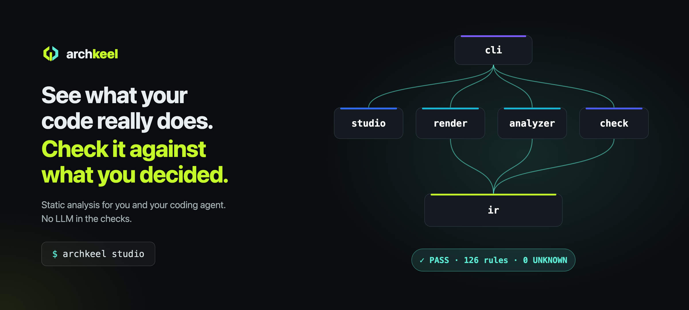
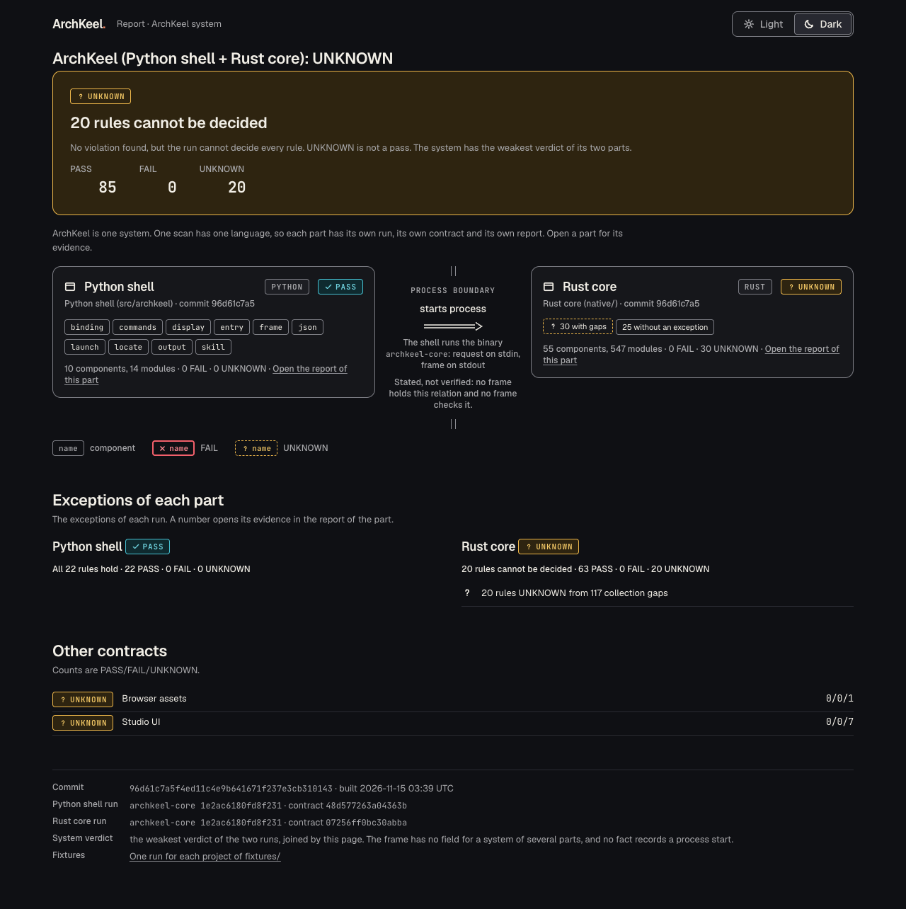

# ArchKeel

<p align="center">
  
</p>

**See what your code really does. Check it against what you decided.**

ArchKeel reads your code and checks it against the boundaries you declare in a contract. It gives
a verdict with the source evidence for each finding. No LLM is in the verdict.

- **PASS**: every rule holds, with complete evidence. Exit code 0.
- **FAIL**: the code breaks a rule. Exit code 1.
- **UNKNOWN**: the analysis cannot decide a rule. Exit code 2. **UNKNOWN is not a pass.**

[](https://github.com/rapiddweller/archkeel/actions/workflows/ci.yml)
[](https://rapiddweller.github.io/archkeel/self/index.html)


[](#claude-code)
[](#codex)
[](https://github.com/rapiddweller/archkeel/blob/main/LICENSE)

**See it live.** ArchKeel checks itself as one system, its Python shell and its Rust core.
The badge above is the verdict of the weakest part, and the reports follow the current `main`:
[ArchKeel as one system](https://rapiddweller.github.io/archkeel/self/index.html) ·
[the Rust core](https://rapiddweller.github.io/archkeel/self/core.html) ·
[the Python shell](https://rapiddweller.github.io/archkeel/self/shell.html) ·
[the fixture showcase](https://rapiddweller.github.io/archkeel/showcase/index.html).
Each report shows every FAIL and every UNKNOWN as the core gives it. Each cause is pinned in the repository.

<p align="center">
  <a href="https://rapiddweller.github.io/archkeel/self/index.html"></a>
</p>

*A report of ArchKeel (layout example). The live page and the badge give today's verdict.*

**What each language decides today.**

<!-- tiers:start -->
Rust and TypeScript projects: each rule kind that the core has ported is decided; a rule kind without a port is UNKNOWN.
Python and Dart projects: the rules that read the import graph are decided, and both decide `interface_boundary` (AD-504; Dart from the bound names of each import, AD-749, held by a `target_symbol` rule); a Dart cycle rule has its receipt from the package map of the survey (AD-800), and every other rule of both is UNKNOWN.
<!-- tiers:end -->

See the [known limits](docs/known-limits.md).

**Start.** A source install needs Python 3.11+, `cargo` and a Git repository with a commit.
For an install without Rust, use the [latest main build](#install-the-latest-main-build-without-rust).

```bash
ARCHKEEL_BUNDLE_NATIVE=1 uv tool install git+https://github.com/rapiddweller/archkeel
archkeel validate --root /path/to/project   # no archkeel.toml? it is drafted, then checked; see docs/onboarding.md
```

[Install](#install) · [Quick start](#quick-start) · [Why](#why-archkeel) · [Compared](#archkeel-floorplan-or-understand-anything) · [Features](#features) · [FAQ](#faq)

## Why ArchKeel?

You, or your coding agent, built a lot of code. Do you know the architecture it really has?
Tests tell you the behavior still works. They do not tell you that `render` now imports `store`,
or that a call became harder to resolve. Asking the agent "is the architecture still fine?" gets
you an opinion.

ArchKeel was built to understand the architecture that was really implemented, and to turn it
into one you choose:

1. **Measure.** Static analysis resolves imports. Each fact keeps its evidence: the record and the
   source line. What the analysis cannot resolve is counted, not hidden.
2. **Challenge.** You and your agent discuss the weak spots: violations, cycles, components that
   hold too much. The agent proposes. Its text stays a claim until the code proves it.
3. **Define and enforce.** You decide the target architecture. Existing imports are evidence, not
   permission. The contract becomes rules. A rule passes only with complete evidence; missing
   evidence is `UNKNOWN`, never a quiet `PASS`.

## ArchKeel, Floorplan or Understand Anything?

All three turn code into something you can see. They answer different questions, and they get
their facts in different ways.

| | **ArchKeel** | **[Floorplan](https://github.com/haydenschmitty/floorplan)** | **[Understand Anything](https://github.com/Egonex-AI/Understand-Anything)** |
|---|---|---|---|
| **Question** | How does our code work, which architecture do we want, and does the code keep to it? | How does the app I built work, and what should I worry about? | How does this large codebase work, down to the functions? |
| **Where the facts come from** | Native static analysis of Rust, TypeScript, Python and Dart, with evidence records and source lines | Scripts scan files, imports and web requests by pattern matching ("not a compiler", in its docs); the AI names and describes the parts | Deterministic scripts plus a multi-agent LLM pipeline that builds the knowledge graph |
| **What is unknown** | Counted and shown as `UNKNOWN` | Missed links can be added by asking the AI | Relationships can come from LLM judgment |
| **Role of the LLM** | Explains and proposes. No part of a check or verdict uses it | Writes the architecture description and the names | Summarizes, finds relationships, writes tours |
| **What you end with** | A declared contract with rules and verdicts, and an exit code for CI | A map, a health check, recent work | A knowledge graph, layers, guided tours |
| **Runs in** | Claude Code, Codex, any shell, CI | Claude Code, Codex | Claude Code, Codex and more |

Understand Anything teaches the story behind a codebase. ArchKeel measures the architecture you actually have and holds it to the one you choose.

Pick **ArchKeel** to turn what the code does into an architecture you can enforce. Pick **Floorplan**
or **Understand Anything** to learn a codebase quickly and in plain words. They combine well: learn
first, then declare what you want to keep.

## Features

- **Evidence on every edge.** Every import count comes from the code. Each import keeps its
  evidence record and source line. No model estimates a number.
- **PASS, FAIL, UNKNOWN.** A rule passes only with complete evidence. A gap in the analysis shows
  as `UNKNOWN`.
- **Made for coding agents.** A skill for Claude Code and Codex, and JSON results with a typed
  status.

## State of `main`

Issue [#880](https://github.com/rapiddweller/archkeel/issues/880). The Rust core `archkeel-core`
is the only engine. The Python engine is deleted.

- `archkeel validate` and `archkeel report` run through the core, as text or JSON.
  PASS exits 0, FAIL exits 1, UNKNOWN and a refusal exit 2.
- Rust, TypeScript, Python and Dart projects run through the core. What each decides: see the
  [known limits](docs/known-limits.md#supported-projects-on-main).
- `init` drafts `archkeel.toml` and a contract for a Python project ([guide](docs/onboarding.md)). `check`, `explore`, `guide`, `story`, `view` and `studio` give a typed refusal with exit 2.
  Interactive reports, `architecture.json` and focused reports are not available.
  `validate --baseline FILE` accepts each listed UNKNOWN and keeps exit code 2. Under a baseline, only that
  verdict exits 2: a refusal or a file that was not written exits 1. See the [reference](docs/reference.md#baselines).
- `report --output PATH` writes one static HTML page; `--format json` writes the core frame instead.
  `report --topology` adds a bounded topology section to the frame.
- The [reports of the current `main`](https://rapiddweller.github.io/archkeel/) show what the core says
  for ArchKeel itself and for each project of `fixtures/`, refusals included.
- No release carries the core binary yet. The release workflow builds the platform wheels with the
  core (AD-476), but the last release is 4.0.1. Use the latest main build or run a source checkout.
  A package without the core refuses each run with `core_binary_not_found`. There is no Python fallback.
- Release 4.0.1 has `check`, a larger `init` and full reports for Python, Dart and TypeScript projects.
  No release has Studio or `explore`. See the [state of `main`](docs/reference.md#state-of-main).

## Install

ArchKeel needs Python 3.11+ and a Git repository with at least one commit.

### Install the latest main build (without Rust)

This is a development build, not a release. It includes the Rust core for each supported platform.

```bash
pip install --pre --find-links https://github.com/rapiddweller/archkeel/releases/expanded_assets/main-build archkeel
uv tool install --prerelease allow --find-links https://github.com/rapiddweller/archkeel/releases/expanded_assets/main-build archkeel
```

```bash
ARCHKEEL_BUNDLE_NATIVE=1 uv tool install git+https://github.com/rapiddweller/archkeel
archkeel --version
```

This builds the current `main` with its core binary. The build needs `cargo` and `cargo-auditable`
(`cargo install --locked cargo-auditable`), and it refuses without the variable, because a package
without the core refuses each run. From a checkout, `make build` does the same and writes the
wheel of your platform to `dist/`:

```bash
make build && uv tool install dist/archkeel-*.whl
```
`uv tool install archkeel` installs release 4.0.1 from PyPI, which has the Python engine.
You can also run `main` from a source checkout:

```bash
git clone https://github.com/rapiddweller/archkeel.git
cd archkeel
make core                                         # build archkeel-core with cargo
uv run archkeel validate --root /path/to/project  # the project needs archkeel.toml and a contract
```

### Claude Code

```bash
claude plugin marketplace add rapiddweller/archkeel
claude plugin install archkeel@archkeel
```

### Codex

```bash
codex plugin marketplace add rapiddweller/archkeel
codex plugin add archkeel@archkeel
```

No plugin? `archkeel skill install claude` (or `codex`) writes the same instructions into your repository.
The plugin needs the CLI above; it adds the agent skill.

## Quick start

```bash
archkeel validate        # check the contract: exit 0, 1 or 2
archkeel report --text   # the same frame of the core as a report
archkeel report --output report.html  # one static page; the parent must exist
```

`validate` and `report` need an `archkeel.toml` with `language = "rust"` or `"typescript"` (or
`"python"` or `"dart"` for import rules) and a contract. Without one, `validate` and `report`
draft both from the folder layout (Python packages, a Cargo workspace or a `package.json` workspace),
say what they wrote, and never replace a file (`--no-init` or `ARCHKEEL_NO_INIT=1` writes nothing;
`archkeel init` drafts without a run). Every decision in the draft is a `TODO`, so the first verdict
is UNKNOWN and lists the decisions that you make. The whole walk, ending in PASS or FAIL, is in
[docs/onboarding.md](docs/onboarding.md). A minimal `archkeel.toml`:

```toml
[scan]
language = "python"
namespace = "shop"
roots = ["src/shop"]
contract = "architecture-contract.json"
```

A minimal contract, which `init` writes for each subpackage (the list of rules is in
[rules](docs/rules.md)):

```json
{"schema_version": "3.14.0",
 "components": [{"id": "COMP-ORDERS", "label": "orders", "role": "component",
   "packages": ["shop.orders"], "exact_modules": [],
   "responsibilities": ["Owns the orders of a customer."], "forbidden_responsibilities": [],
   "provenance": ["docs/architecture/architecture.md"], "decided_by": "architect", "public": []}],
 "rules": [{"id": "COMPONENT-NO-CYCLES", "kind": "no_component_cycles",
   "rationale": "Components stay acyclic.", "provenance": ["docs/architecture/architecture.md"],
   "decided_by": "architect"}]}
```

### In CI

`--summary` prints at most fifteen lines, also when stdout is a pipe or a file; the exit code
(0 PASS, 1 FAIL, 2 UNKNOWN) decides the job. Without it a pipe gets one JSON object that can be
megabytes.

```yaml
- run: archkeel validate --summary          # ends the job with exit 1 or 2 when not PASS
- run: archkeel report --output report.html # one line in the log; keep the file as an artifact
```

A log of a run with violations looks like this (fifteen lines at most):

```text
validate: FAIL -> exit 1 (2 violations in 1 rules)
Next: remove the 2 violations, or review the declared restriction. Then run again.
  DEP-APP-NO-CLI: forbidden dependency: shop.app.a -> shop.cli.b
  DEP-APP-NO-CLI: forbidden dependency: shop.app.c -> shop.cli.b
Details: archkeel validate --text (all: --all); machine output: --json
```

Read the verdicts: on `main`, `report` has the exit codes of `validate`.
`archkeel --help` lists the commands and options. See the [reference](docs/reference.md).

## FAQ

**Does ArchKeel use an LLM to check my code?** No. Checks are deterministic static analysis and run
locally. The agent in your harness explains and proposes; its text is a claim, never a proof.

**Does ArchKeel change my repository?** `validate` and `report` write nothing by default.
`report --output PATH` replaces the named regular file atomically. `skill install` writes one skill file.

**Does a clean graph mean a good design?** No. `PASS` means the required rules have complete evidence
and no decided violation. It does not prove runtime behavior or the quality of a design decision.

**Which languages?** Rust, TypeScript, Python and Dart run through the core. What each decides:

<!-- tiers:start -->
Rust and TypeScript projects: each rule kind that the core has ported is decided; a rule kind without a port is UNKNOWN.
Python and Dart projects: the rules that read the import graph are decided, and both decide `interface_boundary` (AD-504; Dart from the bound names of each import, AD-749, held by a `target_symbol` rule); a Dart cycle rule has its receipt from the package map of the survey (AD-800), and every other rule of both is UNKNOWN.
<!-- tiers:end -->

Use archkeel 4.0.1 for the other Python and Dart rules. See the [known limits](docs/known-limits.md).


## Scope and limits

ArchKeel observes static Rust, TypeScript, Python and Dart source in configured roots through native
collectors. What each language decides: see [the known limits](docs/known-limits.md#supported-projects-on-main).
TypeScript records lexical UML declarations and statically bound relationships;
ambiguous bindings and unsupported constructs remain UNKNOWN. TypeScript roots may name files or directories.
ArchKeel does not prove runtime behavior, performance, or the quality of every design decision.
Separate test trees need their own scan and contract.

Exit meanings are defined [per command](docs/reference.md#exit-codes).

Read the [docs](docs/README.md).

## Development

The shell needs Python 3.11+. The core needs a Rust toolchain: `make core` builds
`native/target/release/archkeel-core`, and the shell finds it in the checkout.
Without the core binary, each run refuses with exit 2. There is no Python fallback.

```bash
make check                # lint, types, browser code check, tests
make gate                 # also build and isolated installs
make native-check         # Rust format, lints, tests, and the self-check
make self-validate        # the core checks native/ and the Python shell against their pinned results
make report-gallery       # build the reports that the site shows, in test-artifacts/gallery
```

ArchKeel checks its own Rust source (`native/archkeel.toml`) and its own Python shell
(`docs/architecture/shell.toml`) with `make self-validate`. Each rule row is pinned with its cause
in `native/expected-gaps.json` and `docs/architecture/target/shell-expected.json`.
`make self-validate` prints one line for the system and one line for each part. The [live reports](https://rapiddweller.github.io/archkeel/self/index.html) show the system and both parts.
See [CONTRIBUTING.md](https://github.com/rapiddweller/archkeel/blob/main/CONTRIBUTING.md).

MIT © 2026 Rapiddweller Asia Co., Ltd. Maintained by [Alexander Kell](https://github.com/ake2l).
