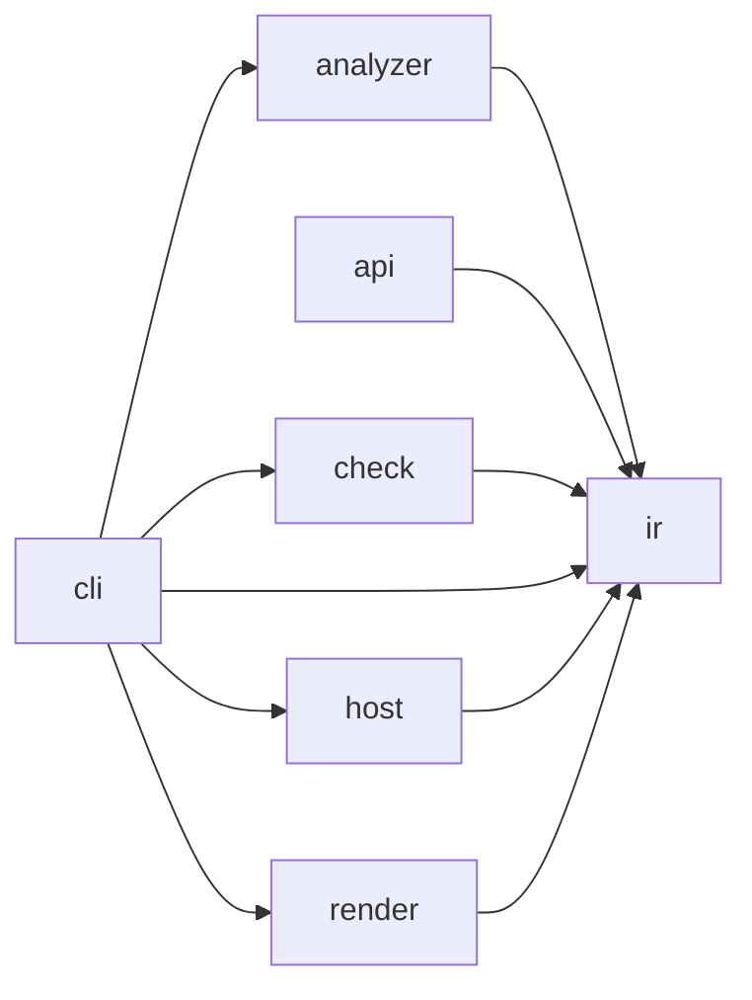

# Archkeel architecture

The [contract](../../architecture-contract.json) owns boundaries, interfaces and permissions.
[Source](../../src/archkeel) and [tests](../../tests/test_self.py) show the implementation.

The [compact target](target/design.md) records responsibilities, ports and the
bounded refactoring included in PR #604.

## Layers

The CLI injects adapters and runs workflows. Core assembles and evaluates evidence;
render projects typed results. Collectors report source facts, not policy.
Layer labels do not grant dependencies. Nested [contracts](contracts/) govern inner boundaries.

## Allowed dependencies

Observed imports:

<!-- archkeel-component-graph -->

Declared permissions:

<!-- archkeel-target-graph -->

Graphs do not prove complete Target conformance. Read the native report's coverage and UNKNOWNs.
The report's Structure overview shows every measured component's module and edge
counts without size-derived review candidates or boundary recommendations
([AD-235](decisions/ad-235-neutral-report-structure-overview.md)).

Boundary permissions appear as neutral counts in the unselected fact sheet.
Selected scopes show declared and applied groups for their recorded identities;
the root audit retains unmapped records. Native disclosures build record lists
in batches and full evidence when opened. Exact hashes retain direct access to
every record ([AD-234](decisions/ad-234-contextual-boundary-permission-disclosures.md)).

## Host evidence

The packaged CLI injects the GitLab [Host adapter](../../src/archkeel/host/gitlab.py).
GitHub collection is repository CI tooling: [`make github-pr-report`](../../tools/github_pr_report.py)
runs through `gh` in this repository's workflow. It is not a packaged GitHub Host adapter.
Recent events remain UNKNOWN; only an authenticated initial-PR receipt can prove
the scoped ordering described in [AD-143](decisions/ad-143-initial-pr-head-proves-scoped-order.md).
Caller-supplied `--host-records` require caller authentication.

## Evidence boundaries

Component `layer` values are contract intent; `layer_order` checks declared permissions
([AD-201](decisions/ad-201-layers-assess-declared-permissions.md)). A `requires` permission
does not prove structural Protocol conformance.
Validation can list observed undecided crossings with an exact open-pair total;
omitted pairs retain their undecided status ([AD-225](decisions/ad-225-compact-validation-decisions.md)).
The TypeScript frontend is packaged in Python at
[`archkeel.analyzer.typescript`](../../src/archkeel/analyzer/typescript/); it remains a
process collector and does not execute project code. Missing source evidence remains UNKNOWN.
Module-level TypeScript array declarations retain constant identities without evaluating
their elements or claiming complete inventories
([AD-232](decisions/ad-232-module-array-constant-identities.md)).
TypeScript decorators retain the direct lexical declarations they annotate;
inventories do not infer generated API
([AD-231](decisions/ad-231-typescript-decorated-inventories.md)).
Complete dependency scopes can retain an authenticated requires receipt alongside
unrelated source resolution gaps ([AD-227](decisions/ad-227-scoped-dependency-proof.md)).
Coverage and cycle closure remain conservative.
Dart named constructor identities retain their lexical owner once; declaration
and reference joins use the same source span
([AD-228](decisions/ad-228-dart-constructor-identities.md)).
Complete native direct-member inventories can retain bound local evidence under
unrelated resolver gaps; global coverage and unresolved traits remain incomplete
([AD-229](decisions/ad-229-local-member-inventory-proof.md)).
Named TypeScript constructor parameter properties use the existing direct attribute
facts while preserving constructor signatures; ordinary parameters remain parameters
([AD-230](decisions/ad-230-typescript-parameter-properties.md)).
TypeScript UML identity matching separates type and value namespaces while retaining
definition-site ambiguity within each ([AD-233](decisions/ad-233-typescript-namespace-identities.md)).
Written string actuals are bound to proven Python call formals before argument policies
evaluate them; omitted defaults and unsupported bindings remain outside that proof
([AD-247](decisions/ad-247-written-call-arguments-bind-to-observed-formals.md)) and canonical catalog values and reads ([AD-251](decisions/ad-251-catalog-arguments-and-source-usage.md)).
([AD-247](decisions/ad-247-written-call-arguments-bind-to-observed-formals.md)).
Narrow construct policies select a nominal receiver, member and operation role;
unproven subjects remain UNKNOWN ([AD-248](decisions/ad-248-construct-selectors.md)).
Proposed contract extensions are tracked in [#356](https://github.com/rapiddweller/archkeel/issues/356).

Protocol declaration selectors use the complete observed scope, closed declaration roles,
and canonical type identity; their exact and optional-union semantics are recorded in
[AD-254](decisions/ad-254-canonical-protocol-declarations.md).

## Decisions

[Internal decision archive](decisions/README.md). Read individual records when reviewing a specific change.

| Decision | Renderer behavior |
| --- | --- |
| [AD-237](decisions/ad-237-shared-dependency-proof-binding.md) | Dependency proof issuance and replay share the existing typed fingerprint recipe. |
| [AD-236](decisions/ad-236-demand-driven-report-exploration.md) | Build the module matrix on Health check open and module links on native list expansion. |
| [AD-239](decisions/ad-239-codec-format-owners.md) | Keep the codec facade while separate format owners preserve parsing and wire bytes. |
| [AD-238](decisions/ad-238-command-view-preparation.md) | Prepare compact command views in a focused governance module while retaining legacy imports and wire output. |
| [AD-242](decisions/ad-242-explicit-browser-module-ports.md) | Check named browser module ports and publish one verified offline bundle. |
| [AD-254](decisions/ad-254-canonical-protocol-declarations.md) | Require exact canonical Protocol identities at selected API positions. |
| [AD-256](decisions/ad-256-guarded-eager-declaration-expressions.md) | Check eager nested declaration expressions while preserving UNKNOWN for class-body calls without replayable path evidence. |
| [AD-257](decisions/ad-257-rule-driven-fact-collection.md) | Collect a fact family only when a declared rule uses it; a rule whose family was not collected is a coverage failure, never PASS. |
| [AD-258](decisions/ad-258-report-opens-with-ranked-findings.md) | Open the report with one verdict line and a ranked findings list computed once in the IR; a change field appears only with a comparison. |
| [AD-259](decisions/ad-259-one-plain-wire-one-validation.md) | The native collector speaks a plain, zlib-compressed protocol 8 and validates once, at the main process. |
| [AD-246](decisions/ad-246-bounded-numeric-operand.md) | Bind selected modulo bounds to bounded source-derived integer proofs. |

| [AD-247](decisions/ad-247-written-call-arguments-bind-to-observed-formals.md) | Bind explicitly written actuals to proven formals before applying argument policies. |
| [AD-251](decisions/ad-251-catalog-arguments-and-source-usage.md) | Check catalog membership and genuine source reads through canonical declarations. |
| [AD-248](decisions/ad-248-construct-selectors.md) | Select one nominal receiver, member and construct role without global spelling bans. |
| [AD-249](decisions/ad-249-source-ownership-defaults.md) | Constrain source definitions, value transfers, defaults, and fallbacks to canonical owners. |
| [AD-250](decisions/ad-250-bounded-guarded-effect-ownership.md) | Prove bounded Boolean paths and one call-site-specific private helper hop for canonical effects. |
