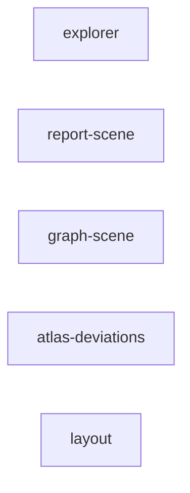
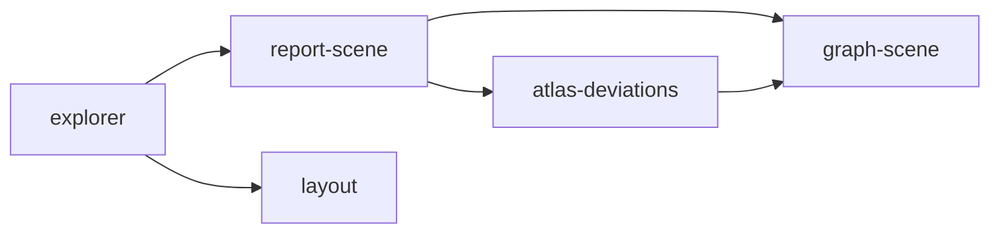

# Browser architecture

The observed graph has no edges. Collection gaps make it incomplete.

<!-- archkeel-component-graph -->

The target graph shows the dependencies permitted by the browser contract.

<!-- archkeel-target-graph -->

