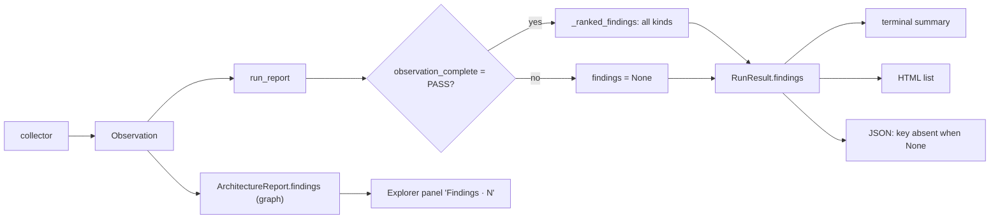

# The findings path: states, sentences and equivalence classes

This page explains how a `report` decides what its ranked list shows, and why. It belongs to
[AD-272](decisions/ad-272-rank-what-an-incomplete-observation-proves.md). The tests take their
expected values from the table of classes below; a drift test compares the two.

## The path today

Two lists carry the word "findings":
- **Ranked findings** (`RunResult.findings`, `ir/findings.py`, AD-258): the list a report opens with.
- **Graph findings** (`ArchitectureReport.findings`): the rule results that the Explorer shows
  for a component ("Findings · 1").

The graph list is filled on every observation. The ranked list is `None` on an incomplete one.
So one page can show a failed rule in the Explorer and "No ranked findings are recorded" above it.
That is the report that Tung reviewed (Compass, forbidden-edge variant, 30 coverage failures).
The sentence for `None` reads as "nothing found". AD-258 does not say that a partial
observation ranks nothing; the sentence is in a docstring of `_ranked_findings` only.

## The path after AD-272

One pure function `findings_state(result)` returns one value of the enum `FindingsState`. The
renders choose their text from it, and no render tests `findings is None` any more.

| State | Meaning |
|---|---|
| `COMPLETE` | all kinds ranked; an empty list means measured empty |
| `PARTIAL` | incomplete; the list holds the proven violations and cycles; hubs are not ranked |
| `NOT_RANKED` | incomplete; nothing proven was found; the list is absent |
| `NO_OBSERVATION` | no usable observation (diagnostics only); the list is absent |
| `FILTERED` | a filter is set; the list is absent |
| `NONE_RECORDED` | the result has no `findings` and no reason above applies (an older result) |

Proof predicates, each with one source:
- **Violation:** `trace_valid_violations(model)` in `ir/trace.py`. It is the same predicate that
  already turns `declared_rules` to FAIL on a partial observation (`_incomplete_report_result`).
- **Cycle:** the finding already carries the import site of every step. A cycle with a step
  that has no import site is not ranked on an incomplete observation.

Sentences (one table, one function `findings_note(result)` in `ir/findings.py`):

| State | Sentence |
|---|---|
| `PARTIAL` | `Hubs are not ranked: the observation is incomplete (30 coverage failures).` |
| `NOT_RANKED` | `Findings are not ranked: the observation is incomplete (30 coverage failures). Nothing was found in the part that was observed. No absence is claimed.` |
| `NO_OBSERVATION` | `Findings are not ranked: no observation was produced.` |
| `FILTERED` | `A filtered result lists no findings. Run report without a filter.` |
| `NONE_RECORDED` | `This result carries no ranked findings.` |

A `COMPLETE` list has no note. An empty one keeps the sentence each render had before:
the terminal says `No ranked findings: no violation, dependency cycle or hub.`, and the HTML says
`No violation, dependency cycle or hub.` under the heading `Findings · 0`. No incomplete observation
produces them. The terminal prints a note for `PARTIAL` (under the list) and `NOT_RANKED`; a run
with no observation prints its diagnostics, and a filtered report prints its own selection. The HTML
prints the note of every state but `COMPLETE`.

The result schema stays 11.0, which no release has shipped. It gains one branch: an incomplete
report (the 8.0 shape) that carries `findings`. `findings` keeps its meaning: an empty list is measured empty,
and absent is not ranked. The reason is in `observation_complete`, `coverage` and
`report_filter`, which the result already carries.

## Equivalence classes

Each row is one class. The tests run each class on every render. The drift test compares this
table with the test table.

| Id | Situation | `findings` | State |
|---|---|---|---|
| C1 | complete, nothing found | `[]` | `COMPLETE` |
| C2 | complete, violations only | violations | `COMPLETE` |
| C3 | complete, cycles or hubs only | cycles, hubs | `COMPLETE` |
| C4 | complete, all kinds | violations, cycles, hubs in this order | `COMPLETE` |
| C5 | incomplete, one proven violation, no cycle | the violation | `PARTIAL` |
| C6 | incomplete, a cycle, no violation | the cycle | `PARTIAL` |
| C7 | incomplete, a violation and a cycle | both, in this order | `PARTIAL` |
| C8 | incomplete, a hub only | absent | `NOT_RANKED` |
| C9 | incomplete, a violation record without a complete trace | absent | `NOT_RANKED` |
| C10 | incomplete, nothing found | absent | `NOT_RANKED` |
| C11 | incomplete, a cycle with a step that has no import site | absent | `NOT_RANKED` |
| C12 | diagnostics only, no model | absent | `NO_OBSERVATION` |
| C13 | any filter: only violations, only architecture, component, rule, only calls | absent | `FILTERED` |
| C14 | a result read without `findings` and without a filter | absent | `NONE_RECORDED` |
| C15 | the same rule broken in both directions, or twice at one pair | one finding, `size` = records | as C2, C5 |
| C16 | a component-cycle violation | one finding with its path, the same on a partial run | as C2, C5 |
| C17 | incomplete, a module-cycle rule violation | the violation and its cycle once; the cycle alone when the trace is incomplete | `PARTIAL` |

Renders: the terminal summary, the terminal with `--json`, the HTML list without JavaScript,
the Explorer data (`DATA.findings`), and `report --only violations`. The HTML and the terminal
must name the same ranked identities, in the same order, with the same sentence.

## Review surface

- The sentence for each state is one row in one table. A reviewer reads the table, not the code.
- `findings_state` is one function with six outcomes. No render derives a state on its own.
- The Explorer panel keeps its label. After this decision, a failed rule that has a violation
  shows in the Explorer and in the ranked list. The reading guide names the two lists.

## Cost of the path today (measured)

One `report` run builds `architecture_report` twice and `module_exploration` twice (once for the
ranking, once for the page). On DATAMIMIC EE (internal, 1,174 files) one build takes 1.6 s each,
so the second pair costs about 3.2 s of 95 s (3 %). On `src/archkeel` it is about 1 s of 52 s.
This is under the 10 % rule for performance changes. The change would also move two large objects
through `RunResult`. It is not part of this decision. The numbers stay here so that nobody measures
them again.
