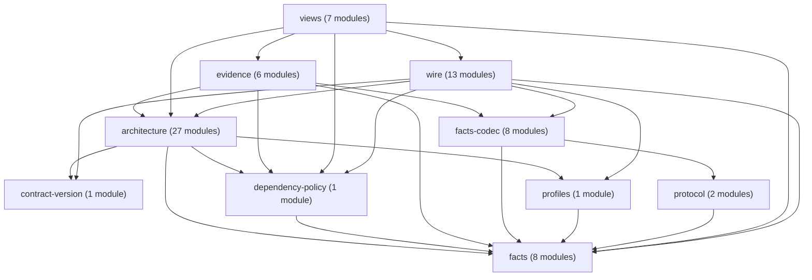

# IR owners

[AD-315](decisions/ad-315-ir-owners-are-inner-components-of-core.md) splits the `ir` component of
Core into inner components. The four owners `architecture`, `evidence`, `wire` and `views` are new.
The other six inner components existed before.

An arrow points from the importing component to the imported component. Each arrow is a `requires`
entry in [`ir.json`](contracts/ir.json). The module count is the number of modules that the
component lists in `ir.json`.

The section between the two markers is generated from `ir.json`. Do not edit it by hand.
`tests/test_ir_owners.py` fails when the section differs from the contract. To write it again, run:

```bash
ARCHKEEL_WRITE_IR_OWNER_PAGE=1 uv run python -m pytest tests/test_ir_owners.py -k owner_page_shows
```

The marked-graph check of `archkeel validate` reads the root contract only. This page uses its own
markers, so that check does not read it.

<!-- archkeel-ir-owner-graph:begin -->
| Name | Kind | Modules | Responsibility | Requires |
| --- | --- | --- | --- | --- |
| `architecture` | owner | 27 | Own the typed architecture model, contract and target graphs, structure, interfaces, lock, baseline, widening and diagnostics. | `facts`, `profiles`, `dependency-policy`, `contract-version` |
| `evidence` | owner | 6 | Own rule decisions, the trace of evidence, digests, phase timings and collection features. | `architecture`, `facts`, `facts-codec`, `dependency-policy` |
| `wire` | owner | 13 | Own strict wire conversion of contracts, baselines, observations, deltas, results and graphs. | `architecture`, `facts`, `facts-codec`, `profiles`, `contract-version`, `dependency-policy` |
| `views` | owner | 7 | Own pure projections of checked results: report graph, report projection, explore, findings, flow graph, story and view spec. | `architecture`, `evidence`, `wire`, `facts`, `dependency-policy` |
| `contract-version` | inner component | 1 | Own contract versions and the features available in each version. | none |
| `dependency-policy` | inner component | 1 | Match owned dependency selectors and exact import-port permissions. | `facts` |
| `facts` | inner component | 8 | Own language-neutral source facts, evidence identities, state, type values and typed IR vocabularies. | none |
| `facts-codec` | inner component | 8 | Strictly decode, validate and encode source facts and process envelopes. Own the bounded source path grammar shared by collection and guarded-effect replay. Intern lossless JSON strings for source and observation wire encodings. | `facts`, `protocol` |
| `profiles` | inner component | 1 | Describe language capabilities, source requirements and comparable measurements. | `facts` |
| `protocol` | inner component | 2 | Own typed request and response envelopes for collector processes. | `facts` |


<!-- archkeel-ir-owner-graph:end -->
