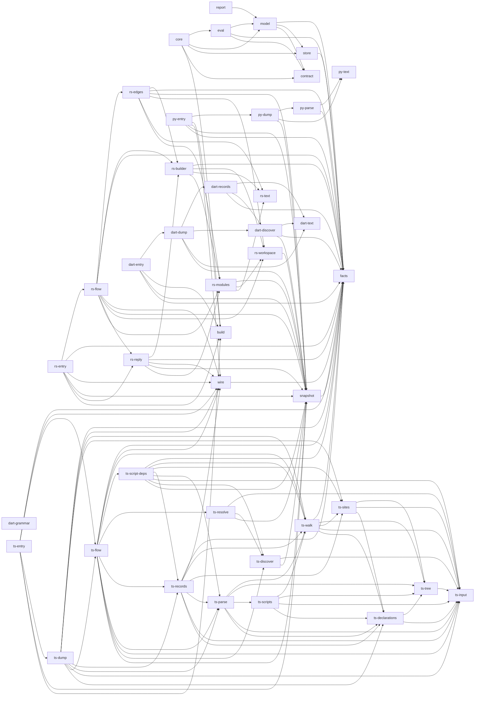

# The native workspace

The Rust workspace in `native/` holds the collectors that read source for Archkeel.
Archkeel checks this workspace with its own Rust collector and the contract in
`native/architecture-contract.json` ([AD-335](decisions/ad-335-archkeel-checks-the-rust-of-native-with-its-own-contract.md)).
Run `make self-validate-native` to check it.

The contract has two levels. The crates are the base (`facts`, `wire`, `snapshot`, `store`, `contract`, `build`, `pytext`) and the core after the collector (`model`, `report`, `core`, AD-359). Each
collector crate is split into components by responsibility, and an arrow points down only:
the entry calls the flow, the flow calls the parts (discover, parse, resolve, records), and
the records component builds the records of the collector. Rule `NATIVE-REQUIRES-COMPLETE` allows only the
arrows in the contract, and rule `NATIVE-NO-MODULE-CYCLES` forbids a module cycle. No module is out of scope: the macro cycle of `archkeel-facts` ([#954](https://github.com/rapiddweller/archkeel/issues/954)) is gone since #961.
The old layer file and its test are removed (AD-327): a declared
Cargo dependency that no module uses is a crate edge, and the contract rejects it.

| Crate | Role | Uses |
|---|---|---|
| `archkeel-wire` | The collector wire: requests, replies and source identities. | `archkeel-facts` |
| `archkeel-snapshot` | The one owner of snapshot reads: POSIX paths, contained reads, the symlink rule and the size limit. | `archkeel-facts` |
| `archkeel-facts` | The one typed definition of each collector fact (AD-345). | no crate of the workspace |
| `archkeel-store` | Validates a reply once, keeps the facts and writes `architecture.json` (AD-346). | `archkeel-facts` |
| `archkeel-contract` | Parses the bytes of one contract into typed values, as the Python parser does (AD-359). It reads no file. | no crate of the workspace |
| `archkeel-model` | The typed model of one run: ids, tables, the components, the modules, packages and owners of slice S1, what the reply proves not seen, and the scope proof that a PASS needs (AD-363, AD-370). Slices S2 to S4 add edges, cycles and the proof. | `archkeel-contract`, `archkeel-store`, `archkeel-facts` |
| `archkeel-eval` | Decides each rule over the model: an outcome with a decision and its violations. Slice S1 decides `complete_assignment` and `root_layout`; each other kind names its slice (AD-370). | `archkeel-model`, `archkeel-contract`, `archkeel-facts` |
| `archkeel-report` | The report v2 payload: the typed `Report` frame, its canonical bytes, the status rule and the check. A frame whose status has no explaining row cannot be built (AD-361, AD-371). The core does not call it yet. | `archkeel-model` |
| `archkeel-core` | The one process after the collector and the only binary of WP6. It speaks the engine command of the dual run; the host uses it for no verdict (AD-363). | `archkeel-eval`, `archkeel-model`, `archkeel-contract`, `archkeel-store`, `archkeel-build-support` |
| `archkeel-build-support` | The helper that the `build.rs` of each collector calls: the digest of the sources. | no crate of the workspace |
| `archkeel-pytext` | The text rules of Python `str` that more than one collector repeats, such as `str.splitlines` (AD-327). | no crate of the workspace |
| `archkeel-dart-grammar` | Gives the Dart grammar: the vendored C parser of tree-sitter-dart 0.1.0, the grammar of the Python collector (AD-342). It does not parse. | no crate of the workspace |
| `archkeel-dart-collector` | Reads Dart source. It holds the discovery (AD-365) and decodes the Dart request (AD-368); it writes no reply before slice 5 of #880. | `archkeel-wire`, `archkeel-snapshot`, `archkeel-facts`, `archkeel-pytext`, `archkeel-build-support` |
| `archkeel-typescript-collector` | Reads TypeScript source. | `archkeel-wire`, `archkeel-snapshot`, `archkeel-facts`, `archkeel-pytext`, `archkeel-build-support` |
| `archkeel-rust-collector` | Reads Rust source. | `archkeel-wire`, `archkeel-snapshot`, `archkeel-facts`, `archkeel-build-support` |
| `archkeel-python-collector` | Reads Python source with `ruff_python_parser`, pinned exactly ([AD-334](decisions/ad-334-the-native-python-collector-reads-the-interpreter-from-the-request.md)). Slice 1b: the parse only. | `archkeel-wire`, `archkeel-snapshot`, `archkeel-facts`, `archkeel-build-support` |

A collector crate never uses another collector crate. Only a collector crate uses a parser crate.
A grammar crate links a vendored C parser and gives its language; only a grammar crate depends on
`tree-sitter-language` (rule `NATIVE-EXTERNAL-TREE-SITTER-LANGUAGE`).
Clippy, `cargo deny` and the file size rule stay outside the contract
([AD-327](decisions/ad-327-rust-architecture-rules-are-measured-in-the-gate.md)).

## The dual run

The Rust model and evaluator (WP6 of #880) must give the verdicts and rows of the Python engine.
`make dual-run` compares a candidate engine with the recorded oracles in `tests/dual_run/`
([AD-360](decisions/ad-360-a-second-engine-is-compared-with-recorded-oracles-per-section-and-rule-family.md)).
A slice names what it owns:

```bash
make dual-run DUAL_RUN_ARGS="--sections modules,packages --families direction \
  --engine-command 'native/target/debug/archkeel-core dual-run'"
```

The engine command reads one JSON request on standard input: `protocol`, `case`, `root`,
`config`, `baseline`, `contracts`, `collector_argv`, `pinned`, `reply` and `sections`. It writes
one frame on standard output: `rules` (rule id to kind and status) and the columnar
`architecture` or the canonical `sections`. A failed or slow engine is a difference
(`--engine-timeout`, default 600 s). The sections and rule families are in
`tools/dual_run_schema.json`.
`python -m tools.dual_run serve-python` is the reference: it serves the Python engine.

`archkeel-core dual-run` is the Rust engine ([AD-363](decisions/ad-363-a-pass-needs-a-scope-proof-that-only-the-model-can-make.md)).
With a command engine, the harness runs the collector and sends its reply as hex in `reply`.
The core decides `complete_assignment` and `root_layout` and writes their `violations` rows
([AD-370](decisions/ad-370-the-core-decides-the-rule-kinds-of-modules-and-ownership.md)); a rule
of these kinds that only the scope proof of S4 can pass is a named gap. Each other rule and each
other requested section has an `unsupported` reason, and a slice that names no part fails
(`--sections none --families none`). The S1 run:

```bash
make dual-run DUAL_RUN_ARGS="--sections violations --families complete_assignment,root_layout \
  --engine-command 'native/target/debug/archkeel-core dual-run'"
```
 `--self-test` compares what the core read: the rule ids and
kinds of the contract bytes against the verdict map, and the reply that the store accepts. A
part that is not ported answers with the slice that ports it, never with an empty result.

<!-- archkeel-component-graph -->

