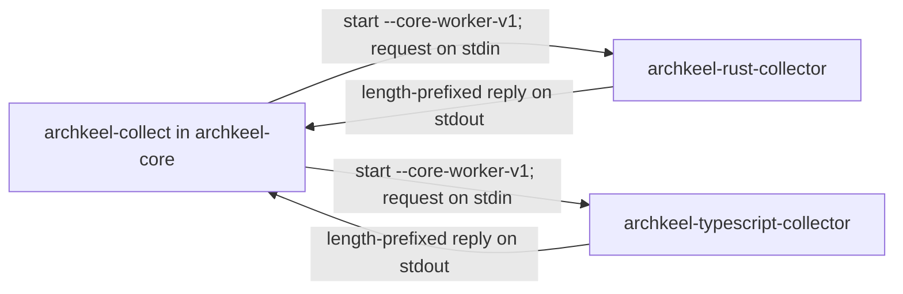

# The native workspace

The Rust workspace in `native/` holds the collectors that read source for Archkeel.
Archkeel checks this workspace with its own Rust collector and the contract in
`native/architecture-contract.json` ([AD-335](decisions/ad-335-archkeel-checks-the-rust-of-native-with-its-own-contract.md)).
Run `make self-validate-native` to check it. The target runs the default `archkeel validate`,
which the core decides ([AD-432](decisions/ad-432-the-rust-core-is-the-only-decision-path.md)).

The contract states the order first ([AD-588](decisions/ad-588-the-self-contract-states-layers-parts-and-crossings.md)).
Each component has a `layer`, and rule `NATIVE-LAYER-ORDER` gives the layers from the inside to the outside:
`foundation` (`facts`, `build`, `pytext`, `dart-grammar`), `transport` (`snapshot`, `wire`, `store`),
`collector` (the parts of the four collectors), `collector-entry` (their entries), `collection` (`collect`),
`contract`, `model`, `barrier` (`model-barrier`), `evaluation`, `report` and `core`.
A declared `requires` points down or stays in its layer. A component without a layer holds every rule UNKNOWN.

Below the order the contract has two levels. The crates are the base (`facts`, `wire`, `snapshot`, `store`, `contract`, `build`, `pytext`) and the core after the collector (`model`, `report`, `core`, AD-359). Each
collector crate is split into components by responsibility, and an arrow points down only:
the entry calls the flow, the flow calls the parts (discover, parse, resolve, records), and
the records component builds the records of the collector. Rule `NATIVE-REQUIRES-COMPLETE` allows only the
arrows in the contract, and rule `NATIVE-NO-MODULE-CYCLES` forbids a module cycle. No module is out of scope: the macro cycle of `archkeel-facts` ([#954](https://github.com/rapiddweller/archkeel/issues/954)) is gone since #961.
The old layer file and its test are removed (AD-327): a declared
Cargo dependency that no module uses is a crate edge, and the contract rejects it.

Four crates of the decision side have parts by responsibility too (AD-588). No code moved for this:
- `model`: `model-terms`, `model-graph`, `model-selection`, `model-run`, `model-match`, `model-proof`, `model-uml`.
- `eval`: `eval-violation`, `eval-rules`, `eval-decide`.
- `report`: `report-payload`, `report-check`, `report-build`, `report-page`, `report-frame`, `report-ruling`.
- `core`: `core-contract`, `core-decode`, `core-engine`, `core-baseline`, `core-hygiene`, `core-frame`, `core-requests`.

The component with the name of the crate is the root part. It owns the root file and the manifest, and it
publishes the parts. A part claims its modules by name and stays in the layer of its crate. A new module of
these crates has no owner until a part claims it, and `NATIVE-ASSIGNMENT-COMPLETE` fails. The parts of one
crate make no cycle (`NATIVE-NO-COMPONENT-CYCLES`). A method call into a part of another crate is a use of
that part (#953), so the contract states it: for example `eval-rules` requires `model-run`.

Each `requires` names its ports in `through`: the modules of the target that the source enters (AD-588).
`NATIVE-REQUIRES-COMPLETE` fails for an import through a module that is no port. A port is a module prefix,
so a port on the root of a crate without parts permits the whole crate.

Each component lists in `public` the names that other components use, as `module:Name`, and rule
`NATIVE-INTERFACE-BOUNDARY` fails for a use of any other name
([AD-604](decisions/ad-604-the-rust-collector-states-the-item-and-route-of-each-import.md)). A use
passes when one hop of the publication route of its name is listed: a re-export at a crate root, or
the module that defines the name. A crate root is the one public path of each name that it
publishes ([AD-608](decisions/ad-608-a-crate-root-is-the-one-public-path-of-each-name-it-publishes.md)):
a component that owns a crate root lists such a name only at the root, so another crate that takes a
deeper path fails. A method call passes through a root entry of its type. `model-barrier` and `core`
list no name, because no other component uses them.

An unresolved named receiver holds the interface even beside a known module edge
([AD-898](decisions/ad-898-a-known-module-edge-does-not-prove-a-second-named-use.md)).
A pair that leaves only impl execution unknown still holds dependency checks, but not the
named interface ([AD-900](decisions/ad-900-a-proven-execution-pair-does-not-hide-a-named-use.md)).

The core chain is core -> report -> eval -> model -> contract, store and facts
([AD-382](decisions/ad-382-the-self-contract-pins-the-crate-chain-and-the-external-homes.md)).
The `NATIVE-NO-*-TO-*` rules forbid each upward direction also when a `requires` entry allows it.
`NATIVE-EXTERNAL-COMPLETE` gives each external crate a stated home. The text scans of AD-382 (system
access and language names on the core side, the order of the `requires`) are retired: the contract does
not say them and no test checks them (owner decision 2026-11-27). #1075 lists what the scan of a Rust workspace misses.

| Crate | Role | Uses |
|---|---|---|
| `archkeel-wire` | The collector wire: requests, replies and source identities. | `archkeel-facts` |
| `archkeel-snapshot` | Owns contained reads, path and symlink rules, parse-work checks, and input digests (AD-420). Collectors turn read results into fact records (AD-926). | No workspace crate |
| `archkeel-facts` | The one typed definition of each collector fact (AD-345). | no crate of the workspace |
| `archkeel-store` | Validates a reply once and keeps the facts for the model; holds the pinned standard library (AD-346). | `archkeel-facts` |
| `archkeel-contract` | Parses contract, amendment and baseline bytes into typed values, as Python does (AD-359, AD-375, AD-386). It reads no file. | no crate of the workspace |
| `archkeel-model` | The typed model of one run: ids, tables, the components, the modules, packages and owners of slice S1, the imports and the module and package edges of slice S2, what the reply proves not seen, the cycles and ranks of slice S3, and the scope proof that a PASS needs: slice S4 checks each cause that makes the scope incomplete one time per model, the import matchers of the direction kinds of slice S5 that the evaluator and the scope proof share, and the scan roots, the component cycles, the cycle receipts and the rules that each pair gap can change of slice S7 (AD-363, AD-370, AD-372, AD-374, AD-378, AD-380, AD-384). | `archkeel-contract`, `archkeel-store`, `archkeel-facts` |
| `archkeel-model-barrier` | A test crate without code: each document test tries to build a PASS without the scope proof of the same model, from outside the model, and has a twin that compiles (AD-378). It also tries a run PASS without the run proof; the report and the evaluator hold their own attempts as document tests (AD-381, AD-382). Attempts 25 to 29 try the gap scope and the scan proof of slice S7 (AD-384). | `archkeel-model`, `archkeel-contract` |
| `archkeel-eval` | Decides each rule over the model: an outcome with a decision and its violations. Slice S1 decides `complete_assignment` and `root_layout`, slice S2 `external_dependency_scope` and `complete_external_scope`, slice S5 the direction kinds (`forbidden_dependency`, `allowed_dependency` as a declaration, `sibling_isolation`, `layer_order`, `complete_requires`), slice S7 `no_component_cycles`; each other kind names its slice (AD-370, AD-372, AD-380, AD-384). | `archkeel-model`, `archkeel-contract`, `archkeel-facts` |
| `archkeel-report` | The engine ruling, its frame and the HTML presentation. The core writes its status and rule verdicts only through its `Ruling` (AD-388). A PASS needs the model and the run proof. The unused report v2 builder and checker are removed (AD-612). | `archkeel-eval`, `archkeel-model`, `archkeel-contract` |
| `archkeel-core` | Handles the engine command, check request and scan request (AD-363, AD-390, AD-399). It delegates collection to `archkeel-collect` and reads the frame status from the report (AD-388). | `archkeel-collect`, `archkeel-report`, `archkeel-eval`, `archkeel-model`, `archkeel-contract`, `archkeel-store`, `archkeel-build-support` |
| `archkeel-collect` | Reads the repository configuration and derives the collection request. Starts the installed Rust or TypeScript worker, or runs a linked Python or Dart collector. Gives the store the typed reply (AD-406, AD-896). | `archkeel-store`, `archkeel-wire`, `archkeel-facts`, `archkeel-snapshot`, `archkeel-python-collector`, `archkeel-dart-collector` |
| `archkeel-build-support` | The helper that the `build.rs` of each collector calls: the digest of the sources. | no crate of the workspace |
| `archkeel-pytext` | The text rules of Python `str` that more than one collector repeats, such as `str.splitlines` (AD-327). | no crate of the workspace |
| `archkeel-dart-grammar` | Gives the Dart grammar: the vendored C parser of tree-sitter-dart 0.1.0, the grammar of the Python collector (AD-342). It does not parse; only the Dart collector uses it (`deny.toml`). | no crate of the workspace |
| `archkeel-dart-collector` | Reads Dart source. It holds discovery (AD-365), request decoding (AD-368), syntax and sites (AD-369, AD-376), SDK checks (AD-387), declarations (AD-392) and complete collection assembly from typed resolver answers (AD-400) and the typed import survey of one package with its own resolver (AD-454). `archkeel-collect` links its library. | `archkeel-wire`, `archkeel-snapshot`, `archkeel-facts`, `archkeel-pytext`, `archkeel-dart-grammar`, `archkeel-build-support` |
| `archkeel-typescript-collector` | Reads TypeScript source. Its binary serves the private worker channel and the public collector protocol (AD-896). | `archkeel-wire`, `archkeel-snapshot`, `archkeel-facts`, `archkeel-pytext`, `archkeel-build-support` |
| `archkeel-rust-collector` | Reads Rust source. Its binary serves the private worker channel and the public collector protocol (AD-881). | `archkeel-wire`, `archkeel-snapshot`, `archkeel-facts`, `archkeel-build-support` |
| `archkeel-python-collector` | Reads Python source with `ruff_python_parser`, pinned exactly ([AD-334](decisions/ad-334-the-native-python-collector-reads-the-interpreter-from-the-request.md)). Slice 1c-2d: the reply of the import survey, which the host does not read yet. | `archkeel-wire`, `archkeel-snapshot`, `archkeel-facts`, `archkeel-build-support` |

A collector crate never uses another collector crate. Only a collector crate uses a parser crate.
Only `archkeel-collect` uses a collector crate, and only `archkeel-core` uses `archkeel-collect`.
`archkeel-collect` uses only `facts`, `store`, `wire`, `snapshot` and the collectors, and a collector uses no
`store` and no crate of the core side (`NATIVE-NO-*-TO-TYPESCRIPT`, `NATIVE-NO-*-TO-COLLECT`,
`NATIVE-NO-COLLECT-TO-*`, `NATIVE-NO-<collector>-TO-*`, AD-406).

The Python collection spine has four layers ([AD-389](decisions/ad-389-the-native-python-collector-checks-compiler-refusals-before-facts.md)):
`py-survey` -> `py-symbols` -> `py-unparse` -> `py-module`, `py-tree` and `py-parse`; `py-survey` and `py-symbols` also read `py-declare`, which reads `py-module` and `facts` (AD-518).
The arrows state the allowed direction, not a required call. Twelve `NATIVE-PY-*-NO-*` rules
forbid each upward pair, even with a matching `requires` entry. The entry, dump and reply are
adapters above this spine. Scope, input, source and work helpers are below it; their declared
`requires` stay in the complete-requires gate. `Module` and `EvidenceMap` have one home below
both consumers. The request carries a checked `PyMinor`; an unknown minor never selects a table.
The parse checks compiler refusals before the survey can write facts. Each refusal is a named
file gap with incomplete scope. The host codec and store still refuse the native Python reply.
**Python reply acceptance — entry condition:** the store must not accept the native Python reply
before #1072 is closed. [AD-402](decisions/ad-402-the-python-raise-site-inventory-keeps-unproved-paths-open.md)
refuses the 100 reviewed sources and checks the H1–H5 scope/name families, but keeps #1072 open.
The pinned CPython inventory has 1,334 calls,
257 message witnesses and 1,077 unproved rows. All current witnesses get native gaps; this is not
a completeness proof. The compile oracle uses the default recursion limit of 1,000.
The `py-symbols` component also owns the pre-import binding inventory and complete unused-binding
records (AD-396). `--dump-bindings` compares them with the unchanged Python functions. It keeps
the alias map empty until the import-proof slice. Work exhaustion gives a named incomplete-file
gap, not a partial inventory. No new section enters the production reply.
`--dump-proofs` compares the import-local binding, decorator, property, class-body and type-alias
proofs that member convergence needs (AD-404). It reads one module after static import binding.
Provider proof sets are empty at this boundary. It does not claim cross-module convergence.
A grammar crate links a vendored C parser and gives its language; only a grammar crate depends on
`tree-sitter-language` (rule `NATIVE-EXTERNAL-TREE-SITTER-LANGUAGE`).
Clippy, `cargo deny` and the file size rule stay outside the contract
([AD-327](decisions/ad-327-rust-architecture-rules-are-measured-in-the-gate.md)).

## The dual run

The linked collector states its profile limits in the typed in-process reply
([AD-426](decisions/ad-426-the-linked-collector-states-profile-limits-before-the-scope-proof.md)).
The model reads these statements before the existing scope proof. They remove no actual source gap.
A stated unsupported feature holds only the rules that read it, not the run
([AD-500](decisions/ad-500-a-stated-profile-limit-holds-only-the-rules-that-read-it.md)).
Each other profile limit also holds only what reads it: an unexamined construct or an undecided kind
holds its own rule, and a declaration that no rule reads holds the run
([AD-644](decisions/ad-644-a-profile-limit-holds-only-what-reads-it.md)).
The public wire reply omits these statements. The private Rust worker frame carries them (AD-881).

Slice S11 decides `forbidden_construct` from construct and typing-signal facts (AD-408).
A known occurrence can FAIL with incomplete coverage. Absence needs the existing scope proof,
a matching receipt and a complete construct capability. A partial capability remains UNKNOWN.
The store still refuses Python replies; recorded-input unit tests do not change that boundary.

> **History.** The Python engine, `make dual-run` and the harness `tools/dual_run*.py` are deleted
> ([AD-432](decisions/ad-432-the-rust-core-is-the-only-decision-path.md)). The text about them below is the record of how the
> core was compared with that engine. The request kinds `archkeel-core dual-run` and `check`
> stay for the Rust tests (`tools/dual_run_schema.json` is deleted, AD-1264). A release binary has neither kind: they
> are compiled in test builds and with the cargo feature `harness` only (#1095).

The Rust model and evaluator (WP6 of #880) had to give the verdicts and rows of the Python engine.
`make dual-run` compared a candidate engine with the recorded oracles in `tests/dual_run/`
([AD-360](decisions/ad-360-a-second-engine-is-compared-with-recorded-oracles-per-section-and-rule-family.md)).
A slice names what it owns:

```bash
make dual-run DUAL_RUN_ARGS="--sections modules,packages --families direction \
  --engine-command 'native/target/debug/archkeel-core dual-run'"
```

The engine command reads one JSON request on standard input: `protocol`, `case`, `root`,
`config`, `baseline`, `contracts`, `collector_argv`, `pinned`, `reply`, `sections`, and, from
`archkeel-dual-run-2`, `namespace` and `standard_library` (the shell reads both; AD-372), and, from
`archkeel-dual-run-3`, `insides` (AD-379), and, from `archkeel-dual-run-4`, `roots` (AD-384). It writes
one frame on standard output: `rules` (rule id to kind and status) and the columnar
`architecture` or the canonical `sections`. A failed or slow engine is a difference
(`--engine-timeout`, default 600 s). The sections and rule families were in
`tools/dual_run_schema.json` (deleted, AD-1264).
`python -m tools.dual_run serve-python` is the reference: it serves the Python engine.

`archkeel-core dual-run` is the Rust engine ([AD-363](decisions/ad-363-a-pass-needs-a-scope-proof-that-only-the-model-can-make.md)).
With a command engine, the harness runs the collector and sends its reply as hex in `reply`.
The core decides `complete_assignment` and `root_layout` and writes their `violations` rows
([AD-370](decisions/ad-370-the-core-decides-the-rule-kinds-of-modules-and-ownership.md)); a rule
of these kinds that only the scope proof of S4 can pass is a named gap. Each other rule and each
other requested section has an `unsupported` reason, and a slice that names no part fails
(`--sections none --families none`). The S1 run:

```bash
make dual-run DUAL_RUN_ARGS="--sections violations --families complete_assignment,root_layout \
  --engine-command 'native/target/debug/archkeel-core dual-run'"
```

The core also decides `external_dependency_scope` and `complete_external_scope`
([AD-372](decisions/ad-372-the-core-projects-the-edges-and-decides-the-external-rule-kinds.md)).
When the request names `dependency_edges`, the frame holds the edge rows without the ranks of S3
in `edges`, and the harness compares them with the Python engine on every case. The S2 run:

```bash
make dual-run DUAL_RUN_ARGS="--sections violations,dependency_edges \
  --families external_dependency_scope,complete_external_scope \
  --engine-command 'native/target/debug/archkeel-core dual-run'"
```

A root that mounts inside contracts names the paths that it needs in `self_test.contract.missing`.
The `scan` request reads them itself, in one core process for the whole tree (`core/src/scan.rs`,
AD-438); the old harness `tools/dual_run_tree.py` is deleted. It reads each path through its
resolved name: a mount with a backslash, a drive letter, a link or a spelling in another case than
its file is refused (UNKNOWN), never mounted. The core assembles the tree, or a named error stays
([AD-379](decisions/ad-379-the-core-asks-the-shell-for-the-inside-contracts-and-decides-the-root-rules-of-a-tree.md)).
The model makes one model for each contract of the tree, with the source domain of its mount and
one scope state for the whole tree, so each rule of the tree has its verdict
([AD-385](decisions/ad-385-the-core-decides-the-rules-of-a-contract-tree-with-one-model-per-mount.md)).

The core decides `no_component_cycles` at component and module level, and the receipts of the
cycle rules and of `complete_requires` read the scan roots that the model binds to the reply. A
kept pair gap holds only the rules whose reading it can change; each PASS beyond the Python engine
is in `beyond`, and the harness shows it as `core decides, Python does not`
([AD-384](decisions/ad-384-the-core-decides-the-cycle-rules-and-scopes-each-pair-gap-to-the-rules-it-can-change.md)).

## The check request

`archkeel-core check` was the request kind of the shell. The shell sends only `scan` now, and the
kind exists in test builds and with the feature `harness` only (#1095)
([AD-390](decisions/ad-390-a-user-run-takes-its-verdict-from-the-core-when-the-core-decides-every-rule.md)).
It carries the contract, the inside contracts, the collector reply, the scan roots and the
namespace, and no trust field. The core reads the profile from the reply and takes the pinned
standard library of that profile. The `code_digest` of a reply is public text that the caller can
write: `check::stage_one_shell_trust` catches a stale build, not a forgery. In stage 1 the trust
root is the shell, which starts only bundled binaries with their recorded digests, and Python
decides the same run, so a difference exits 2. That stage and the Python engine are gone: the core
runs the native collectors itself in its own process, so no reply passes through a caller.

Protocol `archkeel-core-check-2` adds `base` for `archkeel check`: the reply of the accepted
commit ([AD-399](decisions/ad-399-archkeel-check-takes-its-rule-verdicts-from-the-core-with-the-base-reply.md)).
The contract of that request is the contract at the baseline commit, which the shell reads from
Git. The core reads the base reply through the same trust function and derives its model itself
(`core/src/base.rs`); a base that it cannot read names the whole contract. A validation baseline
of `report` changes no verdict, so the request has no baseline field.

## The scan request

`archkeel-core scan` is the request kind for which the core runs the collector itself
([AD-406](decisions/ad-406-the-core-runs-the-typescript-collector-in-its-own-process.md)).
It carries the repository root, the configuration file, and the Git head and dirty state of the
shell, and no reply. `archkeel-collect` reads the configuration and the contract and derives the
collection request. For Rust and TypeScript it starts the executable beside the core and reads
one private frame. The component graph shows imports, not these process calls. The store validates
the typed reply. The core checks the producer identity and code digest. The frame has a `collect`
part: the derived request, which the shell compares with
its own request field by field, or the refusal that names the part. Stage 1 stays on.

`--self-test` compares what the core read: the rule ids and
kinds of the contract bytes against the verdict map, and the reply that the store accepts. A
part that is not ported answers with the slice that ports it, never with an empty result.

Rust and TypeScript scans at runtime (AD-881, AD-896). These arrows cross a process boundary:



The component graph below shows imports. A process call is not a crate dependency.

```mermaid
flowchart LR
    n_41["report"]
    n_42["dart-parse"]
    n_43["pytext"]
    n_41 --> n_5
    n_41 --> n_31
    n_41 --> n_1
    n_41 --> n_4
    n_0["build"]
    n_1["contract"]
    n_2["core"]
    n_3["dart-grammar"]
    n_4["facts"]
    n_5["model"]
    n_6["rs-builder"]
    n_7["rs-edges"]
    n_8["rs-entry"]
    n_9["rs-flow"]
    n_10["rs-modules"]
    n_11["rs-reply"]
    n_12["rs-text"]
    n_13["rs-workspace"]
    n_14["snapshot"]
    n_15["store"]
    n_16["ts-declarations"]
    n_17["ts-discover"]
    n_18["ts-dump"]
    n_19["ts-entry"]
    n_20["ts-flow"]
    n_21["ts-input"]
    n_22["ts-parse"]
    n_23["ts-records"]
    n_24["ts-resolve"]
    n_25["ts-script-deps"]
    n_26["ts-scripts"]
    n_27["ts-sites"]
    n_28["ts-tree"]
    n_29["ts-walk"]
    n_30["wire"]
    n_31["eval"]
    n_32["dart-text"]
    n_33["dart-discover"]
    n_34["dart-records"]
    n_35["dart-dump"]
    n_36["dart-entry"]
    n_37["py-text"]
    n_38["py-parse"]
    n_39["py-dump"]
    n_40["py-entry"]
    n_44["py-scope"]
    n_45["py-inputs"]
    n_46["py-survey"]
    n_47["py-reply"]
    n_48["model-barrier"]
    n_49["py-tree"]
    n_50["py-unparse"]
    n_51["py-symbols"]
    n_10 --> n_12
    n_10 --> n_13
    n_10 --> n_14
    n_11 --> n_10
    n_11 --> n_14
    n_11 --> n_30
    n_11 --> n_4
    n_11 --> n_6
    n_11 --> n_79
    n_13 --> n_14
    n_15 --> n_4
    n_16 --> n_21
    n_16 --> n_28
    n_17 --> n_14
    n_17 --> n_21
    n_18 --> n_16
    n_18 --> n_20
    n_18 --> n_21
    n_18 --> n_22
    n_18 --> n_23
    n_18 --> n_27
    n_18 --> n_29
    n_18 --> n_4
    n_19 --> n_0
    n_19 --> n_14
    n_19 --> n_18
    n_19 --> n_20
    n_19 --> n_30
    n_19 --> n_4
    n_2 --> n_0
    n_2 --> n_1
    n_2 --> n_15
    n_2 --> n_5
    n_2 --> n_31
    n_53["collect"]
    n_54["dart-survey"]
    n_2 --> n_53
    n_53 --> n_4
    n_53 --> n_15
    n_53 --> n_30
    n_53 --> n_40
    n_53 --> n_36
    n_53 --> n_14
    n_2 --> n_4
    n_2 --> n_41
    n_36 --> n_30
    n_19 --> n_23
    n_20 --> n_14
    n_20 --> n_17
    n_20 --> n_21
    n_20 --> n_22
    n_20 --> n_23
    n_20 --> n_24
    n_20 --> n_25
    n_20 --> n_29
    n_20 --> n_30
    n_20 --> n_4
    n_22 --> n_16
    n_22 --> n_21
    n_22 --> n_26
    n_22 --> n_28
    n_22 --> n_29
    n_23 --> n_16
    n_23 --> n_21
    n_23 --> n_22
    n_23 --> n_27
    n_23 --> n_29
    n_23 --> n_30
    n_23 --> n_4
    n_24 --> n_14
    n_24 --> n_17
    n_24 --> n_21
    n_25 --> n_14
    n_25 --> n_17
    n_25 --> n_21
    n_25 --> n_22
    n_25 --> n_23
    n_25 --> n_27
    n_25 --> n_29
    n_25 --> n_4
    n_26 --> n_16
    n_26 --> n_21
    n_26 --> n_28
    n_26 --> n_29
    n_27 --> n_16
    n_27 --> n_21
    n_27 --> n_28
    n_28 --> n_21
    n_29 --> n_16
    n_29 --> n_21
    n_29 --> n_27
    n_29 --> n_28
    n_29 --> n_4
    n_30 --> n_4
    n_5 --> n_1
    n_5 --> n_15
    n_5 --> n_4
    n_6 --> n_10
    n_6 --> n_12
    n_6 --> n_13
    n_6 --> n_4
    n_7 --> n_10
    n_7 --> n_12
    n_7 --> n_13
    n_7 --> n_14
    n_7 --> n_4
    n_7 --> n_6
    n_8 --> n_0
    n_8 --> n_14
    n_8 --> n_30
    n_8 --> n_4
    n_8 --> n_9
    n_8 --> n_11
    n_9 --> n_10
    n_9 --> n_11
    n_9 --> n_13
    n_9 --> n_14
    n_9 --> n_4
    n_9 --> n_6
    n_9 --> n_7
    n_31 --> n_1
    n_31 --> n_4
    n_31 --> n_5
    n_33 --> n_14
    n_33 --> n_4
    n_33 --> n_32
    n_34 --> n_4
    n_34 --> n_33
    n_34 --> n_32
    n_35 --> n_14
    n_35 --> n_32
    n_35 --> n_33
    n_35 --> n_34
    n_36 --> n_4
    n_36 --> n_14
    n_36 --> n_0
    n_36 --> n_35
    n_38 --> n_4
    n_38 --> n_37
    n_39 --> n_14
    n_39 --> n_37
    n_39 --> n_38
    n_40 --> n_4
    n_40 --> n_45
    n_40 --> n_14
    n_40 --> n_30
    n_48 --> n_5
    n_48 --> n_1
    n_40 --> n_0
    n_40 --> n_39
    n_32 --> n_43
    n_42 --> n_3
    n_42 --> n_32
    n_34 --> n_43
    n_34 --> n_42
    n_35 --> n_42
    n_36 --> n_43
    n_36 --> n_3
    n_54 --> n_4
    n_54 --> n_14
    n_54 --> n_30
    n_54 --> n_32
    n_54 --> n_33
    n_54 --> n_42
    n_54 --> n_34
    n_54 --> n_43
    n_35 --> n_54
    n_36 --> n_54
    n_25 --> n_43
    n_19 --> n_43
    n_44 --> n_4
    n_44 --> n_14
    n_45 --> n_4
    n_45 --> n_14
    n_39 --> n_4
    n_39 --> n_44
    n_39 --> n_45
    n_46 --> n_4
    n_46 --> n_14
    n_46 --> n_37
    n_46 --> n_38
    n_46 --> n_44
    n_46 --> n_45
    n_39 --> n_46
    n_47 --> n_4
    n_47 --> n_14
    n_47 --> n_30
    n_47 --> n_45
    n_47 --> n_46
    n_40 --> n_46
    n_40 --> n_47
    n_50 --> n_4
    n_50 --> n_49
    n_51 --> n_4
    n_51 --> n_49
    n_51 --> n_50
    n_51 --> n_52
    n_51 --> n_38
    n_51 --> n_55
    n_52["py-module"]
    n_52 --> n_4
    n_52 --> n_37
    n_52 --> n_44
    n_52 --> n_43
    n_46 --> n_52
    n_46 --> n_55
    n_55["py-declare"]
    n_55 --> n_4
    n_55 --> n_52
    n_39 --> n_52
    n_49 --> n_4
    n_40 --> n_43
    n_39 --> n_49
    n_39 --> n_50
    n_39 --> n_51
    n_56["core-baseline"]
    n_57["core-contract"]
    n_58["core-engine"]
    n_59["core-frame"]
    n_60["core-hygiene"]
    n_61["core-requests"]
    n_78["core-decode"]
    n_62["eval-decide"]
    n_63["eval-rules"]
    n_64["eval-violation"]
    n_65["model-graph"]
    n_66["model-match"]
    n_67["model-proof"]
    n_68["model-run"]
    n_69["model-selection"]
    n_70["model-terms"]
    n_71["model-uml"]
    n_72["report-build"]
    n_73["report-check"]
    n_74["report-frame"]
    n_75["report-page"]
    n_76["report-payload"]
    n_77["report-ruling"]
    n_79["rs-type-reach"]
    n_2 --> n_59
    n_2 --> n_61
    n_56 --> n_1
    n_56 --> n_4
    n_56 --> n_5
    n_56 --> n_65
    n_56 --> n_41
    n_56 --> n_77
    n_56 --> n_15
    n_56 --> n_73
    n_56 --> n_70
    n_56 --> n_76
    n_57 --> n_1
    n_57 --> n_5
    n_57 --> n_70
    n_78 --> n_57
    n_58 --> n_1
    n_58 --> n_57
    n_58 --> n_31
    n_58 --> n_4
    n_58 --> n_5
    n_58 --> n_68
    n_58 --> n_41
    n_58 --> n_77
    n_58 --> n_15
    n_58 --> n_53
    n_58 --> n_65
    n_58 --> n_70
    n_59 --> n_1
    n_59 --> n_56
    n_59 --> n_57
    n_59 --> n_58
    n_59 --> n_60
    n_59 --> n_78
    n_59 --> n_4
    n_59 --> n_5
    n_59 --> n_41
    n_59 --> n_15
    n_60 --> n_53
    n_60 --> n_1
    n_60 --> n_57
    n_60 --> n_4
    n_60 --> n_5
    n_60 --> n_65
    n_60 --> n_68
    n_60 --> n_70
    n_61 --> n_53
    n_61 --> n_1
    n_61 --> n_56
    n_61 --> n_57
    n_61 --> n_58
    n_61 --> n_59
    n_61 --> n_60
    n_61 --> n_78
    n_61 --> n_4
    n_61 --> n_5
    n_61 --> n_15
    n_61 --> n_65
    n_31 --> n_62
    n_31 --> n_63
    n_31 --> n_64
    n_31 --> n_67
    n_31 --> n_68
    n_62 --> n_1
    n_62 --> n_64
    n_62 --> n_5
    n_62 --> n_67
    n_63 --> n_1
    n_63 --> n_64
    n_63 --> n_4
    n_63 --> n_5
    n_63 --> n_65
    n_63 --> n_68
    n_63 --> n_66
    n_64 --> n_1
    n_64 --> n_4
    n_64 --> n_5
    n_64 --> n_65
    n_5 --> n_65
    n_5 --> n_66
    n_5 --> n_67
    n_5 --> n_68
    n_5 --> n_69
    n_5 --> n_70
    n_5 --> n_71
    n_65 --> n_1
    n_65 --> n_4
    n_65 --> n_70
    n_65 --> n_15
    n_66 --> n_1
    n_66 --> n_4
    n_66 --> n_65
    n_66 --> n_68
    n_66 --> n_69
    n_66 --> n_70
    n_67 --> n_1
    n_67 --> n_4
    n_67 --> n_65
    n_67 --> n_66
    n_67 --> n_68
    n_67 --> n_69
    n_67 --> n_70
    n_68 --> n_1
    n_68 --> n_65
    n_68 --> n_69
    n_68 --> n_70
    n_68 --> n_15
    n_69 --> n_1
    n_69 --> n_4
    n_69 --> n_65
    n_69 --> n_70
    n_70 --> n_1
    n_70 --> n_4
    n_71 --> n_1
    n_71 --> n_65
    n_71 --> n_66
    n_71 --> n_67
    n_71 --> n_68
    n_71 --> n_70
    n_41 --> n_72
    n_41 --> n_73
    n_41 --> n_76
    n_41 --> n_77
    n_72 --> n_1
    n_72 --> n_31
    n_72 --> n_5
    n_72 --> n_73
    n_73 --> n_5
    n_73 --> n_76
    n_74 --> n_75
    n_75 --> n_4
    n_75 --> n_76
    n_77 --> n_1
    n_77 --> n_31
    n_77 --> n_5
    n_77 --> n_65
    n_77 --> n_67
    n_77 --> n_68
    n_77 --> n_72
    n_77 --> n_73
    n_77 --> n_74
    n_77 --> n_76
    n_77 --> n_4
    n_61 --> n_41
    n_41 --> n_74
    n_79 --> n_4
    n_6 --> n_79
    n_7 --> n_79
    n_9 --> n_79
    n_57 --> n_71
    n_58 --> n_64
    n_59 --> n_65
    n_59 --> n_74
    n_59 --> n_77
    n_60 --> n_66
    n_63 --> n_70
    n_77 --> n_69
    n_77 --> n_70
    n_77 --> n_71
```

<!-- archkeel-component-graph -->

