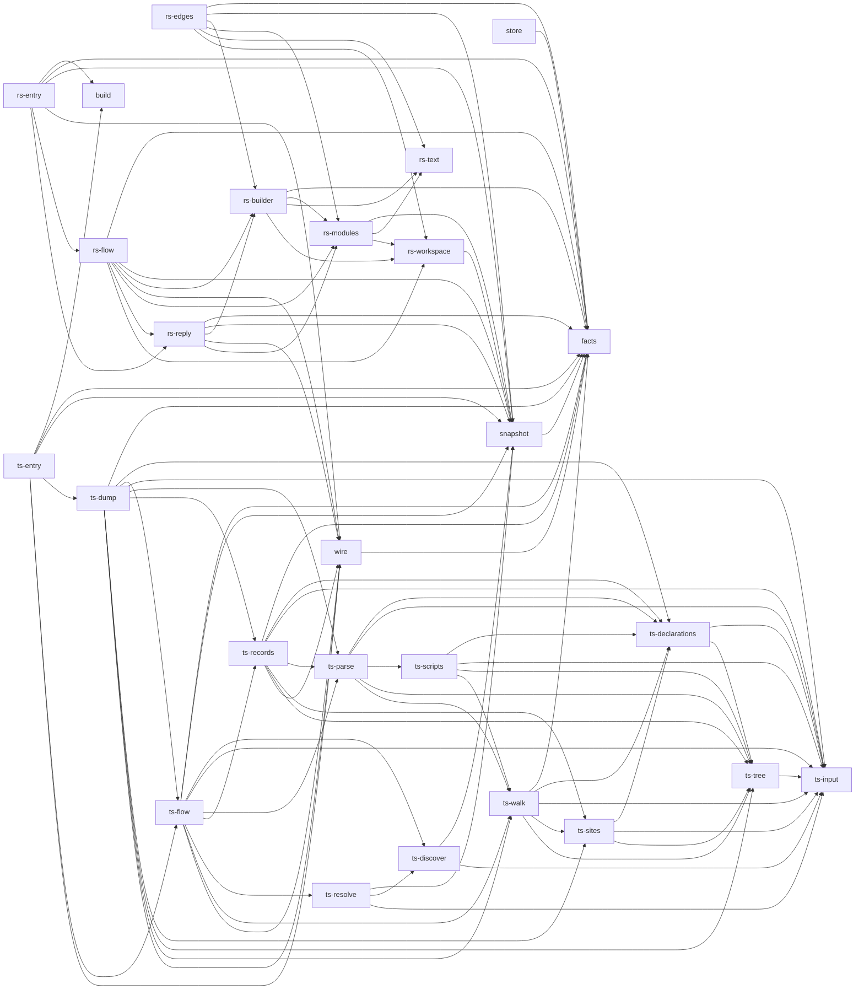

# The native workspace

The Rust workspace in `native/` holds the collectors that read source for Archkeel.
Archkeel checks this workspace with its own Rust collector and the contract in
`native/architecture-contract.json` ([AD-335](decisions/ad-335-archkeel-checks-the-rust-of-native-with-its-own-contract.md)).
Run `make self-validate-native` to check it.

The contract has two levels. The crates are the base (`facts`, `wire`, `snapshot`, `store`, `build`). Each
collector crate is split into components by responsibility, and an arrow points down only:
the entry calls the flow, the flow calls the parts (discover, parse, resolve, records), and
the records are the only place that builds facts. Rule `NATIVE-REQUIRES-COMPLETE` allows only the
arrows in the contract, and rule `NATIVE-NO-MODULE-CYCLES` forbids a module cycle. The module cycle
of `archkeel-facts` (macro bodies, [#954](https://github.com/rapiddweller/archkeel/issues/954)) is
out of scope until its fix merges. The old layer file and its test are removed (AD-327): a declared
Cargo dependency that no module uses is a crate edge, and the contract rejects it.

| Crate | Role | Uses |
|---|---|---|
| `archkeel-wire` | The collector wire: requests, replies and source identities. | `archkeel-facts` |
| `archkeel-snapshot` | The one owner of snapshot reads: POSIX paths, contained reads, the symlink rule and the size limit. | `archkeel-facts` |
| `archkeel-facts` | The one typed definition of each collector fact (AD-345). | no crate of the workspace |
| `archkeel-store` | Validates a reply once, keeps the facts and writes `architecture.json` (AD-346). | `archkeel-facts` |
| `archkeel-build-support` | The helper that the `build.rs` of each collector calls: the digest of the sources. | no crate of the workspace |
| `archkeel-typescript-collector` | Reads TypeScript source. | `archkeel-wire`, `archkeel-snapshot`, `archkeel-facts`, `archkeel-build-support` |
| `archkeel-rust-collector` | Reads Rust source. | `archkeel-wire`, `archkeel-snapshot`, `archkeel-facts`, `archkeel-build-support` |

A collector crate never uses another collector crate. Only a collector crate uses a parser crate.
Clippy, `cargo deny` and the file size rule stay outside the contract
([AD-327](decisions/ad-327-rust-architecture-rules-are-measured-in-the-gate.md)).

<!-- archkeel-component-graph -->

