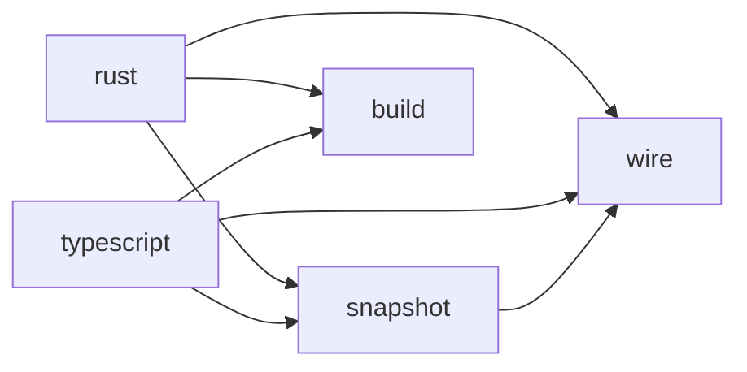

# The native workspace

The Rust workspace in `native/` holds the collectors that read source for Archkeel.
Archkeel checks this workspace with its own Rust collector and the contract in
`native/architecture-contract.json` ([AD-335](decisions/ad-335-archkeel-checks-the-rust-of-native-with-its-own-contract.md)).
Run `make self-validate-native` to check it.

| Crate | Role | Uses |
|---|---|---|
| `archkeel-wire` | The collector wire: requests, replies and source identities. | no crate of the workspace |
| `archkeel-snapshot` | The one owner of snapshot reads: POSIX paths, contained reads, the symlink rule and the size limit. | `archkeel-wire` |
| `archkeel-facts` | The typed facts of protocol 10 (planned, no code yet). | no crate of the workspace |
| `archkeel-store` | Validates facts once and keeps them (planned, no code yet). | `archkeel-facts` |
| `archkeel-build-support` | The helper that the `build.rs` of each collector calls: the digest of the sources. | no crate of the workspace |
| `archkeel-typescript-collector` | Reads TypeScript source. | `archkeel-wire`, `archkeel-snapshot`, `archkeel-facts`, `archkeel-build-support` |
| `archkeel-rust-collector` | Reads Rust source. | `archkeel-wire`, `archkeel-snapshot`, `archkeel-build-support` |

A collector crate never uses another collector crate. Only a collector crate uses a parser crate.
Clippy, `cargo deny` and the file size rule stay outside the contract
([AD-327](decisions/ad-327-rust-architecture-rules-are-measured-in-the-gate.md)).

<!-- archkeel-component-graph -->

