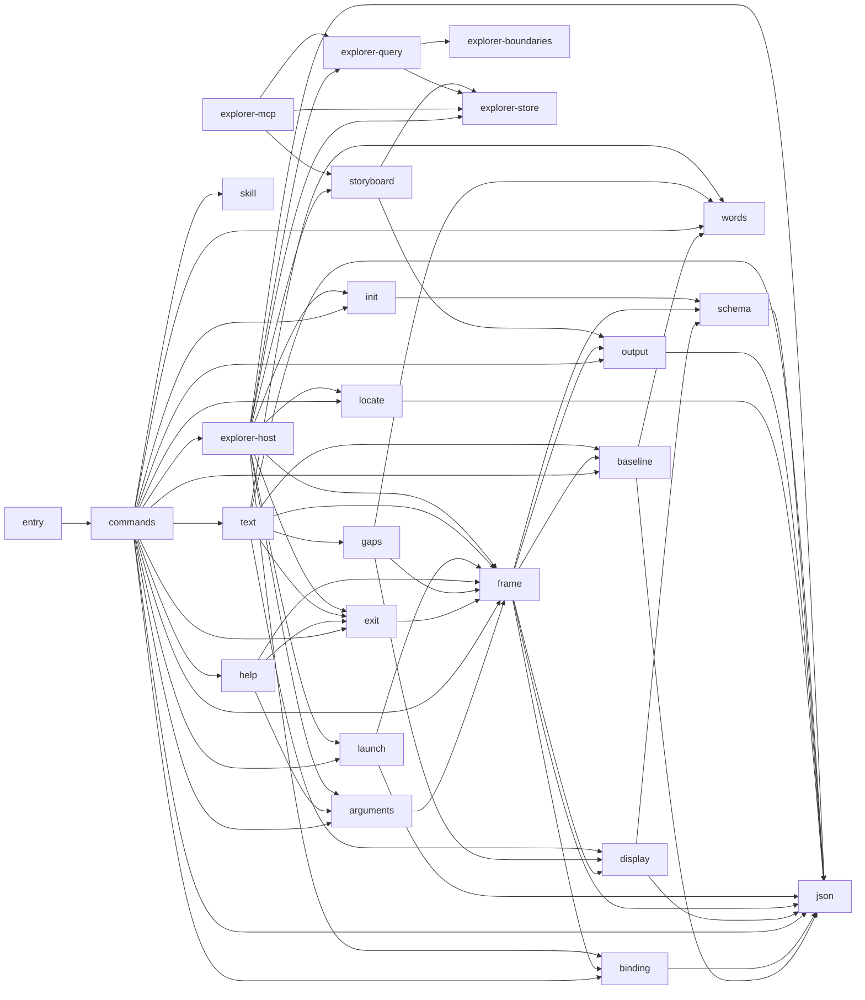

# The Python shell

The Python shell in `src/archkeel` starts the core binary and prints its frame. It decides nothing
([AD-432](decisions/ad-432-the-rust-core-is-the-only-decision-path.md)).
Archkeel checks the shell with its own core and the contract in
`docs/architecture/target/shell-contract.json` (AD-478). Run `make self-validate-shell` to check it.
`make self-validate` checks the shell and `native/`. The shell check passes only when all rules PASS,
no gap exists and the exit code is 0 (AD-1064).

## Parts

| Part | Modules | Task |
|---|---|---|
| `entry` | `archkeel`, `archkeel.cli`, `archkeel.cli.__main__` | Start the command line and return the exit code. |
| `commands` | `core_only`, `core_init` | Send the scan identity, print the frame, map the status to an exit code. |
| `arguments` | `core_arguments` | Read the command line into typed options and refuse by name what this line does not serve (AD-596). |
| `locate` | `core_binary` | Find the core binary of this install. |
| `launch` | `native_scan` | Build the scan request, start the core and return its bytes. |
| `frame` | `core_frame` | Read one frame into typed values. The only part that reads a verdict. |
| `display` | `core_evidence`, `core_explain`, `core_topology` | Decode evidence, the explain part and topology as display values. They give no verdict. |
| `baseline` | `core_baseline` | Read the baseline part of a frame and copy the exit code that the core decided (AD-546). |
| `binding` | `core_binding` | Bind a frame to the request identity and the contract file bytes. |
| `output` | `core_output` | Read the presentation of the core and write the received bytes to one file. |
| `json` | `core_json` | Checked readers and the shared error type. |
| `schema` | `core_schema` | Check a frame against the one schema that the core generates from its types (AD-596). |
| `words` | `core_words` | Say in plain words what a machine word means; strip internal numbers from a message (AD-632). |
| `exit` | `core_exit` | The one exit table and the exit code of one run. |
| `text` | `core_text` | The text of a run for a person: header with exit code and reason, then problems, violations, grouped causes. |
| `gaps` | `core_gaps` | The lines of the gaps of a scan: grouped by cause with a count and one example each, and the packages that were not found. |
| `help` | `core_help` | The help of the tool and of each command. |
| `skill` | `skill` | Install the coding-agent skill. |
| `init` | `init_draft`, `init_areas`, `init_binding` | Draft `archkeel.toml`, a first contract and its document from the folder layout and manifests: one configuration, or a system with one part for each language area and the interface of a stated PyO3 binding (AD-626, AD-638, AD-660, AD-784). It reads no source and writes only missing files. |

An arrow points down only. The entry calls the commands, the commands call the other parts, and
no part calls up. Rule `SHELL-REQUIRES-COMPLETE` allows only the arrows in the contract.
`SHELL-NO-*-TO-FRAME` rules name the parts that must not reach the verdict reader.
`SHELL-ONLY-*` rules give each standard-library door (process, arguments, configuration file,
temporary file name, install layout, trace) an explicit owner. The shell uses the standard
library. `SHELL-ONLY-EXPLORER-MCP-USES-FASTMCP` permits FastMCP in the optional MCP entry.

The shell starts the core as a process. That is not an import, so no rule can name the edge
from the shell to the core. `SHELL-ONLY-LAUNCH-STARTS-A-PROCESS` keeps it in one module.

## Rules that the core cannot say today

- A rule that forbids a library that no module imports (`ast`, `tokenize`, `inspect`): the rule
  selects no module, and that makes the scope of the whole run incomplete. Such a rule cannot PASS.
- `external_dependency_scope` with no allowed source: the contract is refused.
- A rule that a module reads no frame field, or builds no `Status` value: there is no rule kind
  for the use of a name inside a function.
- A rule that the shell never imports the Rust crates: they are not Python modules, and a
  mixed-language contract tree is refused (see AD-478).

<!-- archkeel-component-graph -->

