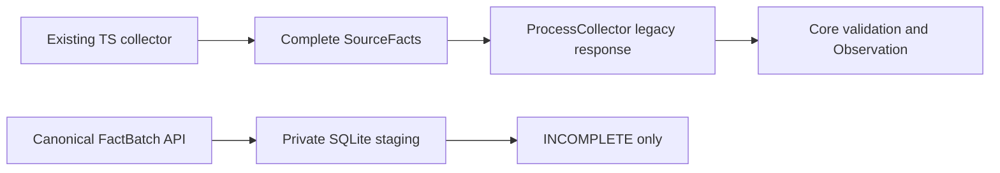
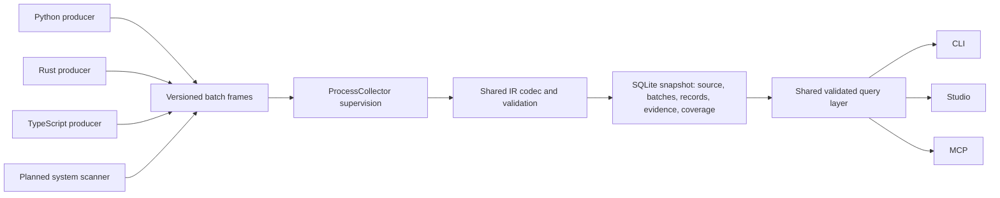

# Streaming analysis pipeline

This diagram separates the current store slice from the planned streaming path.

## Implemented

The IR owns versioned canonical fact batches. The private SQLite stager checks frame structure,
global IDs, evidence references, frame/snapshot byte limits, and the database page limit. Published
staged snapshots remain `INCOMPLETE`; abort preserves earlier snapshots. This path is not connected
to a collector, process transport, CLI, Studio, or MCP. Existing collectors still build complete
`SourceFacts`, and Core still validates and assembles complete `Observation` values.

## Target under development

Language producers should send bounded, versioned batches through the existing supervised
`ProcessCollector` boundary. The shared Core owns trust validation and query semantics. SQLite is a
derived snapshot with source identity, batches, records, evidence, and coverage. CLI, Studio, and
MCP should use one shared query interface after full validation. A system scanner is planned as
another producer. These producer, transport, validation, query, and consumer connections are not
implemented by the current store slice.

The current SQLite slice cannot publish a validated snapshot or certify complete coverage. Syntax
and cross-file producer indexes remain in memory. No end-to-end memory or speed claim is made.
