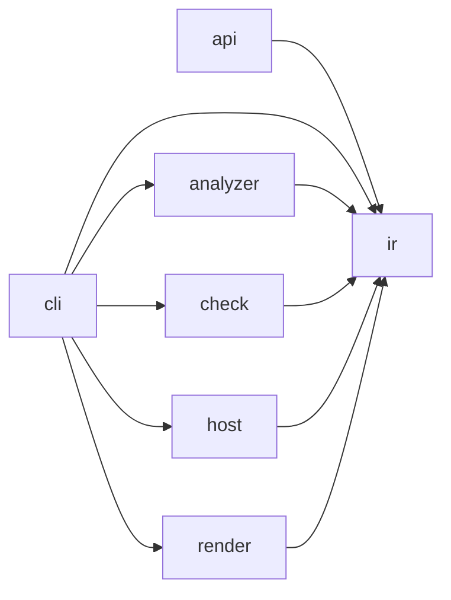

# Compact Target definition scope

Status: contracts, owner corrections and native evidence foundations implemented;
full architecture acceptance remains open.
Baseline: `006bc089852a80bd60f8723e2c4b4f9bfb6d1210`.
The earlier experiment at `2378c9006390f40d63f2948a0eff4ed0e3f895b4` is retained
on `feat/detailed-target-architecture-experiment`; PR #604 is rebuilt from the baseline.

## Goal and scope

Implement the compact target contracts and align production code with them in
PR #604, preserving supported behavior, conservative evidence and all existing
rule meanings. Contract definition is the first milestone; complete code alignment
and validation in the same PR are the end goal. The two implemented boundary
refactorings are a milestone, not evidence of complete architecture conformance.
Merge only after the complete acceptance below; the user has authorized merge and release.

The user selected source-declaration semantics: compare direct declarations and
traceable source bindings, without claiming stability against later runtime effects.
Runtime behavior is tested separately. Missing source, ambiguous bindings and
unsupported declaration transformations remain UNKNOWN. Checker input authentication,
bounded execution and cleanup remain required operational guarantees.

Keep the baseline's root and eight nested Python contracts. Add one canonical
[browser contract](browser-contract.json) for the previously textual browser owners
and ports. The current evaluator accepts one language profile per observation;
one separate contract avoids copying Python policy or introducing profile projections.
Acceptance requires both native results. Refine existing owners and actual crossing
ports; do not add a parallel inventory or prescribe a package migration. Preserve
required entities and all allowances except the explicitly accepted Mapping change;
ratchet budgets downward only after their reductions are proved.
The original 59 positions are reconciled below; required proof gaps remain open.

Basis: [AD-17](../decisions/ad-17-archkeels-own-target-names-its-quality-goals-and-ir-holds.md),
[adapter target](../language-adapter-target.md) and
[AD-213](../decisions/ad-213-renderer-responsibility-boundaries.md).
Responsibility refinements and new constraints are agent decisions. Existing
permission authorship remains recorded in its original entries. Existing imports identify consumers;
they do not authorize dependencies. The previous implementation does not approve
its own design decisions.

## Responsibilities

Keep the seven established outer owners and their permitted directions:

| Owner | Owns | Excludes |
| --- | --- | --- |
| `api` | Read a saved report through the stable external Python API. | Rule decisions and a second decoder. |
| `cli` | Decode arguments/configuration, inject adapters, publish returned files. | Parsing source, evaluating rules and duplicating workflows. |
| `analyzer` | Collect source facts through bounded language processes. | Reading architecture policy and executing the analyzed project. |
| `check` | Authenticate inputs, assemble observations, apply declared rules. | Rendering and selecting concrete collector/forge implementations. |
| `host` | Acquire forge evidence and disclose authentication/ordering gaps. | Architecture verdicts and acceptance decisions. |
| `ir` | Typed values, strict codecs, pure evidence derivations. | I/O, except the existing checker-source identity boundary. |
| `render` | Explain results in HTML, terminal output and offline scenes. | Re-evaluating rules and treating display filters as proof. |

Refine the existing inner owners at these seams:

| Seam | Responsibility and dependency direction |
| --- | --- |
| IR facts / protocol / codecs | Facts describe measurements; protocol owns process envelopes; codecs validate and convert bytes. Codecs consume typed values and do not acquire inputs or decide verdicts. |
| IR governance | Distinguish local value invariants, wire conversion, graph/metric derivation and projections. Pure command-view preparation remains part of result composition ([AD-238](../decisions/ad-238-command-view-preparation.md), [AD-239](../decisions/ad-239-codec-format-owners.md)); it does not evaluate policy. Do not mandate seven new physical packages. |
| Check inputs / declarations | Inputs acquire immutable source/runtime/host evidence; declarations authenticate contract/UML intent. Neither decides rule verdicts; declarations do not depend on evaluation. |
| Check observation / evaluation | Observation assembles facts and intent once; evaluation applies rules. One evaluator per rule; no permissions inferred from imports. |
| Check regression / workflows / validation | Regression compares bound revisions; workflows coordinate commands; validators return diagnostics. Shared operations sit below command peers; no forwarding service layer. |
| Type-boundary evaluation | Interpretation depends on binding lookup; assessment consumes interpreted types and exact allowance matching. Keep recursive interpretation together and reuse one named-type resolver. |
| Python source / binding / member proof | AST and lexical identity precede binding proof; member proof consumes proven identities. Specialist collectors emit facts, not architecture policy. |
| Dart / TypeScript | Keep their established input, syntax, configuration/snapshot, resolution and collection owners. Split only for an independently useful operation. |
| CLI arguments / installer / composition | Decode input, install requested resources and wire dependencies respectively. Installation does not evaluate repository policy. |
| Render payload / summary / HTML / terminal | Payload projects evidence; summary explains results; HTML and terminal compose output. Payload and summary do not depend on HTML. |
| Browser projection / layout / Explorer | Projection builds scenes; layout places/routes them; Explorer owns DOM, navigation, focus and input lifetime. Generated runtime and vendored ELK are outputs/dependencies. |

A new `inside` boundary needs an independent change reason, a crossing worth
constraining and a useful negative control. File size alone does not justify it.
Keep decision ownership at one contract level; do not copy every child API upward.
Compatibility bridges constrain migration, not the permanent responsibility model.

## Reviewed physical scope

The recursive structure review inventories all 146 maintained Python modules,
including initializers, plus authored browser assets. It checks module responsibilities,
imports, declared owners and direct I/O sites; it does not prove every function body
correct. Counts below exclude initializers. A large count triggers review, not a split.
Empty experiment directories are not source packages.

| Reviewed subtree | Direct modules / subpackages | Actual review depth and decision |
| --- | --- | --- |
| `api.py` | 1 / 0 | Read the complete reader path through file read, strict decoding and violation projection. Keep this stable I/O edge; exact import ports and signature are native intent. |
| `analyzer` | 4 / 3 | Traced collector setup, request/response binding, bounded pipe exchange, deadline and POSIX process-group cleanup; Windows helper internals remain structurally reviewed. Keep runtime/bootstrap above isolated language adapters. |
| `analyzer/python` | 18 / 0 | Traced collector assembly, definition contexts and the closed callable-signature proof into symbol/call evidence; other specialist bodies structurally reviewed. Keep source/binding/member foundations below isolated collectors. |
| `analyzer/dart` | 6 / 0 | Structural review plus snapshot/syntax/resolution/collection declarations and ports; no new complete parser/resolver semantic review. Keep the five existing owners; file length alone does not justify a split. |
| `analyzer/typescript` | 7 / 0 | Structural review plus input/configuration/syntax/resolution port declarations; no new complete parser/resolver semantic review. Keep these independently changing owners. |
| `check` | 18 / 2 | Traced shared repository observation, UML authentication, report/saved-report boundaries and Check input ordering; remaining workflow helpers structurally reviewed. Keep shared observation below command consumers. |
| `check/evaluation` | 8 / 0 | Reviewed coverage composition/profile-rule callers and call-owner binding/target proof. The recursive interpreter has separate source/body permission controls. `evaluate` composes coverage and `rules` owns availability; no coverage module is needed. |
| `check/validation` | 8 / 0 | Read public validation/error entry and containment handling; diagnostic modules structurally reviewed. Keep focused diagnostics under validation orchestration. |
| `cli` | 5 / 0 | Read parser construction, nominal input targets and adapter wiring; remaining dispatch/configuration bodies structurally reviewed. Keep typed choices in arguments and parser/configuration I/O in composition. |
| `host` | 1 / 0 | Read the complete environment/identity/subprocess/decode/record path. Keep forge acquisition outside Check; fail bounded requests through typed ordering errors. |
| `ir` | 52 / 0 | Structural/import/I/O review of every module; read non-use candidate derivation and codec/projection ownership decisions. Keep focused flat formats, values and pure derivations (AD-238/239); no speculative package migration. The digest reader is the documented I/O exception. |
| `render` | 6 / 0 | Read exact public ports and existing payload/summary direction constraints; HTML composition bodies structurally reviewed. Keep payload/summary below HTML and terminal. |
| `render/assets` | 9 authored JS/TS; 2 CSS | Read projection/layout ports, layout validation, Explorer async generation handling and their existing browser controls. Other UI paths structurally reviewed; Python rules do not scan these assets. |

Browser sources use named ES imports and exports across the same nine selected
JavaScript identities and original exact port restrictions. Compatibility globals
remain available; internal dependencies use lexical bindings. The separate Python
scan retains every maintained module. Native source witnesses prove unique direct
named exports and same-name export clauses, including aliased named imports.
Defaults, namespaces, re-exports, missing and competing bindings cannot prove exact
ports. Legacy global reads remain conservative in modules too.

Generated assets are `flow.runtime.js`, `report-graph-protocol.js`, its
`report-graph-protocol.types.d.ts` companion, `report-graph-vocabulary.ts` and
`explorer.runtime.js`. Flow, `report-graph-schema.ts` and canonical Python enums
remain their authored sources. `make browser-runtime-check` verifies the Terser
publication witness and the pinned offline bundle. `make browser-graph-check`
checks protocol/declaration generation and strict graph-scene/deviation consumers.
It does not typecheck all Explorer JavaScript. Installed reports need no Node or
network; the locked ELK package must match the existing canonical vendored bytes.
Those vendor bytes load unchanged before the first-party bundle. Its build-only
bridge binds the exact layout import to the existing ELK publication; it proves
no vendor effects. The original 2 MB small-report and 400 KB nonvendor limits remain.

Existing browser controls cover projection/input preservation, duplicate/nonfinite
layout rejection, async generation ownership, retry, interactions and offline CSP.
Actual-source PASS, forbidden-port FAIL, missing/ambiguous-source UNKNOWN and stale
output rejection are separate obligations. Classic UMD declarations retain source
identity after opaque factory calls, but their effects remain UNKNOWN. The bundle
is derived output, not a replacement source scope or a claim of runtime purity.
See [AD-242](../decisions/ad-242-explicit-browser-module-ports.md).
Failure/lifecycle meanings in port responsibilities likewise need behavior tests beyond signatures.

The Host acquisition contract bounds the `glab` request to 30 seconds, decodes UTF-8
explicitly and exposes timeout, decoding and execution failures as `OrderingError`.
Environment/commit validation precedes execution; Check owns acceptance of ordering
evidence. `test_host_gitlab.py` verifies these failure paths independently of native
signature checks. Captured output is still buffered; no output-size bound is claimed.

At the clean `173f5482` evidence revision, the 58 required UNKNOWNs comprise 30 type
positions, 20 facade routes and eight UML assessments. Fifteen routes reach unscanned
external exports (including pathlib, contextlib and Rich); five remain local alias
routes. Their public availability is not proof of their type shape. The native control
`test_boundary_types_chain_proof.py::test_unscanned_public_alias_is_unknown_beside_a_typed_function`
preserves this distinction. No export narrowing, scan reduction or allowance change
can close these required gaps; the final candidate must be measured again.

Replaying the actual checker and collector from `60eed561` reproduces all 59 original
required coordinates and record IDs (source digest
`c2e6ee4714eedba8b2b62c476ecdab5be428806b5fcac521417dca82a4efa366`).
The reconciliation is **59 − 2 + 1 = 58**: 57 positions remain; two abandoned
experimental constant targets (`OPAQUE_NATIVE_REASONS`, `BROAD_BOUNDARY_TYPES`)
left the compact scope; the retained report facade adds one `JsonValue` return
position. None is an evidence improvement. The 30 type positions are 29 alias
positions and one inherited `Mapping` surface; the other groups are 20 facade
routes and eight incomplete member inventories. Binding/source identity is not
static namespace proof. At that revision, external declarations and browser script-global
binding were native capability gaps. The extensions below address them without whitelists.

No deletion follows from the unreferenced-symbol projection. It excludes known dynamic
interfaces and declared exports but cannot prove external or runtime non-use. The
report facade and codec aliases remain compatibility obligations; no dead-code removal
is claimed by this structure review.

## Interfaces

Specify exact crossing symbols, typed inputs/outputs, failure behavior and
compatibility in their authoritative native entries. These are the required seams:

| Crossing | Interface obligation |
| --- | --- |
| External caller → API | `load_violations(Path) -> tuple[ViolationRow, ...]`; preserve `ViolationRow`, `ViolationFingerprint` and existing read/decode errors. |
| CLI → Check | Existing `run_report`, `run_saved_report`, `run_check`, `run_validate`, `run_init`; retain `RunResult`, canonical bytes and `FilesToWrite` outputs. Distinguish invalid input, violations and missing evidence. |
| Check workflows → observation / Host ports | Existing `Analyzer` is the workflow observation callable returning `ObservationResult`; `Host` returns records or ordering evidence/error. Check does not import concrete adapters. Unauthenticated evidence remains unproven. |
| Check observation → injected collector | Check-owned `Observer` calls `SourceCollector.collect(CollectionRequest) -> SourceFacts | CollectionError`. CLI injects the collector implementation; retain timeout/output bounds, response validation and child cleanup. |
| CLI → Render | `render_architecture_pages(RunResult, bytes, *, repository: str, architecture_href: str)` returns ordered immutable filename/bytes pairs after one strict decode/projection. Terminal consumes the existing typed result/summary. Neither changes verdicts. |
| Check producer / saved reader → IR | `rule_evaluation_binding_id(str, Record, str) -> str` binds the inventory, full claim and observation version through one pure operation. It detects inconsistent evidence; it does not authenticate artifacts. |
| Browser Explorer → projection/layout | Reuse typed scene/layout ports. Specify shared state and cancellation ownership; no new route codec or state model without a demonstrated need. |

The paired renderer prepares the entire HTML set before the caller writes it.
Malformed observations fail before publication; atlas pages additionally require
a matching authenticated Core projection. Filtered or no-projection output keeps
legacy behavior. Filesystem writes remain caller-owned. Existing single-page APIs
remain compatible; paired and legacy entry points emit identical bytes for the
same inputs and assets. Alex accepted the exact two-name-to-one migration to
`archkeel.render.html:render_architecture_pages`: CLI → Render falls from eight
accepted names to seven, at the unchanged ceiling seven (AD-99).

`FilesToWrite` deliberately replaces its Python `Mapping` API with a frozen value:
`entries: tuple[tuple[str, bytes], ...]`. Producers retain insertion order and exact
bytes. Consumers iterate `.entries` or use `dict(files.entries)` for lookup;
indexing, mapping methods and mapping equality are no longer supported.

Use exact `public` and dependency `through` entries for governed crossings.
Keep field/signature details in one authoritative entry, not a parallel ledger.
Planned interfaces stay planned; missing implementations cannot prove PASS.
Even accidental export narrowing needs separate caller/compatibility evidence.

## Rules, quality and evidence

| Criterion | Definition acceptance |
| --- | --- |
| Maintainability | One concrete owner per governed module. Each new boundary names its change reason, ports and forbidden crossing; no generic "own this boundary" descriptions. |
| Extensibility | Replace collectors/renderers through existing typed ports. Keep language and presentation policy out of Check; no speculative framework. |
| Determinism / reliability | Bind input/tool identities; preserve canonical results, strict decoding, bounded execution, cleanup and conservative missing/ambiguous evidence. |
| Compatibility | Preserve external API, CLI, wire identities and rule/allowance meanings. Later selector moves require a bound migration. |
| Performance | Define comparable workloads and environments; measure time, memory, bytes and first interaction for affected paths. No speed improvement follows from moving a function. |

Reuse `complete_assignment`, `complete_requires`, `interface_boundary`,
`no_component_cycles` and existing signature/placement/UML rules at justified
levels. Preserve constraints with positive, negative and missing-evidence controls.
UNKNOWN is not PASS; do not raise budgets to adopt the target. Reconcile any new
measurement scope separately from evidence improvements.

Keep authored intent and a short result in Git. Generate full file/hash/symbol
inventories, call graphs and raw logs as revision-bound artifacts. Record their
input/tool identities without duplicating contract payloads in migration ledgers.
Dead-code candidates need caller, test, export, entry-point, dynamic-use and
compatibility evidence. No reference found is UNKNOWN, not deletion authority.
Misplacement findings name the current owner, target owner and offending crossing.

## Native evidence extension

`PythonProviderCollector` obtains a bounded V4 import survey through `ProcessCollector`,
captures provider bytes inside that bounded child, then requests full collection
(V5 with or without providers). The parent authenticates the complete captured inventory
without provider-file I/O. Both passes share one deadline and the existing output bounds.
Non-provider inputs and producer identities must match; records from different passes are never merged.
The survey retains all selected files, digests and parse gaps. Core rejects its partial
sections as a complete Python observation; the wrapper always returns the final collection.
V4 binds provider bytes and hashes in the request; V5 retains those fields while using
compact lossless source rows. V1–V4 wire formats and custom collector wiring retain their
existing behavior. Separate resolution inputs never become governed
Files, symbols or coverage. Exact source-binding receipts live with observation proofs,
not typing debt. They prove a direct export identity, not member shape or effects.
Default Python composition uses this adapter; explicit collector commands and other
languages keep their existing process adapter. A receipt identifies one unique direct
source declaration. It does not require proving unrelated bodies or import side effects.
Missing or ambiguous provider/package paths, competing bindings and unsupported
declaration transformations remain UNKNOWN. An unrelated ineligible provider cannot
erase another provider's source witness. Captured bytes retain their provenance.

Direct and reexported callable signatures require native source-binding and decorator
proofs. Every reexport hop needs its own concrete declaration; runtime member-stability
flags do not replace or invalidate that source identity. Missing declarations,
competing bindings and unproven decorators retain the affected positions as UNKNOWN.
A provider receipt cannot bypass these checks.
Symbol collection reuses immutable module proofs only within one invocation; a later
collection must observe changed bindings. No persistent proof cache is introduced.

The Source owner shares one lexical index per parsed module. Its AST identity,
source text, relative path and module name bind reuse; changed inputs rebuild it.
Source retains the AST visitor through its standard base type; the lexical owner
checks the concrete index before reuse, keeping the module dependency acyclic.
Import aliases remain live inputs to lookup. The cache stores compiler structure,
not lookup results or binding proofs, and lives only as long as the parsed snapshot.
The ordinary `LexicalScopes` constructor still creates a fresh index.

Synchronous `contextmanager` declarations have a separate native signature proof.
It binds the factory, wrapper, metadata updater and complete supported base-class
surfaces to captured source. Closed CPython 3.11 to 3.14 witnesses cover native
`partial` and the successful `_abc` import branch; unsupported variants stay UNKNOWN.
The proof references its own function evidence and separate provider support.
Original parameters, returns and decorator flags remain unchanged. Only the exact
proven return receives the effective wrapper/payload interpretation; its payload
uses the existing type interpreter. UML signatures continue to show source declarations.
The roughly 1,000-line recognizer is a new native capability with permanent profile
maintenance cost. It does not prove arbitrary decorators or runtime cleanup.
Progress lifecycle behavior has separate execution tests.

Existing member/effect facts remain conservative compatibility data. They cannot
substitute for source-declaration proof or turn it into a runtime guarantee. Recursive
aliases and inherited external interfaces still need their own bounded source evidence.

The TypeScript adapter records JavaScript script-global source dependencies separately
from lexical imports and runtime effects. Existing native rules evaluate those crossings.
Unique direct declarations, factory return members and namespace bindings need their
actual source witnesses; they do not prove runtime availability or call targets.
Missing/competing sources, explicit alternative bindings and unsupported transformations
retain UNKNOWN. All selected writers participate, including writes through direct aliases.
Read-only aliases use precise member dependencies only when their static uses are
exhaustive; unsupported uses retain the broad dependency and uncertainty.
Standard globals require a closed language/library environment. Vendor publications
require a complete authenticated provider inventory, an explicit classic-browser host,
the actual UMD envelope and existing package/hash provenance. Host contradictions veto
that proof. Real opaque effects remain bound runtime-effect gaps; Core authenticates
their own source facts, evidence, profile and replay digest. Runtime calls stay conservative.
Captured UMD factory writes exclude competing standard globals or vendor publications.
An unbounded global write target or unproved factory call cannot certify that namespace.
Factory calls and constructors retain the authenticated publication declaration, but no
callee or argument effect proof is inferred from an Object/Reflect spelling.

The user approved exactly one additional CLI-to-Analyzer coupling name:
`archkeel.analyzer.python.collect:PythonProviderCollector`. It keeps Python-specific
acquisition in its adapter and composition in CLI. Its declared coupling ceiling is
two names: `ProcessCollector` and `PythonProviderCollector`. All other budget ceilings
remain unchanged; proved reductions use the ordinary downward ratchet.

## Code alignment and acceptance

- Observation derives exposed public types once through the existing evaluator;
  declaration projection consumes the mapping without importing evaluation.
  Uncertain signatures retain publisher/mount-specific possible uses; missing
  callable proof cannot justify declaring their named types unused.
- UML authentication belongs to observation. Shared repository observation lives
  there, below onboarding/report/validation. The existing report callable keeps its
  signature and delegates there; an import alias silently dropped its five governed
  type positions, so the facade is required for compatibility and unchanged scope.
- CLI ownership, dependencies and component cycles are closed by native rules.
  The onboarding-to-report prohibition selects exact modules (contract 3.4),
  rather than accidentally prohibiting every import within their shared owner.
- Keep baseline rules and required entities. The accepted `FilesToWrite` API
  replacement removes its obsolete constructor-map allowance; retain every other
  original allowance and executable rule field.
  Bind ownership/port migration through native widening review; do not hide new
  findings in the debt baseline or increase its budgets.
- Run `make target-contract-check`, relevant behavior/negative controls, native
  validation/report, lint/type checks and installed-package smoke checks. Inspect
  diagnostics, coverage, violations and UNKNOWNs separately from exit status.
- Update the existing draft PR with the final diff, rationale and exact evidence.
  Full inventories and raw logs stay revision-bound artifacts, outside Git.

## P0 scope and maintenance experiment

[#601](https://github.com/rapiddweller/archkeel/issues/601) directly affects these
explicit nested contracts. The existing `fixtures/H-uml-dart` supplies eight source
files and two nested boundaries; three isolated edits exercise existing native
focused projections and validation without adding a generator or policy format.

| Edit | Logical edit files | Focused / full architecture projection bytes | Correctness control |
| --- | ---: | ---: | --- |
| Rename the pricing module within its owner | 3 | 11,779 / 20,103 | Existing root dependency prohibition still rejects the forbidden import. This does not prove migration between owners. |
| Rename persistence API `findById` to `find` | 4 | 9,231 / 20,110 | Return-type drift fails against the new target; changing both nested API targets must also require an amendment. |
| Remove unused pricing permission | 1 | 9,745 / 20,059 | The same import passes before tightening and fails after it. |

The API edit exposed a real false acceptance: the historical comparison combined
nested owners/rules but omitted nested declarations. `validate --against` now
compares declarations at each mount through the existing widening classifier,
preserving scoped identity, UML versions and native rename handling. A matching
bound amendment accepts the change; stale intent fails. The existing pure
`renamed_contract` operation is published through IR instead of duplicating it.
Unchanged/format-only intent remains neutral. Physical UML paths still need an
amendment when a recognized package rename does not normalize them.
Rename candidates must remain valid in every historical mount. A normalization
that collides two planned targets is rejected as a rename; the ordinary comparison
still reports the transition and accepts only its bound amendment.

Five alternating CLI comparisons on the same eight-file fixture reproduce API
false acceptance before the fix and two scoped findings after it. Median wall time
is 0.495 s before and 0.487 s after; overlapping spread supports no speed claim.
This is not a large-tree or memory benchmark.
The collision repair also preserves a valid recognized rename in five alternating
pairs (median 0.504 s before / 0.502 s after, no diagnostics or widenings). Both
measurements have overlapping spread and make no speed claim.

#601 remains partial: conservative declaration diagnostics are not a complete
semantic diff. The eight-source nested Dart fixture now exercises an actual owner
move: three logical edit files, unchanged root publication, native Target PASS,
unamended widening rejection and preserved forbidden-import rejection. Its focused
and whole saved review inputs measure 11,180 and 18,907 bytes respectively; these
are maintenance measurements, not runtime speed claims. A bounded maintenance
example ships in the canonical skill, CLI asset and generated plugin with byte-parity
controls. [#600](https://github.com/rapiddweller/archkeel/issues/600) uses this
self-review and reusable review method as evidence; its full semantic scenarios
and delivered-report navigation controls remain open.
[#602](https://github.com/rapiddweller/archkeel/issues/602) owns the broader native
capability and checker-retirement work. No P0 is closed by this PR's partial evidence.

## Validation

Accept only a frozen candidate with complete scope, zero required UNKNOWNs,
no diagnostics or violations, and passing relevant Core/report/browser,
packaging and final-head CI checks. Earlier receipts do not validate later code.
The 120-second report ceiling and 52 typing-position ceiling remain unchanged.
Earlier native integrations tightened unresolved calls from 837 to 832. After
eight additional Source/browser calls, Alex expressly authorizes up to 840.
The native baseline records that approved ceiling, bound by the amendment.
The final single-pass publication index measures 840; its chained list append
remains unresolved. All other debt budgets and rules remain unchanged.
Microbenchmarks do not establish whole-report acceptance.

Preserve every original field of 921 UML entities, exclusions and 121 original
rules. The accepted Mapping replacement removes only its obsolete constructor-map
allowance and corrects the rationale. Nine Python contracts add four constraints
and 155 entities, including call ownership, its receipt-binding port, lexical index and paired rendering;
one separate browser contract adds five owners and one rule.
The original 59-to-58 scope reconciliation is not an evidence gain.

The target requires both `collect → collect_response → _exchange` edges. Native
positive and missing-edge controls prove the migration. Its bound amendment also
names the accepted Mapping API replacement and exactly approved provider and
paired-render port migrations.
The baseline ratchet reduces required UNKNOWNs from 58 to zero without
`--accept-new`; every other ceiling remains in force.

Exercise actual-source positive, forbidden-edge, missing-publication and
missing/unowned-file controls. Preserve stale/replayed evidence rejection and
real namespace/factory/hook mutation counterexamples. Source identity, native
creation, member stability and runtime effects require distinct proofs.
Independent Astra review covers maintainability, extensibility, performance and
reliability; resolve material findings before acceptance.

Record revision-bound LOCAL VERIFIED and CI-ONLY VERIFICATION evidence in the PR.
Retained runtime gaps and unresolved calls are not a runtime guarantee. Required
UNKNOWNs, missing scope or failed budgets prevent complete target acceptance.
