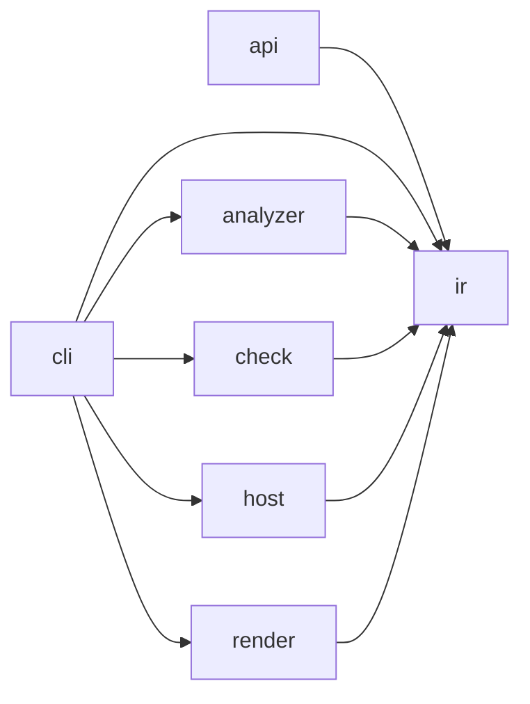

# Compact Target definition scope

Status: compact target and bounded refactoring; validation results are recorded below.
Baseline: `fd1c0c4b29cfa50da91a6adc7fb60e2b4601bba4` (current Main).
The earlier experiment at `2378c9006390f40d63f2948a0eff4ed0e3f895b4` is retained
on `feat/detailed-target-architecture-experiment`; PR #604 is rebuilt from the baseline.

## Goal and scope

Implement the compact target contracts and their bounded code refactoring in
PR #604, preserving supported behavior, conservative evidence and all existing
rule meanings. Contract definition is the first milestone; code alignment and
validation in the same PR are the end goal. Do not merge automatically.

Keep the baseline's root and eight nested contracts. Refine existing owners and
actual crossing ports; do not add a parallel source inventory or prescribe a
package migration. Preserve required entities, allowances and acceptance budgets.
The old 59-position UNKNOWN investigation is not claimed complete by this work.

Basis: [AD-17](../decisions/ad-17-archkeels-own-target-names-its-quality-goals-and-ir-holds.md),
[adapter target](../language-adapter-target.md) and
[AD-213](../decisions/ad-213-renderer-responsibility-boundaries.md).
Responsibility refinements and new constraints are agent decisions. Existing
permission authorship remains recorded in its original entries. Existing imports identify consumers;
they do not authorize dependencies. The previous implementation does not approve
its own design decisions.

## Responsibilities

Keep the seven established outer owners and their permitted directions:

| Owner | Owns | Excludes |
| --- | --- | --- |
| `api` | Read a saved report through the stable external Python API. | Rule decisions and a second decoder. |
| `cli` | Decode arguments/configuration, inject adapters, publish returned files. | Parsing source, evaluating rules and duplicating workflows. |
| `analyzer` | Collect source facts through bounded language processes. | Reading architecture policy and executing the analyzed project. |
| `check` | Authenticate inputs, assemble observations, apply declared rules. | Rendering and selecting concrete collector/forge implementations. |
| `host` | Acquire forge evidence and disclose authentication/ordering gaps. | Architecture verdicts and acceptance decisions. |
| `ir` | Typed values, strict codecs, pure evidence derivations. | I/O, except the existing checker-source identity boundary. |
| `render` | Explain results in HTML, terminal output and offline scenes. | Re-evaluating rules and treating display filters as proof. |

Refine the existing inner owners at these seams:

| Seam | Responsibility and dependency direction |
| --- | --- |
| IR facts / protocol / codecs | Facts describe measurements; protocol owns process envelopes; codecs validate and convert bytes. Codecs consume typed values and do not acquire inputs or decide verdicts. |
| IR governance | Distinguish local value invariants, wire conversion, graph/metric derivation and projections. Pure command-view preparation remains part of result composition ([AD-238](../decisions/ad-238-command-view-preparation.md), [AD-239](../decisions/ad-239-codec-format-owners.md)); it does not evaluate policy. Do not mandate seven new physical packages. |
| Check inputs / declarations | Inputs acquire immutable source/runtime/host evidence; declarations authenticate contract/UML intent. Neither decides rule verdicts; declarations do not depend on evaluation. |
| Check observation / evaluation | Observation assembles facts and intent once; evaluation applies rules. One evaluator per rule; no permissions inferred from imports. |
| Check regression / workflows / validation | Regression compares bound revisions; workflows coordinate commands; validators return diagnostics. Shared operations sit below command peers; no forwarding service layer. |
| Type-boundary evaluation | Interpretation depends on binding lookup; assessment consumes interpreted types and exact allowance matching. Keep recursive interpretation together and reuse one named-type resolver. |
| Python source / binding / member proof | AST and lexical identity precede binding proof; member proof consumes proven identities. Specialist collectors emit facts, not architecture policy. |
| Dart / TypeScript | Keep their established input, syntax, configuration/snapshot, resolution and collection owners. Split only for an independently useful operation. |
| CLI arguments / installer / composition | Decode input, install requested resources and wire dependencies respectively. Installation does not evaluate repository policy. |
| Render payload / summary / HTML / terminal | Payload projects evidence; summary explains results; HTML and terminal compose output. Payload and summary do not depend on HTML. |
| Browser projection / layout / Explorer | Projection builds scenes; layout places/routes them; Explorer owns DOM, navigation, focus and input lifetime. Generated runtime and vendored ELK are outputs/dependencies. |

A new `inside` boundary needs an independent change reason, a crossing worth
constraining and a useful negative control. File size alone does not justify it.
Keep decision ownership at one contract level; do not copy every child API upward.
Compatibility bridges constrain migration, not the permanent responsibility model.

## Interfaces

Specify exact crossing symbols, typed inputs/outputs, failure behavior and
compatibility in their authoritative native entries. These are the required seams:

| Crossing | Interface obligation |
| --- | --- |
| External caller → API | `load_violations(Path) -> tuple[ViolationRow, ...]`; preserve `ViolationRow`, `ViolationFingerprint` and existing read/decode errors. |
| CLI → Check | Existing `run_report`, `run_saved_report`, `run_check`, `run_validate`, `run_init`; retain `RunResult`, canonical bytes and `FilesToWrite` outputs. Distinguish invalid input, violations and missing evidence. |
| Check workflows → observation / Host ports | Existing `Analyzer` is the workflow observation callable returning `ObservationResult`; `Host` returns records or ordering evidence/error. Check does not import concrete adapters. Unauthenticated evidence remains unproven. |
| Check observation → injected collector | Check-owned `Observer` calls `SourceCollector.collect(CollectionRequest) -> SourceFacts | CollectionError`. CLI injects the collector implementation; retain timeout/output bounds, response validation and child cleanup. |
| CLI → Render | HTML consumes `RunResult` and optional `Observation`, returning bytes. Terminal consumes the existing typed result/summary. Neither changes verdicts. |
| Browser Explorer → projection/layout | Reuse typed scene/layout ports. Specify shared state and cancellation ownership; no new route codec or state model without a demonstrated need. |

Use exact `public` and dependency `through` entries for governed crossings.
Keep field/signature details in one authoritative entry, not a parallel ledger.
Planned interfaces stay planned; missing implementations cannot prove PASS.
Even accidental export narrowing needs separate caller/compatibility evidence.

## Rules, quality and evidence

| Criterion | Definition acceptance |
| --- | --- |
| Maintainability | One concrete owner per governed module. Each new boundary names its change reason, ports and forbidden crossing; no generic "own this boundary" descriptions. |
| Extensibility | Replace collectors/renderers through existing typed ports. Keep language and presentation policy out of Check; no speculative framework. |
| Determinism / reliability | Bind input/tool identities; preserve canonical results, strict decoding, bounded execution, cleanup and conservative missing/ambiguous evidence. |
| Compatibility | Preserve external API, CLI, wire identities and rule/allowance meanings. Later selector moves require a bound migration. |
| Performance | Define comparable workloads and environments; measure time, memory, bytes and first interaction for affected paths. No speed improvement follows from moving a function. |

Reuse `complete_assignment`, `complete_requires`, `interface_boundary`,
`no_component_cycles` and existing signature/placement/UML rules at justified
levels. Preserve constraints with positive, negative and missing-evidence controls.
UNKNOWN is not PASS; do not raise budgets to adopt the target. Reconcile any new
measurement scope separately from evidence improvements.

Keep authored intent and a short result in Git. Generate full file/hash/symbol
inventories, call graphs and raw logs as revision-bound artifacts. Record their
input/tool identities without duplicating contract payloads in migration ledgers.
Dead-code candidates need caller, test, export, entry-point, dynamic-use and
compatibility evidence. No reference found is UNKNOWN, not deletion authority.
Misplacement findings name the current owner, target owner and offending crossing.

## Code alignment and acceptance

- Observation derives exposed public types once through the existing evaluator;
  declaration projection consumes the mapping without importing evaluation.
- UML authentication belongs to observation. Shared repository observation lives
  there, below onboarding/report/validation. The existing report callable keeps its
  signature and delegates there; an import alias silently dropped its five governed
  type positions, so the facade is required for compatibility and unchanged scope.
- CLI ownership, dependencies and component cycles are closed by native rules.
  The onboarding-to-report prohibition selects exact modules (contract 3.4),
  rather than accidentally prohibiting every import within their shared owner.
- Keep all 121 baseline rule payloads, required entities and allowance values.
  Bind ownership/port migration through native widening review; do not hide new
  findings in the debt baseline or increase its budgets.
- Run `make target-contract-check`, relevant behavior/negative controls, native
  validation/report, lint/type checks and installed-package smoke checks. Inspect
  diagnostics, coverage, violations and UNKNOWNs separately from exit status.
- Update the existing draft PR with the final diff, rationale and exact evidence.
  Full inventories and raw logs stay revision-bound artifacts, outside Git.

## Validation

LOCAL VERIFIED: 913 behavior/contract tests passed; five Python 3.12 cases skipped
on Python 3.11. `make target-contract-check` passed all 17 cases
(included in that total). Lint, type checking, strict distribution metadata and
isolated installed wheel/sdist smoke checks passed. Independent review checked
ownership, compatibility and retained constraints.

Native validation against the baseline: 144/144 files; no diagnostics or known
violations; 58 UNKNOWNs, 837 unresolved calls and all debt budgets unchanged.
All 121 original rule payloads, declaration payloads and responsibility exclusions
remain; four rules were added. The Realworld fixture's 72-file observation and
result match before/after except for the expected tool-code digest. No performance
improvement is claimed.

The attempted alias reduced the type-rule denominator from 122 to 117 and gated
UNKNOWNs from 58 to 57. That lost scope was rejected; the signature-preserving
report facade restores it without changing the evaluator or baseline.

CI-ONLY VERIFICATION: the full PR suites, browser runtime and wider platform/version
matrix. Existing UNKNOWN debt remains explicit; this does not close the old
59-position investigation or prove complete target conformance.
