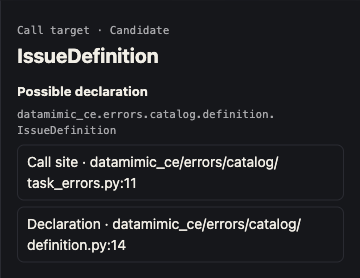
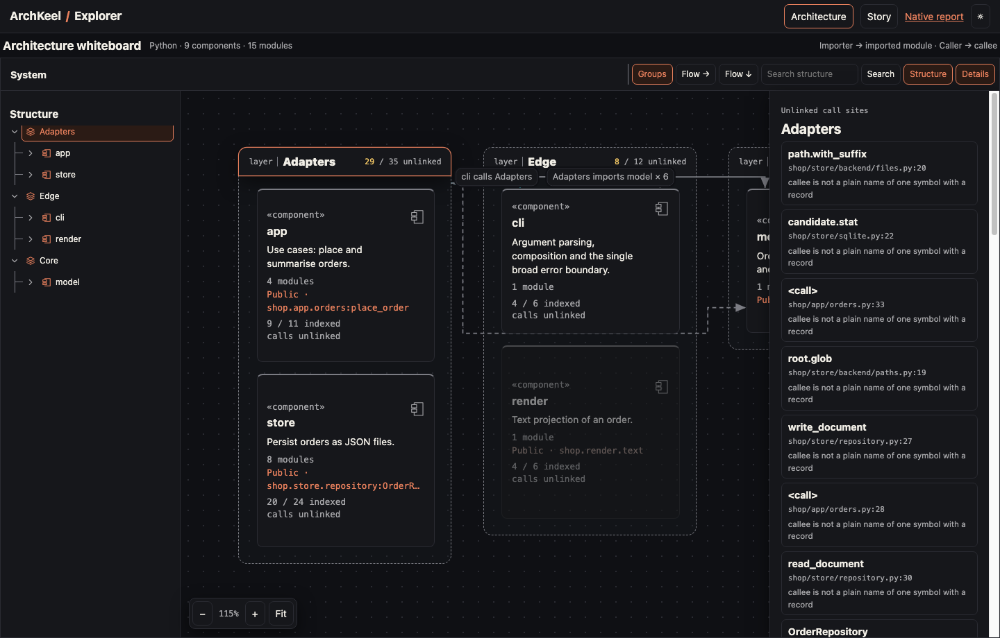
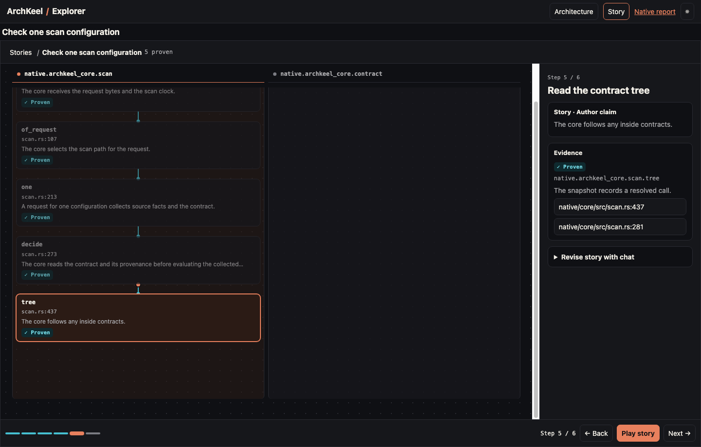

# Local architecture Explorer

Studio and MCP are available from this development checkout. Run `make core` here
before starting Studio. Open a repository with `uv run archkeel studio /path/to/repository`.
Existing scripts can use `explore` as an alias.
Omit the path to use the current repository, or use `--root PATH`. Do not combine both forms.
Without a contract, the Explorer shows observed source and package groups. It does not write a
contract. A project-specific schema file or a gap-free scan is not required to open it. UNKNOWN and partial
coverage remain visible; they do not become a PASS.

The ArchKeel checkout defines three system parts. Select **Python shell**, **Rust core** or
**Studio UI** to inspect its components and modules. To select this contract explicitly, run:

```sh
uv run archkeel studio --config docs/architecture/architecture-system.json
```

Keep the terminal open while you use the browser. Use `--no-open` to print the local
address.

## Follow a dependency to source

1. Choose **Groups** to see the module hierarchy. Open a large group to see its children. Small branches appear inside their parent.
2. Select a module to highlight its incoming and outgoing edges. Choose **Flow →** or **Flow ↓** to change the layout.
3. Read the arrow toward its tip. `A → B` labelled **Import** means A imports B. **Call** means A calls B.
4. Select an edge between two groups. The inspector lists the underlying relations. Select a source reference to open its file and line.

A line can import several names. An import count can exceed the number of source lines.
A call with an unknown target contributes to the unresolved count.
For a Python call with a matching source declaration, Studio can show **Call target · Candidate**.
Open its **Call site** and **Declaration** references to inspect both ends.
The source identifies a possible binding. Python can select another target at runtime.



The unresolved call count can include built-ins, library calls and dynamic calls. A zero count of
recorded sites does not establish call coverage. The arrows do not track values.
Select **Inspect unlinked calls** to list expressions, reasons and source locations in the selected branch. Agents get the same rows from the relations tool with `scope="unlinked_calls"`. Every result includes its snapshot identity and scan coverage.


The System inspector shows how many indexed files in each part have symbol or call records when those counts are available.
It also lists up to 12 external packages resolved from observed imports.
Open a class to inspect its methods and properties. A class card shows a preview of
each group. Each group reports its own collector coverage. A partial inventory can
contain known members. The native report retains its own layout and rule verdicts.

## Play a story

Open **Story**. The ArchKeel checkout includes six examples you can play immediately.
They follow validation to its exit code, report generation to its HTML file, initialization to the
contract files, skill installation to the agent instructions, Studio startup to the browser map,
and an MCP client request to the returned map.

To draft a story, install the Codex CLI and sign in with `codex login`.
Enter the flow you want to follow. The model proposes an ordered story
from snapshot facts. Studio checks each step and saves the story under
`.archkeel/stories/<id>.story.json`. Select **Play** once to follow the calls.
Each lane represents a module. Each step names the function. Pause on a step
to read the explanation and open its source. The cold-cache example follows the
request from Python to Rust, the response back to Python, and the SQLite write.
A dashed transition marks an unresolved link. A follow-up creates
a separate story. Existing stories can be opened without a model connection.

You can share stories and an optional narrative template at `.archkeel/templates/story.md`
with Git. SQLite snapshots stay in the bounded user cache.

## Write a story

Run `archkeel skill install codex` or `archkeel skill install claude` in the repository.
It creates `.archkeel/templates/story.md` and `.archkeel/templates/example.story.json`.
It keeps existing files. The example is not a saved story and does not claim to describe your code.

Start Studio with `archkeel studio . --no-open`. Keep it running.
Set `URL` to its printed URL without the final `/`.
Find a function with:

```sh
curl -G "$URL/api/v1/search" --data-urlencode "text=FUNCTION"
```

Use a returned element ID to inspect its outgoing calls:

```sh
curl -G "$URL/api/v1/relations" --data-urlencode "element=ID" -d direction=out -d kind=call
```

Follow `next_cursor` with `--data-urlencode "cursor=CURSOR"` until it is null.
Repeat for each target to explore a path. These calls do not find a complete path for you.
A candidate is not a resolved call. Missing or unresolved calls are not proof of no runtime call.

Copy the example to `.archkeel/stories/<id>.story.json` and replace its example names.
Use the view spec `1.2.0`. Keep the example snapshot placeholders when you do not know the digests.
Studio rebinds saved stories by node name when the digests differ. It does not rewrite the file.
Set `story.id` to the filename stem. Declare each qualified function name in `nodes`.
Put the steps in order. Each step names a declared `node`; its `note` holds the explanation.
When `story.chapters` has entries, each step names a chapter. Use `claim: true` only for an
unverified transition, never for the first step. The
[view spec schema](../schema/view-spec.schema.json) defines the remaining fields.
Open the saved story in Studio and inspect its checked statuses. A claim is not a proven call.

## Connect an agent

From this checkout, run the local stdio server with the optional `mcp` extra. Supply the snapshot path from the Explorer and the
absolute path of the scanned repository.

```sh
uv run --extra mcp archkeel-mcp --snapshot /absolute/path/to/snapshot.sqlite3 --root /absolute/path/to/repository
```

For an installed wheel, install its optional extra instead of running `uv sync` in a checkout:

```sh
python -m pip install '/absolute/path/to/archkeel-<version>-<tags>.whl[mcp]'
```

The server provides overview, children, search, relations, evidence, source and story.
Use `stories` to list saved stories, `story_read` to play a checked story, and `story_save`
to save a new view specification.
Use `verdict` for the contract status, the exit code, the counts and `freshness`. Use `findings`
for one row for each violation, and `unknowns` for each part that ArchKeel did not decide.
These tools copy the frame of the scan ([AD-1084](architecture/decisions/ad-1084-the-mcp-server-answers-verdict-findings-and-unknowns-from-the-frame-in-the-snapshot.md)).
Each row has `basis`: `proven`, `declared` or `unknown`. A text that comes from the repository
is an object with `untrusted: true`. An answer is at most 16 KiB, with `limit` 25 by default and 100 at most.
`freshness: stale` means that a scanned file changed. Scan again before you trust the answer.
`archkeel validate --json` stays the CI truth.
A source request takes a reference from the index. It checks the file content before
returning the excerpt. A call step describes static analysis. Runtime dispatch and
deployment bindings require separate evidence.

## Measure a local corpus

```sh
make explorer-corpus WORKSPACE=/path/to/checkouts OUTPUT=/private/local/results
```

The output can contain private repository paths and source information. Keep it local.
Check the revision, working tree state and scan configuration when comparing results.

## Query a snapshot

The browser uses GET requests under `/api/v1/`. The MCP tools use the same operation
names and element IDs. Every response identifies the snapshot and its coverage.
Use IDs from that snapshot as opaque values. A component and a file with the same name have
different IDs. Previously published snapshots keep their IDs.

| Operation | Input | Result |
| --- | --- | --- |
| overview, children | parent (default system), cursor, limit | Elements with ID, name, kind and parent |
| map | parent, view, optional focus, cursor, limit | Use `hierarchy` for the module board. Focus a visible group to inspect its edges. Use `components` or `modules` for a list with a cursor. |
| search | text, optional parent, cursor, limit | Matching elements, or matching modules within a branch |
| relations | element, direction, optional kind, cursor, limit | Directed edges with resolution, element status and evidence |
| relations | aggregate ID from a map edge, cursor, limit | Source relations that contribute to the selected edge |
| evidence | relation | Evidence references and source locations |
| source | reference, limit | Checked lines of the file. HTTP returns 409 if the file changed |
| story | ID of a call edge | One static call step with its evidence, or UNKNOWN |

Lists use a stable ID cursor. Pass the returned `next_cursor` to get the next page.
For Python source candidates, filter `relations` by `kind=source_call`. Each record has
`resolution=candidate`. Its evidence identifies the `call_site` and the `declaration`.
Coverage applies to the selected scan. A null collector section means that this build
does not supply that fact type. An empty section means the collector supplied zero rows.

## Follow a Rust scan request

Run `uv run archkeel explore --config native/archkeel.toml` from the
ArchKeel checkout. Open **Check one scan configuration** in Studio.
The story follows direct Rust calls from the scan handler to the contract
reader. Call coverage is partial. It includes proven relative module paths
and some inherent calls on `self`. Trait dispatch, callbacks, and macro
expansions remain unresolved.


