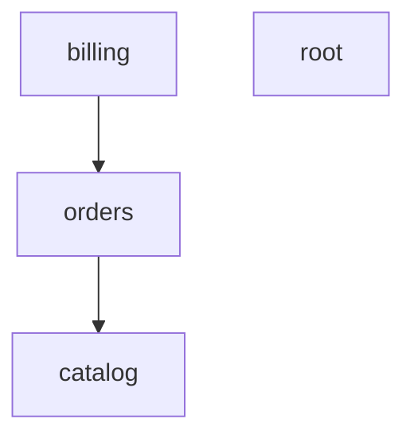

# Onboard a project

Follow this page in a new project that has no `archkeel.toml`. It takes five minutes and ends in
a verdict. You need ArchKeel installed (`archkeel --version`) and a Git repository with a commit.

## 1. Run `validate`: the files are drafted for you

```bash
cd /path/to/project
archkeel validate
```

Without `archkeel.toml`, `validate` (and `report`) first drafts the files, as `archkeel init`
does, and says so in one block before the verdict:

```text
ArchKeel created archkeel.toml and a first contract draft with 4 components from your package layout.
Why: there was no archkeel.toml. Written: archkeel.toml, architecture-contract.json, docs/architecture/architecture.md. No file was replaced.
Review the open decisions listed below, then run archkeel validate again. Guide: .../docs/onboarding.md
```

No existing file is replaced. If you want nothing written (CI, a read-only checkout), use
`archkeel validate --no-init` or set `ARCHKEEL_NO_INIT=1`: the run writes nothing and tells you what
the layout would give. `archkeel init` drafts the files without a run and prints text (`--json` for
JSON).

The draft reads the folder layout, not the code:

| Layout | One component for each |
|---|---|
| Python, one top-level package (`src/shop` or `shop`) | subpackage |
| Python, several top-level packages | top-level package |
| Cargo workspace (`[workspace] members`) | crate |
| `package.json` with `workspaces` | workspace package |

The modules beside the packages are the component `root`. The contract has two rules: every module
has one owner, and no component cycle. A Python project must declare `requires-python` in
`pyproject.toml`; if not, the output says so, because the core cannot decide the scan scope.

## 2. Read the first verdict

The first verdict is `UNKNOWN`. That is correct: the draft decided nothing. The list is your work:

```text
validate: UNKNOWN -> exit 2 (0 of 2 rules cannot be decided)
Parts that are not decided (8):
  4 x a component without a written responsibility
      architecture-contract.json/components/0/responsibilities billing: The architect-decided component has no substantive responsibility.
  2 x a rationale that is still a placeholder
      architecture-contract.json/rules/0/rationale ASSIGNMENT-COMPLETE: The rationale is a placeholder.
  1 x an open decision in the contract (a TODO)
      architecture-contract.json/rules 12 open dependency decisions: Component dependency directions remain undecided.
  1 x graph drift
      ... found and not drawn: billing->orders, orders->catalog.
```

`graph drift` shows the imports between your components that the code has today.

## 3. Decide

Edit `architecture-contract.json`:

1. Replace each `TODO` in `responsibilities` with one sentence: what the component owns.
2. Replace each `TODO` in a rule `rationale` with the reason for the rule.
3. For each dependency that you want, add `requires` to the component. A dependency that you do
   not want is not listed, and the code that has it fails:

   ```json
   "requires": [{"component": "orders", "rationale": "Billing asks orders for the order total."}]
   ```

4. Add the rule that closes the list. Without it the other dependencies stay undecided:

   ```json
   {"id": "REQUIRES-COMPLETE", "kind": "complete_requires",
    "rationale": "Only the listed dependencies are allowed.",
    "provenance": ["docs/architecture/architecture.md"], "decided_by": "architect"}
   ```

Edit the graph in `docs/architecture/architecture.md` to draw the same dependencies:

````markdown
<!-- archkeel-component-graph -->

````

## 4. Get PASS or FAIL

```bash
archkeel validate --text
```

- **PASS** (exit 0): every rule holds with complete evidence.
- **FAIL** (exit 1): the code breaks a decision. The line names the import. Fix the code, or change
  the decision on purpose.
- **UNKNOWN** (exit 2): the core cannot decide a rule. Read the line; UNKNOWN is not a pass.

Commit the three files. Run `archkeel validate` in CI; `archkeel report --output report.html` writes
one page for people.

## When the layout cannot be drafted

The draft refuses (exit 2, nothing written) a project with no top-level Python package, a
TypeScript project without `workspaces`, a single Cargo crate, a Dart project, and a root with both
a Cargo and a package.json workspace. Run `archkeel init --root <folder>` for one part, or write the
files by hand:

```toml
# archkeel.toml
[scan]
language = "python"          # or "rust", "typescript", "dart"
namespace = "shop"           # the name of the package (the crate, the library) you check
roots = ["src/shop"]         # folders below the repository root; no globs
contract = "architecture-contract.json"
```

Start the contract from the output of `archkeel init` on a plant, or from the
[contract of ArchKeel itself](architecture/target/shell-contract.json). The
[reference](reference.md) lists each option and [the rules](rules.md) each rule kind.
