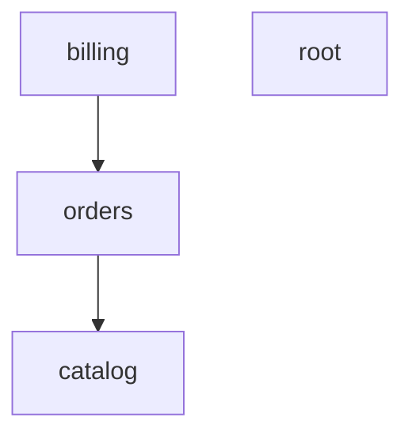

# Onboard a project

Follow this page in a new Python project that has no `archkeel.toml`. It takes five minutes and
ends in a verdict. You need ArchKeel installed (`archkeel --version`) and a Git repository with a
commit.

## 1. Draft the files

```bash
cd /path/to/project
archkeel init
```

`init` reads the folder layout, not the code. For one top-level package (`src/shop` or `shop`) it
writes three files and replaces none:

| File | Content |
|---|---|
| `archkeel.toml` | The scan: language, namespace, root and the contract path. |
| `architecture-contract.json` | One component for each subpackage, one `root` component for the modules beside them, and two rules: every module has one owner, and no component cycle. |
| `docs/architecture/architecture.md` | The contract cites this file. It holds the component graph. |

The project must declare `requires-python` in `pyproject.toml`. If not, `init` says so, and the
core cannot decide the scan scope.

## 2. Read the first verdict

```bash
archkeel validate --text
```

The first verdict is `UNKNOWN`. That is correct: `init` decided nothing. The list is your work:

```text
hygiene:responsibility.missing: ... billing: The architect-decided component has no substantive responsibility.
hygiene:rationale.placeholder: ... ASSIGNMENT-COMPLETE: The rationale is a placeholder.
hygiene:graph.drift: ... The marked component graph differs from observed imports; ... found and not drawn: billing->orders, orders->catalog.
hygiene:decision.open: ... 12 open dependency decisions: Component dependency directions remain undecided.
```

`graph.drift` shows the imports between your components that the code has today.

## 3. Decide

Edit `architecture-contract.json`:

1. Replace each `TODO` in `responsibilities` with one sentence: what the component owns.
2. Replace each `TODO` in a rule `rationale` with the reason for the rule.
3. For each dependency that you want, add `requires` to the component. A dependency that you do
   not want is not listed, and the code that has it fails:

   ```json
   "requires": [{"component": "orders", "rationale": "Billing asks orders for the order total."}]
   ```

4. Add the rule that closes the list. Without it the other dependencies stay undecided:

   ```json
   {"id": "REQUIRES-COMPLETE", "kind": "complete_requires",
    "rationale": "Only the listed dependencies are allowed.",
    "provenance": ["docs/architecture/architecture.md"], "decided_by": "architect"}
   ```

Edit the graph in `docs/architecture/architecture.md` to draw the same dependencies:

````markdown
<!-- archkeel-component-graph -->

````

## 4. Get PASS or FAIL

```bash
archkeel validate --text
```

- **PASS** (exit 0): every rule holds with complete evidence.
- **FAIL** (exit 1): the code breaks a decision. The line names the import. Fix the code, or change
  the decision on purpose.
- **UNKNOWN** (exit 2): the core cannot decide a rule. Read the line; UNKNOWN is not a pass.

Commit the three files. Run `archkeel validate` in CI; `archkeel report --output report.html` writes
one page for people.

## Not a single Python package

`init` refuses a layout without one top-level package, and a layout with several. Rust, TypeScript
and Dart projects have no `init` yet. Write the files by hand:

```toml
# archkeel.toml
[scan]
language = "python"          # or "rust", "typescript", "dart"
namespace = "shop"           # the name of the package (the crate, the library) you check
roots = ["src/shop"]         # folders below the repository root; no globs
contract = "architecture-contract.json"
```

Start the contract from the output of `archkeel init` on a Python plant, or from the
[contract of ArchKeel itself](architecture/target/shell-contract.json). The
[reference](reference.md) lists each option and [the rules](rules.md) each rule kind.
