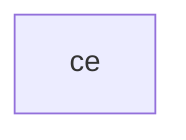

# CLI validation time

## DATAMIMIC Community Edition

How long does a developer wait for a local contract check? This comparison times the installed
`archkeel validate --config FILE --json` process from launch through exit. It includes startup,
analysis and writing JSON to a pipe. It measures the whole command, including differences in
how much evidence each version collects and prints.

The benchmark covers the entire `datamimic_ce` production package at
[revision e1000a6e](https://github.com/rapiddweller/datamimic/tree/e1000a6eef55ae4d710c923116d6551f19436d53).
Both versions scanned 540 Python files (63,982 source lines) and passed the same `complete_assignment` rule, which
checks that every module has a declared owner. CE's existing contract requires a measurement
baseline on 4.0.1, so the timed runs used a separate one-rule contract. The production code
was unchanged.

| Installed CLI | Median | Min–max | Package ownership | Overall verdict |
| --- | ---: | ---: | --- | --- |
| 4.0.1, Python engine | 27.93 s | 27.88–28.25 s | PASS | PASS, exit 0 |
| 5.0.0-dev, Rust core | 1.18 s | 1.17–1.19 s | PASS | UNKNOWN, exit 2 |

The Rust core reported 59 collection gaps across the scan. The two commands therefore answer
the same ownership question but report different overall coverage. This timing does not predict
the cost of evaluating CE's full contract.

## Smaller fixtures

| Fixture | Rule results in both builds | 4.0.1 median (range) | 5.0.0-dev median (range) |
| --- | --- | --- | --- |
| F-architecture, Python test scope | 6 PASS | 227 ms (226–232) | 80 ms (79–83) |
| H-typescript-checkout | 1 PASS, 1 declaration | 210 ms (207–214) | 86 ms (84–88) |

Measured November 20, 2026, on one Apple M5 Pro, macOS 27.2 arm64, CPython 3.11.12.
The older wheel was PyPI 4.0.1. The unreleased 5.0.0 line was measured at
`858cb6905` using its bundled release-mode Rust core. Its wheel version was
`4.0.2.dev933+g858cb6905`. Each fixture had one warm-up per version, then eight measured
runs per version for CE and 12 for each small fixture, alternating which ran first. Each run started a fresh process.
Installation and builds took place before measurement.

Both displayed cases exited 0 and agreed on every rule ID and status. Four further fixtures
tested for inclusion (G-dart, J-compass, K-python-realworld and L-nest-realworld) had differing
rule results or lacked comparable output. Studio snapshot startup is a separate workload.

## Repeat the measurement

Install the two wheels in separate environments with the same Python. For CE, use a disposable
checkout of the revision linked above. Save these three files at its root and commit them
there so both engines see a clean Git tree.

**benchmark.toml**

```toml
[scan]
roots = ["datamimic_ce"]
namespace = "datamimic_ce"
contract = "benchmark-contract.json"
```

**benchmark-contract.json**

```json
{
  "schema_version": "3.3.0",
  "components": [
    {
      "id": "COMP-CE",
      "label": "ce",
      "role": "component",
      "packages": [
        "datamimic_ce"
      ],
      "responsibilities": [
        "Own the CE production package."
      ],
      "forbidden_responsibilities": [],
      "provenance": [
        "benchmark-architecture.md"
      ],
      "requires": [],
      "decided_by": "architect"
    }
  ],
  "rules": [
    {
      "id": "CE-ASSIGNMENT",
      "kind": "complete_assignment",
      "source": "datamimic_ce",
      "rationale": "Each module in the CE production package has one declared owner.",
      "provenance": [
        "benchmark-architecture.md"
      ],
      "decided_by": "architect"
    }
  ]
}
```

**benchmark-architecture.md**

````markdown
# CE benchmark architecture

<!-- archkeel-component-graph -->

````

Save the script below outside the checkout. From CE's root, set `PYTHONHASHSEED=0` and run
`python /path/to/bench.py /path/to/old/archkeel /path/to/new/archkeel benchmark.toml 8`.
To repeat a small-fixture run, copy the fixture from ArchKeel revision `858cb6905` into its own
Git repository and commit it. Use `archkeel-tests.toml 12` for F-architecture and
`archkeel.toml 12` for H-typescript-checkout.

```python
import json
import statistics
import subprocess
import sys
import time

old, new, config, pairs = sys.argv[1:]
times = {old: [], new: []}
expected = None
for pair in range(int(pairs) + 1):
    for cli in ((old, new) if pair % 2 else (new, old)):
        start = time.perf_counter()
        run = subprocess.run([cli, "validate", "--config", config, "--json"],
                             capture_output=True, check=False)
        ms = (time.perf_counter() - start) * 1000
        data = json.loads(run.stdout)
        if cli == old:
            rows = {r["id"]: r["status"] for r in data["rule_assessments"]}
        else:
            rows = {k: v[1] for k, v in data["frame"]["rules"].items()}
        if config == "benchmark.toml":
            count = (data["coverage"]["files_parsed"] if cli == old
                     else data["frame"]["self_test"]["reply"]["files"])
            assert count == 540 and rows == {"CE-ASSIGNMENT": "PASS"}
            assert run.returncode == (0 if cli == old else 2)
        else:
            assert run.returncode == 0
        if expected is None:
            expected = rows
        assert rows and rows == expected
        if pair:
            times[cli].append(ms)
for cli, values in times.items():
    print(cli, "median/min/max (ms)", statistics.median(values), min(values), max(values))
```
