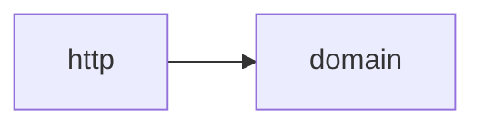

# Checkout HTTP boundary

The HTTP adapter converts a request payload into a domain order.
The domain owns the order type. It does not import the HTTP adapter, even for types.

<!-- archkeel-component-graph -->

The showcase changes the domain to take the ID type from the HTTP payload.
The type-only import adds no runtime code, but it adds a dependency in the reverse direction.
