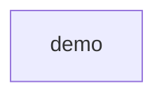

# TypeScript UML demo Target

The demo component owns the port, implementation and request entry point.
Client extends Base, implements Port and delegates run to helper. App imports core
and calls helper. Core references the standard String global for helper conversion.
Build creates Unit and assigns it to item. State names two literals.
Client has private token storage, a static limit and reset. Text is a type alias;
VERSION is a constant. The contract is independent of collector output.

TypeScript source-unit identities follow the collector's relative-path codec:
demo.src.core_x2e_ts and demo.src.app_x2e_ts. The UI labels their declared source files.

The current collector records TypeScript SourceFacts independently of this Target:
definitions, member inventories, calls, references, bases, and bindings. The original
closed module scopes remain UNKNOWN where evidence is incomplete.

The Target is unchanged. Check it with the core, from the repository root:
`archkeel report --root fixtures/H-uml-typescript --output build/h-uml-typescript.html`.
The gallery runs this project and shows its verdict next to the verdict it was built for. The
earlier match, mismatch and partial variants of this project were Make targets of the removed
Python core and are gone. As-Is and Diff show only recorded facts.

`make typescript-compiler-check` is the compiler check: pinned TypeScript 5.9.3 checks this
fixture's strict `tsconfig.json` with `--noEmit`. This development acceptance needs
Node and npm; collecting TypeScript source facts with the installed CLI does not.

Tracked in #339 (demos) and #340 (complete ArchKeel Target).

<!-- archkeel-component-graph -->

