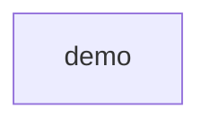

# UML demo Target

The component owns the port, implementation and request entry point.
Client inherits Base, realizes Port and delegates run to helper.
App imports core and calls helper. Build constructs Unit and binds it to item.
State has READY and STOPPED literals. Client has private token storage,
a static limit and a static reset operation. Text aliases str; VERSION names the demo version. Text is a type alias; VERSION is a constant.

This contract is authored independently of the source observation.
Open scopes require listed intent; they do not certify an exhaustive inventory.
Python visibility follows naming conventions. Static binding sites are not live objects.
Dynamic enum generation and complete instance inventories remain partial.

Check the unchanged Target with the core, from the repository root:

    archkeel report --root fixtures/H-uml --output build/h-uml.html

The showcase page of the gallery runs this project and shows its verdict next to the verdict it
was built for, and the issue that blocks a PASS while there is one. The Target is unchanged in
every run.

The gallery also runs one planted variant, `H-uml-plant-signature`: it copies this project and
changes the return type of `Client.run` from `str` to `int`. The Target still says `str`, so the
signature row is a FAIL, and the card links the violation block of its report. The plant is the
`plant` entry of that run in `fixtures/matrix.json`.

These examples check the Python collector against its independent Target. Dart and TypeScript
have separate source-only reports and retain their own unsupported facts as UNKNOWN. Each
language has an independently declared Target; the gallery lists them.

Tracked in #339 (demo acceptance) and #340 (inner Target contracts).

Open scopes say what is intended; they never certify that nothing else exists. A closed scope
needs an inventory that the collector proves complete, and the Python profile cannot prove every
symbol and binding form, so exhaustive observation stays UNKNOWN. PASS does not certify
completeness.

A component is a responsibility boundary, not a folder. A Python module here maps
to one source file. Namespace groups do not prove physical package directories.

<!-- archkeel-component-graph -->

