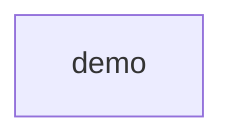

# UML demo Target

The component owns the port, implementation and request entry point.
Client inherits Base, realizes Port and delegates run to helper.
App imports core and calls helper. Build constructs Unit and binds it to item.
State has READY and STOPPED literals. Client has private token storage,
a static limit and a static reset operation. Text aliases str; VERSION names the demo version. Text is a type alias; VERSION is a constant.

This contract is authored independently of the source observation.
Open scopes require listed intent; they do not certify an exhaustive inventory.
Python visibility follows naming conventions. Static binding sites are not live objects.
Dynamic enum generation and complete instance inventories remain partial.

Check the unchanged Target with the core, from the repository root:

    archkeel report --root fixtures/H-uml --output build/h-uml.html

The showcase page of the gallery runs this project and shows its verdict next to the verdict it
was built for, and the issue that blocks a PASS while there is one. The Target is unchanged in
every run.

The gallery also runs one planted variant, `H-uml-plant-signature`: it copies this project and
changes the return type of `Client.run` from `str` to `int`. The Target still says `str`, so the
signature row is a FAIL, and the card links the violation block of its report. The plant is the
`plant` entry of that run in `fixtures/matrix.json`.

These examples check the Python collector against its independent Target. Dart and TypeScript
have separate source-only reports and retain their own unsupported facts as UNKNOWN. Each
language has an independently declared Target; the gallery lists them.

Tracked in #339 (demo acceptance) and #340 (inner Target contracts).

## The variants of this Target

The Target is the same in every run. The variants change the code or close a scope, and each
one shows another verdict. A variant needs a Git copy of this folder, because the scan reads the
tracked files:

    copy=$(mktemp -d) && cp -R fixtures/H-uml "$copy/H-uml" && cd "$copy/H-uml"
    git init -q -b main && git add -A && git -c user.name=x -c user.email=x@x commit -qm base

Then change a file as below, commit it, and run `archkeel report --root .` in the copy.

**Mismatch (FAIL).** Change the return type of `Client.run` from `str` to `int`. The signature
row is a FAIL. The gallery runs this as `H-uml-plant-signature`.

**Partial (UNKNOWN).** Replace the literal of `State.READY` with a computed value: in
`demo/core.py` change `from enum import Enum` to `from enum import Enum, auto` and
`READY = "ready"` to `READY = auto()`. A computed literal has no value to compare, so the
existence of the literal is UNKNOWN. This cannot be told apart on 5.0 today: the unchanged
project is already UNKNOWN, because the Python collector gives no attribute record for a bare
annotation such as `_token: str` ([#1534](https://github.com/rapiddweller/archkeel/issues/1534)).
The partial variant shows its own cause only after that issue is closed.

**Complete (closed inventory).** The earlier `uml-complete` Target extended this contract with
the initializer, the namespace groups, the external references, the file inventory and every
recorded relationship kind, and closed the scope of `demo.core`. An extra definition then failed
the closed inventory, while exhaustive observation stayed UNKNOWN because the Python profile
cannot certify all symbol and binding forms. That full Target is not reproduced on 5.0: its file
went with the removed Python core, and a closed class scope never passes on 5.0 for now
([#1532](https://github.com/rapiddweller/archkeel/issues/1532)); a Python inventory is partial by
design. What reproduces is the failing half. The gallery runs `H-uml-plant-closed-scope`: it
closes the scope `core-module` in `architecture-contract.json` with a short list, and the core
reports each relationship of the code that the list leaves out as a FAIL ("closed scope holds an
unlisted relationship"). The edit is the `plant` entry of that run in `fixtures/matrix.json`.

The unchanged project does not show a PASS today, for the reason given for the partial variant.
PASS does not certify completeness; open scopes say what is intended and never certify that
nothing else exists.

A component is a responsibility boundary, not a folder. A Python module here maps
to one source file. Namespace groups do not prove physical package directories.

<!-- archkeel-component-graph -->

