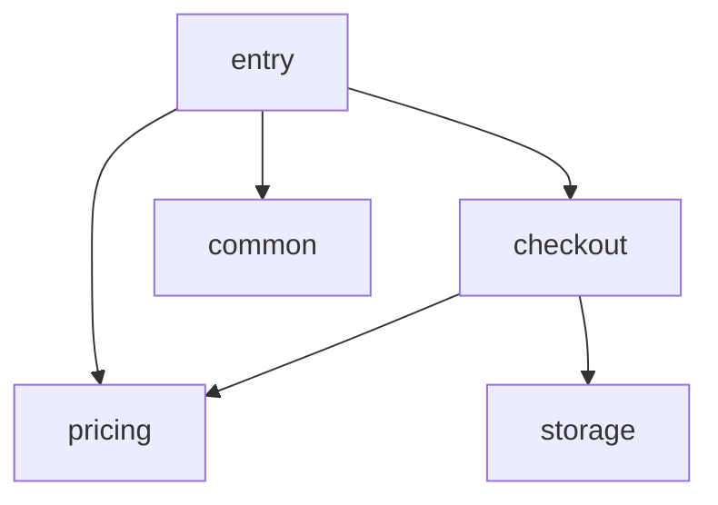

# Orders target

Synthetic service for the architecture-review workflow (#600) and contract maintenance (#601).
`orders.api.place_order` is the one entry point: checkout prices an order line, rounds it to
cents and persists the receipt through the storage backend chosen by deployment configuration.

<!-- archkeel-component-graph -->

