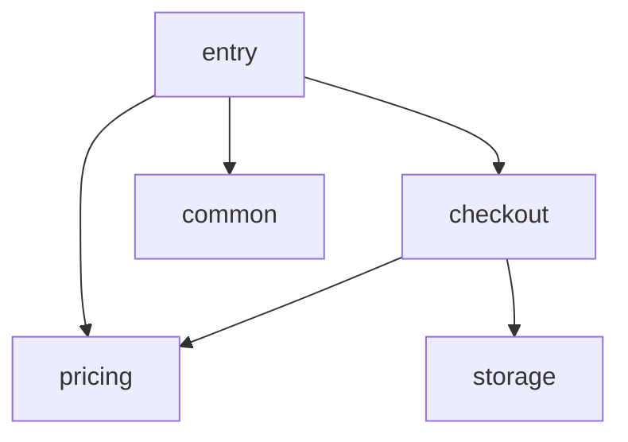

# Orders target

Synthetic service for the architecture-review workflow (#600) and contract maintenance (#601).

Entry points: `orders.api.place_order` places an order; `orders.api.quote` returns what it
would cost in cents without placing it. Checkout prices an order line through the pricing
pipeline (clearance, bulk and coupon discounts, VAT, surcharges, shipping, currency), rounds
it to cents and persists the receipt through the storage backend that deployment
configuration (`ORDERS_BACKEND`) selects: memory, a JSON-lines file, or S3 with the optional
`cloud` extra.

<!-- archkeel-component-graph -->

