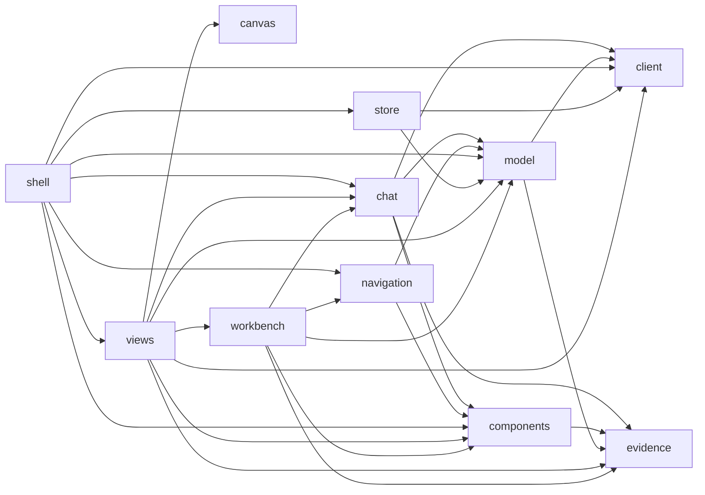

# Studio UI

Rules for the Studio frontend (AD-290). They add to the root [AGENTS.md](../../../../AGENTS.md).
`make browser-architecture-check` enforces the graph below with
[studio-ui-contract.json](../../../../docs/architecture/target/studio-ui-contract.json).

## Layout

| File | Owner | Job |
|---|---|---|
| `shell.tsx` | shell | Entry. Starts the store, routes by `#/<view>[/<function>]`, draws nav, legends, contract state. |
| `views/*.tsx` | views | One page each: Briefing, Map, Component, Module, Explore (the lens), Stories (list and player), Report, not built. Gets the state or the model as props. |
| `workbench.tsx` | workbench | The page of every level: toolbar, tree, canvas, the "You are here" box with Up, the zoom between levels, and the drawing of modules or functions with their stubs. |
| `chat.tsx` | chat | The chat panel and the one conversation (the shell keeps it). Agent text is a claim; only Studio facts read OBSERVED. |
| `components.tsx`, `viewport.tsx` | components | Nav item, legends, proof mark, badge, tabs, card, box, panel, page frame, pan and zoom surface. Props only. |
| `navigation.tsx` | navigation | The structure tree, the one location bar (links that go up) and the search field. Props only. |
| `model.ts`, `map-layout.ts`, `lens-layout.ts`, `story-layout.ts`, `level-layout.ts` | model | The indexed call graph, the search and the layouts of the Map, the component, the module, the lens and a story. Pure: no DOM, no network. |
| `canvas.tsx` | canvas | The Explorer island: the Explorer page with `?embed`; passes on its selection. |
| `store.ts` | store | The one store: polls `GET /api/v1/state`, then reads `GET /api/v1/graph` once and builds the model. |
| `api.ts` | client | The only `fetch`; typed API responses and shared response value sets from `schema/studio-api-1.5.schema.json`. |
| `vocabulary.ts` | client | Generated from the enums of `archkeel.studio.api`. Never edit it. |
| `evidence.ts` | evidence | The evidence model and the call proof (proven, claim, unknown). |
| `tokens.css` | — | The one tokens file: colours, radius, font; dark and light. A leaf. |
| `studio.css` | — | Layout. Uses only `var(--token)` colours. |
| `studio.js` | — | Generated bundle. Never edit it. |

Allowed imports (observed; `validate --write-graph` updates it):

<!-- archkeel-component-graph -->

A view never imports another view. Components never import the client or the store.
Planned Figma part: discussion message (PROPOSED - NOT APPLIED). Build it when a view needs it.

## Naming and typed values

- Files: kebab-case. Components: PascalCase functions. Slice 1 is always dark.
- A closed set is a `const` object with `as const` and a type of the same name, as in
  `evidence.ts`. Do not use `enum`: the collector cannot decide an enum in its own module.
- Decide on a typed value (`Evidence.Claim`), never on a label or a string literal. API response values such as snapshot completeness are owned by `api.ts`; pages use its exported value.
- Evidence: Observed = code evidence, Claim = agent hypothesis, Target = architect decision.
  Each kind is a CSS class of the same value. An agent text is a Claim until the architect
  accepts it. A proposal reads "PROPOSED - NOT APPLIED".
- Call proof (`Proof`): `✓ proven` = resolved call, `✎ claim` = partly resolved call, `? unknown`
  = no target found. Always draw the glyph and the word, never a colour alone. Never show PASS.
  A line is `proven` only with no claim in it. Count call sites, never edges (`site` of an edge).
  No arrow encodes data flow: a line is a dependency, and the band says who calls whom.
- The levels are the URL hash: `#/map`, `#/component/<n>[/<package>]`, `#/module/<n>`, `#/explore/<function index>`. Esc goes one level up; a card is a link, so the
  browser Back button works and no view imports another view. Colours come from `tokens.css`,
  also for the components (`--comp-0` to `--comp-9`). The CSP blocks inline style attributes:
  set styles through Preact `style` objects and CSS classes.

## Add a view

1. Write `views/<name>.tsx` that exports one function component.
2. Add the file to `exact_modules` of `views` and to `UI-VIEWS-ISOLATED` in the contract.
3. Add its symbol to `public` of `views` and to the `requires` of `shell`.
4. Add a `View` value and a `NAV` row in `shell.tsx`.
5. Run `make browser-runtime-generate browser-architecture-check`.
6. Add the view to `tests/test_studio_browser.py`.
7. A name that the TypeScript analyzer cannot read breaks `make browser-architecture-check`: do not
   index a variable named `module`, and do not label a tuple element `symbol` or `unknown`.

## Floors

- Accessibility: each action is a link or a button, usable by keyboard, with a visible focus
  ring. The layout works at 800x600 and 1440x900 without horizontal scroll.
- Network: none, except the own server. The CSP header blocks other origins.
- Markdown: none. A chat message is plain text.
- Packages: Preact only, pinned in `tools/browser-runtime/package.json`.

## Tests

`tests/test_studio.py` checks the API on a real server. `tests/test_studio_browser.py` checks
the shell in Chromium at both sizes. Write the failing test first.

## An agent must not

- Edit `studio.js` by hand, or commit it stale (`--check` fails).
- Add a package, a network call, a second store or a colour outside `tokens.css`.
- Write a contract or a repository file from the UI. Only the planned proposals endpoint
  writes, and only after an explicit architect action.

## Stories and chat

- The check has five statuses; the proof has three. `proven` is the only status that shows as proven. `declared` shows as claim, `missing` as unknown.
- A claim step shows its candidate count. The verdict line is always visible.
- Chat tests mock `POST /api/v1/chat` in the browser (`page.route`); the product code has no mock path.
- "Pin to story" only shows a draft. A route that writes needs the AD-290 hard gate first.
