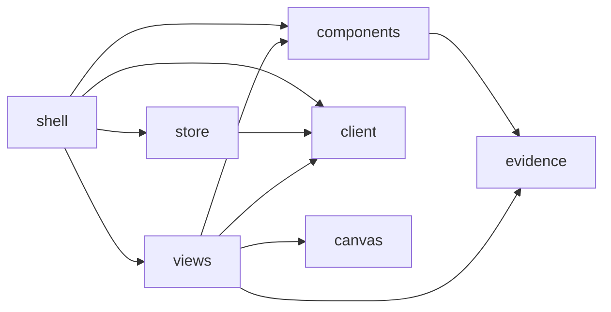

# Studio UI

Rules for the Studio frontend (AD-290). They add to the root [AGENTS.md](../../../../AGENTS.md).
`make browser-architecture-check` enforces the graph below with
[studio-ui-contract.json](../../../../docs/architecture/target/studio-ui-contract.json).

## Layout

| File | Owner | Job |
|---|---|---|
| `shell.tsx` | shell | Entry. Starts the store, routes by `#/<view>`, draws nav, legend, contract state. |
| `views/*.tsx` | views | One page each. Gets the API state as props. |
| `components.tsx` | components | Nav item, legend, badge, tabs, card, page frame. Props only. |
| `canvas.tsx` | canvas | The Explorer island: an `<iframe>` of the offline Explorer page. |
| `store.ts` | store | The one store: polls `GET /api/v1/state`. |
| `api.ts` | client | The only `fetch`. Types of `schema/studio-api-1.0.schema.json`. |
| `evidence.ts` | evidence | The evidence model. |
| `tokens.css` | — | The one tokens file: colours, radius, font; dark and light. A leaf. |
| `studio.css` | — | Layout. Uses only `var(--token)` colours. |
| `studio.js` | — | Generated bundle. Never edit it. |

Allowed imports (observed; `validate --write-graph` updates it):

<!-- archkeel-component-graph -->

A view never imports another view. Components never import the client or the store.

## Naming and typed values

- Files: kebab-case. Components: PascalCase functions. One default theme: dark.
- A closed set is a `const` object with `as const` and a type of the same name, as in
  `evidence.ts`. Do not use `enum`: the collector cannot decide an enum in its own module.
- Decide on a typed value (`Evidence.Claim`), never on a label or a string literal.
- Evidence: Observed = code evidence, Claim = agent hypothesis, Target = architect decision.
  Each kind is a CSS class of the same value. An agent text is a Claim until the architect
  accepts it. A proposal reads "PROPOSED - NOT APPLIED".

## Add a view

1. Write `views/<name>.tsx` that exports one function component.
2. Add the file to `exact_modules` of `views` and to `UI-VIEWS-ISOLATED` in the contract.
3. Add its symbol to `public` of `views` and to the `requires` of `shell`.
4. Add a `View` value and a `NAV` row in `shell.tsx`.
5. Run `make browser-runtime-generate browser-architecture-check`.
6. Add the view to `tests/test_studio_browser.py`.

## Floors

- Accessibility: each action is a link or a button, usable by keyboard, with a visible focus
  ring. The layout works at 800x600 and 1440x900 without horizontal scroll.
- Network: none, except the own server. The CSP header blocks other origins.
- Markdown: none in slice 1. A chat message is plain text and fenced code blocks.
- Packages: Preact only, pinned in `tools/browser-runtime/package.json`.

## Tests

`tests/test_studio.py` checks the API on a real server. `tests/test_studio_browser.py` checks
the shell in Chromium at both sizes. Write the failing test first.

## An agent must not

- Edit `studio.js` by hand, or commit it stale (`--check` fails).
- Add a package, a network call, a second store or a colour outside `tokens.css`.
- Write a contract or a repository file from the UI. Only the planned proposals endpoint
  writes, and only after an explicit architect action.
