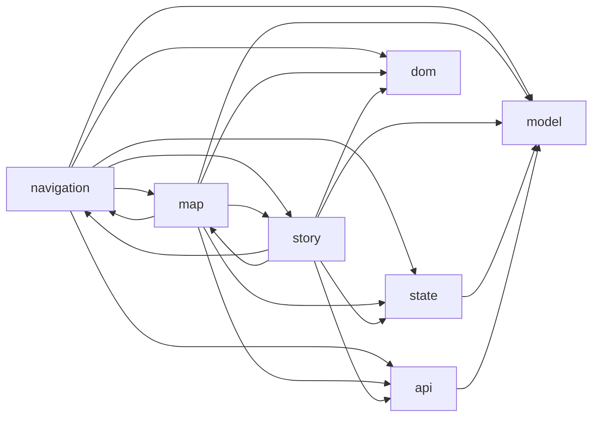

# Studio architecture

Studio presents the system model and checked stories. Navigation, map and story components use the
state, model, API and DOM components. The presentation components call each other. The core decides
architecture rules and verdicts.

Navigation reads the current map view and requests focused connections. The map sends selected
connections to navigation to open their evidence. Both components use the DOM path formatter.

The Studio server has no current schema for its query endpoints. The system contract does not declare
an interface for them until a schema describes the actual messages.

<!-- archkeel-component-graph -->

